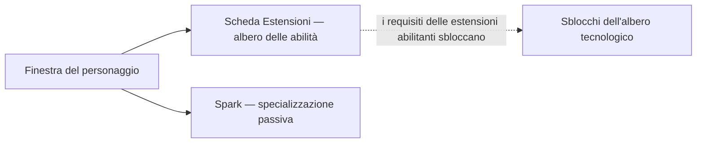

# Personaggio

La **finestra del personaggio** (barra superiore → **Personaggio**, in alto a sinistra) è il luogo in cui si trova la progressione del tuo personaggio: profilo, crediti, le **estensioni** (abilità) e le impostazioni. Tutto ciò che si trova in questa pagina è legato al singolo personaggio — gli account possono contenerne diversi, ciascuno con il proprio albero. Le posizioni dell'interfaccia utente seguono la [panoramica dell'interfaccia client](/it/features/ui/).

## Estensioni

La **scheda delle estensioni** è l'albero delle abilità del personaggio: livelli di abilità specifici per ciascun personaggio che sbloccano elementi di gioco e ottimizzano gli attributi — in particolare le **estensioni abilitanti** necessarie per pilotare una classe di robot. Il livello 1 costa crediti, mentre ogni livello successivo costa Punti Estensione (EP), con prerequisiti che regolano l'avanzamento.

- [Categorie principali](/content/extensions/#categories) — una panoramica delle 15 categorie: quali categorie ne sbloccano altre (fai clic su un riquadro per passare alle relative schede)
- [Estensioni per categoria](/content/extensions/#table) — tutte le estensioni: grado, prezzo, bonus, prerequisiti
- Come funzionano gli EP e l'albero tecnologico: [Ricerca](/it/features/research/)

## Spark

Il tuo **spark** è la specializzazione nanotecnologica installata sul personaggio — finché è attivo, i suoi bonus si applicano a ogni robot che piloti. Il cambio di spark ha un costo; l'autorizzazione regola l'accesso alle linee superiori. Dettagli in [Spark](/it/features/sparks/).