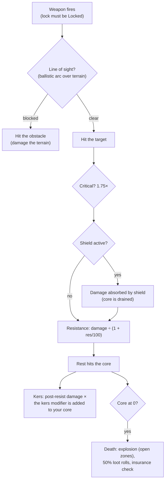

# Combattimento

Il combattimento avviene **nelle zone**, con il tuo robot attivo. Combatti contro altri giocatori (PvP),
NPC e strutture ostili. Questa pagina illustra le meccaniche confermate lato
server; le interazioni dettagliate relative a danni e fitting si trovano in [robot & fitting](/it/features/robots/).

> La disposizione dell'interfaccia segue la [panoramica della UI del client](/it/features/ui/): lo **scudo/corazza/scafo ed
> energia** del tuo robot sono mostrati nel pannello di stato da sganciato (undocked). I controlli di puntamento e delle armi
> in combattimento non sono ancora documentati in dettaglio.

## Entrare in combattimento

- Puoi combattere solo da **sganciato (undocked)** — sei il tuo robot attivo.
- Sparare con un'arma offensiva a un altro giocatore in una zona aperta (PvP) attiva il
  **flag PvP** sull'attaccante. Rispondere al fuoco, o usare un modulo di supporto su un
  giocatore già contrassegnato dal flag, lo attiva anche su di te. Il flag dura **5 minuti**
  (la definizione `effect_pvp`, 300.000 ms) e si azzera a ogni nuovo atto
  di aggressione.
- Mentre il flag è attivo:
  - **non puoi usare teletrasporti** (inclusi quelli mobili), e
  - **non puoi attraccare normalmente** — l'unica via d'uscita è il **force dock**, che è
    deliberatamente non bloccato dal flag.

## Cosa puoi combattere

- **Robot di altri giocatori** (PvP).
- **NPC** — gli NPC di zona sono organizzati in **flock** (gruppi con comportamento condiviso).
- **Strutture ostili / elementi schierabili** nella zona.

## Quando il tuo robot viene distrutto

Il tuo robot viene **distrutto** e un **container di loot** appare nel punto in cui è stato abbattuto. Il bottino viene
calcolato per ciascun oggetto, con un lancio per ogni elemento al 50%:

| Oggetto | Esito |
|---|---|
| Ogni **modulo** montato | 50% di probabilità di essere rilasciato **danneggiato** (riparabile); altrimenti distrutto |
| Le **munizioni** caricate in ogni modulo | 50% di probabilità di rilascio (solo se il modulo viene rilasciato) |
| **Cargo** (pacchi/casse) | i contenuti vengono rilasciati come loot, il contenitore stesso viene distrutto |
| Altri **oggetti accumulabili (stackable)** nel cargo | 50% di probabilità di rilascio, con una quantità ridotta casualmente (il resto viene distrutto) |
| La tua **verniciatura/tinta (paint/tint)** | 50% di probabilità di rilascio come oggetto vernice |
| Il **robot stesso** | distrutto — a meno che non avesse un'**assicurazione** attiva, nel qual caso il risarcimento ti viene accreditato in crediti (il robot è comunque perduto) |

L'**assicurazione** (acquistata presso la struttura assicurativa di una base, da attraccati — vedi
[produzione → assicurazione](/it/features/production/)) copre un robot per **15 giorni** (più
i giorni di bonus delle estensioni). Ogni robot ha una **quota** e un **risarcimento** definiti dai dati di gioco (la
tabella `insuranceprices` — 67 definizioni di robot); la quota può essere ridotta da un bonus
estensione e pagata dal portafoglio della corporazione. I robot starter non possono essere assicurati. Puoi mantenere
l'assicurazione su 1 + (bonus estensione) robot.

Dopo essere stato abbattuto rimani **senza robot attivo**. Per rientrare in gioco puoi:

- **selezionare un altro robot** in tuo possesso che abbia le estensioni abilitanti richieste, oppure
- **richiedere un robot starter** mentre sei attraccato — ma c'è un breve blocco temporale dopo la distruzione:
  **3 minuti se sei stato ucciso da un giocatore, 1 minuto da un NPC**. Se ti ha ucciso un **NPC**,
  la base ti assegna anche automaticamente un **robot starter gratuito** al tuo ritorno.

## Fuga

Quando uno scontro volge al peggio:

- **Force dock** — l'uscita di emergenza. Ti porta fuori dalla zona e ti fa attraccare alla
  base principale (TMA) immediatamente, anche nel mezzo del combattimento.
- **SOS** — una via di fuga alternativa: ti fa attraccare alla base attuale dopo il normale
  ritardo di sgancio (7 secondi).

Entrambi sono le tue reti di sicurezza; il force dock è il pulsante "sto per morire".

## Puntamento del bersaglio, gittata e impatto

- **Prima aggancia il bersaglio (lock).** Le armi sparano solo a bersagli *agganciati* — e solo una volta che il lock
  è stato completato. L'aggancio di un bersaglio richiede il **tempo di puntamento (locking time)** del tuo robot (una statistica in ms);
  sparare mentre l'aggancio è ancora in corso viene rifiutato. Puoi mantenere diversi bersagli agganciati
  contemporaneamente (limitati dalla statistica **max locked targets**), ma solo uno è il *primario*, e
  alcune armi sparano solo al bersaglio primario.
- **Gittata ottimale + falloff.** Entro la **gittata ottimale (optimal range)** di un'arma infliggi il danno
  massimo. Oltre questa soglia, il danno decresce gradualmente lungo la distanza di **falloff** —
  all'incirca metà danno al punto medio del falloff, zero al suo limite estremo. Oltre
  optimal + falloff non infliggi alcun danno.
- **Raggio dell'esplosione vs. dimensione del bersaglio.** Le armi da fuoco non "mancano il bersaglio": la statistica di **precisione (accuracy)** di un'arma
  funziona come un raggio d'impatto/esplosione, e un bersaglio la cui **segnatura (signature)** è più piccola di tale raggio
  subisce proporzionalmente meno danni. I missili *possono* mancare del tutto il colpo (la probabilità di fallimento
  deriva dalla statistica missile-accuracy del robot), ma quando colpiscono esplodono
  per il loro **raggio di esplosione (explosion radius)** — e, come per le armi da fuoco, un bersaglio piccolo subisce una porzione inferiore
  dell'esplosione.
- **Colpi critici.** Ogni colpo effettua un controllo sulla tua **probabilità di colpo critico (critical hit chance)**; un critico
  moltiplica l'intero danno per 1,75×, e ogni colpo varia inoltre casualmente di ±10%.
- **Linea di visuale (Line of sight).** I colpi viaggiano in linea retta, venendo bloccati da terreno, ostacoli e
  vegetazione. I missili seguono una traiettoria ad arco e possono superare coperture basse — ma l'arco è
  limitato, quindi le alture sopraelevate bloccano comunque la traiettoria.
- **Il tuo stesso scudo blocca le tue armi.** Mentre lo scudo è attivo, le tue armi non spareranno.

### Tipi di danno

Le munizioni trasportano il danno: ogni munizione possiede un valore per uno o più tipi di danno —
solitamente un tipo primario dominante più uno secondario minore (le munizioni dei missili infliggono danno esplosivo
più cinetico o chimico, i cristalli laser termico più chimico, i proiettili railgun
cinetico più termico). I tipi:

| Tipo | Note |
|---|---|
| **Chimico (Chemical)** | Il componente comune delle munizioni per armi da fuoco e laser |
| **Cinetico (Kinetic)** | Munizioni per railgun, proiettili e missili |
| **Termico (Thermal)** | Laser, alcune munizioni per proiettili |
| **Esplosivo (Explosive)** | Missili |
| **Tossico (Toxic)** | Alcune munizioni per armi da fuoco; danneggia solo piante e terreno |
| **Elettrico (Electric)** | Effetti speciali (es. lo scorcher) — **penetra gli scudi** |

Il danno in arrivo viene ridotto per ciascun tipo dalla **resistenza** del bersaglio a quel tipo:
una resistenza del 50% riduce il danno di 50/(50+100) ≈ 33%. Le resistenze si applicano solo a ciò che
passa *attraverso* lo scudo — lo scudo assorbe per primo, e il costo viene detratto dall'energia
dello scudo: più pesante è l'impatto, maggiore è l'energia richiesta. I moduli **Kers**
permettono a una quota di un tipo di danno di bruciare direttamente l'energia dello scudo anche dopo
la resistenza. La [lega adattiva (adaptive alloy)](/it/features/modules/#le-famiglie-di-moduli)
ridistribuisce le tue resistenze verso il tipo di danno che ti sta effettivamente colpendo.

## Rilevamento, mascheramento e velocità

- **Rilevamento vs. mascheramento.** Puoi vedere un'unità entro una distanza che cresce con
  la tua statistica di **rilevamento (detection)** e si riduce con la statistica di **mascheramento (masking)** del bersaglio —
  all'incirca 100 m × detection ÷ masking. Un'unità che ti ha agganciato (lock) è sempre
  visibile per te, indipendentemente dal suo mascheramento. I moduli stealth aumentano temporaneamente
  il tuo mascheramento (vedi [moduli](/it/features/modules/)); le mine utilizzano invece un raggio di
  rilevamento dedicato.
- **Blob.** Alcune unità e strutture emettono un campo di *blob*. Mentre ti trovi all'interno
  del raggio di un emettitore, il livello di blob sulla tua unità aumenta; tra le due statistiche di
  soglia del blob, questo **aumenta il tempo di puntamento** (fino a 6× il valore base)
  e **dimezza la gittata di puntamento e l'efficacia dei sensori**.
- **Velocità.** La velocità massima diminuisce con la massa: velocità = base × (massa di progetto ÷ massa
  effettiva) — ogni tonnellata extra di moduli, corazza e carico che monti ti rende più lento.
- **Demobilizzazione ("demob").** L'effetto webber riduce la velocità massima del bersaglio.
  L'intensità dell'effetto scala con la **massività (massiveness)** del bersaglio — le unità più pesanti subiscono
  una demobilizzazione più marcata, quindi i bersagli grandi e lenti ne risentono maggiormente.

## Allarmi

Un **allarme** viene innescato in una zona tramite un **interruttore di allarme (alarm switch)** (una struttura
legata a una missione). Una volta avviato:

- Rimane attivo per un **periodo di allarme** fisso (impostato dalla missione; breve per impostazione predefinita).
- Devi **rimanere all'interno del raggio dell'interruttore** per l'intera durata — la posizione viene
  controllata ogni paio di secondi, e allontanarsi annulla l'allarme.
- Puoi avere solo **un allarme attivo alla volta**.

Gli allarmi sono collegati ai contenuti delle missioni — vedi [missioni](/it/features/missions/).

## Rapporti di abbattimento (Kill reports)

La tua cronologia di combattimento è disponibile sotto forma di **rapporti di abbattimento**:

- Filtra per **intervallo temporale**.
- Filtra per **ruolo**: come **vittima**, **attaccante** o **uccisore**.

Usali per esaminare le circostanze in cui sei morto o chi hai distrutto.

## Classifiche (High scores)

- **Classifiche del server** — i migliori risultati dell'intero server.
- **I miei record** — i tuoi record personali.

## Note pratiche

- **Non morire per disattenzione** — un robot distrutto comporta tempi morti mentre effettui il refit o
  richiedi un nuovo bot.
- **Il force dock è istantaneo** — se sei sopraffatto, raggiungi subito TMA; potrai cambiare fitting più tardi.
- **Il PvP blocca i teletrasporti** — pianifica le tue vie di fuga; non puoi teletrasportarti fuori da uno scontro.
- **Gli allarmi sono un segnale** — un allarme attivo indica che un evento di missione è in corso in quell'area.

<!--
Developer notes: rewritten 2026 from backend sources; no community-wiki text reused.
Verified against:
- Locking: Zones/Locking/LockHandler.cs (locking time in ms from
  AggregateField.locking_time; MaxLockedTargetsProperty; one primary lock;
  lock states Inprogress -> Locked), Zones/Locking/Locks/Lock.cs,
  Zones/Locking/LockValidator.cs (dead/not-lockable/out-of-range validation);
  ZoneSession.cs (weapons take an existing lock id; firing a weapon whose lock is
  not fully Locked raises LockIsInProgress — there is NO auto-lock on fire).
- Damage: Modules/Weapons/Damage.cs (CalculateDamages: crit = attacker.
  CriticalHitChance, CRITICALHIT_MOD 1.75, random 0.9-1.1; falloff =
  cos(x*PI)/2+0.5 with x=(distance-optimal)/falloff; zero beyond optimal+falloff;
  explosion modifier = target.SignatureRadius/explosionRadius clamped 0..1;
  toxic excluded from unit damage), Modules/Weapons/WeaponAmmo.cs (damage values
  per type live on the ammo: damage_chemical/thermal/kinetic/explosive/toxic;
  firearm adds damage_toxic to plants).
- Weapons: Modules/Weapons/FirearmWeaponModule.cs (CheckAccuracy always false —
  firearms never miss; WithExplosionRadius(Accuracy) — accuracy IS the blast
  radius), Modules/Weapons/MissileWeaponModule.cs (miss when rnd >
  robot.MissileHitChance; missile_miss property), WeaponModule.cs (shield active
  => ShieldIsActive error; LOS check before firing).
- Resistances: Units/Unit.cs GetResistByDamageType = resist/(resist+100);
  Zones/DamageProcessors/DamageProcessor.cs (shield absorbs first, paid from
  core: coreDamage = damage * AbsorbtionModifier; Electric damage penetrates as
  coreDamage; kers = damage * type kers modifier, scaled by
  (sin(core/coreMax*PI)/2)+0.5, added to target core);
  EffectModules/ShieldGeneratorModule.cs (AbsorbtionModifier =
  max(SigRadius/shieldRadius,1)/shieldAbsorbtion).
- Damage types: Modules/Weapons/DamageType.cs — Chemical, Kinetic, Thermal,
  Explosive, Toxic, Electric (no "seismic"; missile damage is Explosive).
  Electric is only produced by ScorcherModule.cs in this backend.
- Detection: Units/Unit.Visibility.cs (IsDetected: range = 100/max(1,
  target.StealthStrength)*max(1, DetectionStrength); locked-on-you always
  visible; mine detection range separate); stealth_strength property includes
  effect_stealth_strength_modifier (stealth modules raise masking).
- Speed: Units/UnitProperties/SpeedMaxProperty.cs (speed_max * Mass/ActualMass;
  dreadnought => 0.05; massiveness/drone/highway effect modifiers).
- Demob: Modules/EffectModules/WebberModule.cs (effect_demobilizer; effect
  property = module value + target.Massiveness, clamped at 1.0 — heavier targets
  get the full effect; longrange webbers additionally require LOS; accuracy
  check via optimal-range modifier).
- Blob: Zones/Blobs/BlobHandler.cs (emitters raise blob level inside
  BlobEmissionRadius; between blob_level_low/high the multiplier scales:
  locking_time modifier -5, i.e. lock time x(1+5*m) — up to 6x base at full blob, max_targeting_range *0.5,
  sensor_strength *0.5).
- LOS: Zones/LineOfSight.cs (raycast vs terrain blocks incl. Plant flag;
  ballistic arc for missiles: max amplitude 16 m over 40 m);
  Zones/Terrains/BlockingFlags.cs (Obstacle/Plant/Decor/Island block).
Corrections vs ingested page: "seismic" damage type does not exist (explosive
does); "firearms lose damage instead of missing" verified (accuracy = explosion
radius); auto-lock on fire NOT in backend (lock must be created and completed
first); "interference" (emission/minimum/peak, emitters, anomaly degradation)
has NO equivalent in this backend — only a comment in Services/RiftSystem/Rift.cs
— section removed; shield "absorbs" is core-energy based, and Electric damage
penetrates it.
Developer files: Zones/Locking/*; Zones/Locks via Zones/Locking/Locks/*;
Modules/Weapons/*.cs; Zones/DamageProcessors/*.cs; Units/Unit.Visibility.cs;
Units/Unit.cs; Units/UnitProperties/SpeedMaxProperty.cs;
Modules/EffectModules/ShieldGeneratorModule.cs, WebberModule.cs,
StealthModule.cs; Modules/ScorcherModule.cs; Zones/Blobs/*.cs;
Zones/LineOfSight.cs; Zones/ZoneSession.cs (lock/fire packet handling).
Previously verified (kept as-is): PvP flag = effect_pvp 300000 ms
(effect_pvp definition), raised by attack/aggro/support (Player.cs
ApplyPvPEffect); blocks teleport + normal dock (CantDockThisState), ForceDock.cs
has no PvP check; death loot 50% rolls (Player.cs OnUnitDeath,
Services/Looting/LootHelper.cs DROP_CHANCE 0.5); insurance (InsuraceFacility.cs,
InsuranceHelper.cs, insuranceprices 67 defs); starter-robot lock 3 min PvP /
1 min NPC; alarms (Zone/AlarmStart.cs, AlarmSwitch.cs); kill reports
(GetMyKillReports.cs); high scores (GetHighScores.cs / GetMyHighScores.cs).
-->