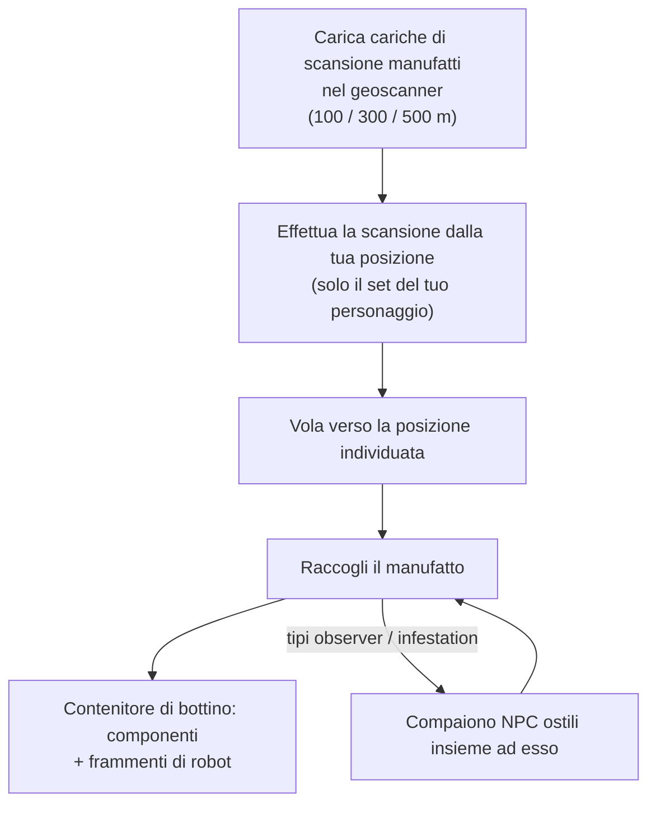

# Esplorazione (manufatti e reliquie)

L'esplorazione consiste nello scovare risorse preziose nascoste nel terreno: un'ottima attività in solitaria a qualsiasi livello. Si presenta in due forme: i **manufatti** (artifacts), che sono personali e nascosti, e le **reliquie** (relics), che sono pubbliche e contese.

## Ricerca di manufatti (Artifacting)

I manufatti sono punti che esistono **per personaggio**: il server mantiene un set di manufatti separato per ogni personaggio su ciascuna isola, quindi ciò che trovi appartiene solo a te. Rimangono invisibili finché non effettui una scansione per individuarli.

1. Carica le **cariche di scansione per manufatti** (artifact scan charges) in un modulo geoscanner. Esistono tre gradi di cariche con differenti portate di scansione (100 / 300 / 500 m).
2. Effettua la scansione dalla posizione del tuo robot: lo scanner rileva le posizioni dei manufatti entro il raggio d'azione (la statistica di precisione del geoscanner restringe la posizione rilevata).
3. Vola verso la posizione individuata e raccogli il manufatto; sul posto comparirà un **contenitore di bottino** (loot container).

Due elementi rendono la ricerca di manufatti un'attività sia di combattimento che di raccolta:

- Alcuni tipi di manufatti **fanno comparire NPC ostili insieme a te**: le varianti "observer" e "infestation" attirano nemici nel momento stesso in cui il manufatto viene trovato, quindi pilota un mezzo in grado di combattere.
- Il bottino è casuale in base al tipo di manufatto: componenti di moduli (piastre di corazza, induritori, generatori, riparatori…) e **frammenti di robot** (robot shards) — gli ingredienti per la ricerca e la produzione specifici di ciascuna fazione, rendendo così l'esplorazione di manufatti una carriera industriale fondamentale.

I tipi di manufatto sono suddivisi in livelli (livello 1–3, con più bottino ai livelli superiori) ed esistono in varianti neutrali e per fazione.

## Caccia alle reliquie (Relic hunting)

Le reliquie si trovano nel **mondo aperto**: la zona le genera in posizioni casuali (con un ciclo di rientro di circa 90 minuti e una variazione casuale), sono oggetti visibili dotati di un raggio luminoso e chiunque ne raccolga una per primo ottiene il bottino. Il bottino consiste in un'estrazione di NIC più **frammenti di robot**, proporzionata al livello della reliquia e alla fascia di valore dell'isola — gli stessi frammenti prodotti dalla ricerca di manufatti.

I tipi di reliquie sono suddivisi in livelli per isola (livelli 1–3, con diversi valori di EP a seconda del livello) e sono disponibili in varianti neutrali, per fazione e industriali. Alcune reliquie sono legate agli [avamposti](/it/features/outposts/) — l'attività SAP genera reliquie dedicate, che rimangono attive fino a 12 ore — e sulle isole con PvP aperto i punti di generazione si trovano in territorio conteso, quindi aspettati di incontrare altri cacciatori.

## Anche le missioni offrono ricompense

Anche le [missioni](/it/features/missions/) possono assegnarti incarichi legati ai manufatti, dove vieni pagato direttamente e i beni vanno al datore di lavoro anziché nel tuo inventario.

<!--
Written from scratch against the server backend, 2026-09-27:
Zones/Artifacts/Repositories/ZoneArtifactRepository.cs (per-character artifact
rows), Zones/Scanning/Scanners/Scanner.Artifact.cs (scan range + accuracy),
Zones/Artifacts/Generators/Loot/ (random loot per type),
Services/Relics/RelicManagers/ZoneRelicManager.cs (~1.5 h respawn + random
window) and SAPRelic.cs (12 h lifespan),
artifacttypes/artifactloot/relictypes/relicloot tables,
ammo_artifact_scan_a/b/c (scan ranges 100/300/500).
An earlier version of this page was adapted from the Open Perpetuum
community wiki (perpetuum.miraheze.org) and has been fully rewritten from
backend sources; no text was reused.
-->