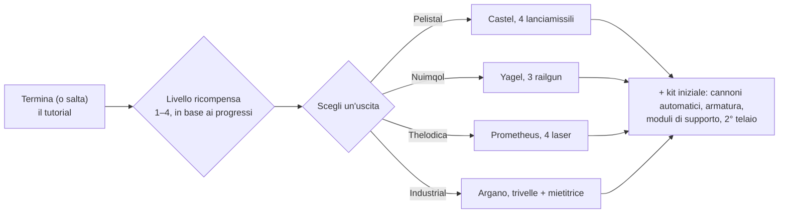

# FAQ

## Posso saltare il tutorial?

Puoi lasciare la zona di addestramento in anticipo, ma rinuncerai alla ricompensa ottenuta
completandola. Quando un personaggio esce dal tutorial, il server:

- accredita i **NIC iniziali** più un bonus **per ciascun livello di ricompensa** guadagnato nel
  tutorial (ci sono quattro livelli di ricompensa),
- ti inserisce nella **corporazione predefinita** per la fazione e la scuola scelte,
- concede le tue **estensioni iniziali** (abilità) e la tua **spark**,
- crea il tuo **robot iniziale**, ti fa attraccare alla base di attracco di New Virginia e
  la imposta come tua **base di partenza (home base)** — il luogo in cui rinasci quando il tuo robot viene
  distrutto,
- deposita gli **oggetti di ricompensa** in un contenitore pubblico presso quella base di attracco e
  ti invia un messaggio di benvenuto.

## Come completo il tutorial?

Segui gli obiettivi in ordine; la **Rookie Checklist** del client (menu Aiuto
nella barra superiore) li traccia e può essere fissata alla barra inferiore. Il punto in cui
arrivi determina il tuo livello di ricompensa, che stabilisce quali livelli di ricompensa
riceverai all'uscita — un'uscita di livello 1 ottiene solo il primo livello, un completamento
completo ottiene tutti e quattro.

## Cosa mi offre ciascuna uscita?

La tua scelta determina tre elementi: il **robot iniziale** che piloti, gli **oggetti di
ricompensa** che ricevi e la **corporazione predefinita con le abilità iniziali** che ottieni.
Tutto il resto — qualsiasi abilità, qualsiasi robot, equipaggiamento di qualsiasi fazione — può essere appreso e
acquistato in seguito con EP e NIC, quindi la scelta è un kit iniziale, non un vincolo permanente.

| Uscita | Robot iniziale (equipaggiato) | Tema ricompensa |
|---|---|---|
| **Pelistal** | Castel — quattro lanciamissili | missili + cannoni automatici |
| **Nuimqol** | Yagel — tre railgun | munizioni railgun + cannoni automatici |
| **Thelodica** | Prometheus — quattro laser | cristalli laser + cannoni automatici |
| **Industrial** | Argano — due trivelle, una mietitrice, una sonda mineraria | estrazione, raccolta e munizioni per scansione artefatti |

Ogni uscita include anche un set di piccoli cannoni automatici con proiettili, armatura e
moduli di supporto (riparatore armature, potenziatore sensori o riduttore di massa, ricaricatore
del nucleo, modificatori di danno), un secondo telaio (vuoto) e una capsula bomba da parete ai
massimi livelli di ricompensa.

## Cosa faccio una volta uscito?

Quasi tutte le attività fruttano EP per le abilità e NIC per l'equipaggiamento:

- Estrai minerali, raccogli piante, scansiona artefatti — e vendi il raccolto sui [mercati](/it/features/market/).
- Abbatti NPC e vendi il [bottino](/it/features/npcs/).
- Raccogli o compra materiali e [costruisci](/it/features/production/) oggetti.
- Completa [missioni](/it/features/missions/) — qualsiasi incarico offerto a un terminale o
  avamposto può essere completato da solo nel mondo.

Nuovo al PvP nel mondo aperto? Leggi prima le [note di sopravvivenza in Guida per
iniziare](/it/features/getting-started/#sopravvivenza).

## Posso tornare nella zona di addestramento?

No. La zona di addestramento è riservata ai nuovi personaggi e non è possibile rientrarvi una volta
abbandonata. La Rookie Checklist rimane disponibile nel menu Aiuto se desideri
rileggere gli obiettivi, e puoi sempre creare un altro personaggio e lasciarlo
nel tutorial come ambiente di prova.

## Abbreviazioni

Termini gergali comuni in chat, annunci di mercato ed equipaggiamenti. La maggior parte dei termini ha una pagina
dedicata (collegata dove utile) — i nomi degli oggetti sono risolti nella ricerca del sito.

| Termine | Significato |
|---|---|
| **EP** | [Punti Estensione (Extension Points)](/it/features/research/#ep-sources) — la valuta abilità a livello di account spesa per potenziare le [estensioni](/it/features/character/#estensioni) (le regole di guadagno si trovano nella [pagina di ricerca](/it/features/research/#ep-sources)). |
| **NIC** | Nian Credit — la valuta del gioco (il saldo di `credit` sul tuo personaggio). |
| **CT** | [CPRG — Programma di Calibrazione](/it/features/production/#cprg-calibration-programs) — il programma con cui viene calibrata una linea di fabbrica prima della produzione (uno per oggetto, con efficienze materiali/temporali). |
| **Proto** | Un oggetto prototipo — la variante di alto livello di un modulo/robot, fabbricata presso la [struttura prototipi](/it/features/production/#the-item-lifecycle-the-circular-process) (consuma un esemplare del livello precedente; vedi [progressione di livello](/it/features/production/#tier-progression)). |
| **LWF** | Telaio leggero (Lightweight frame) — un modulo di armatura che riduce la massa (il client li chiama "… lightweight frame", es. *Niani lightweight frame*). Rende il robot più leggero a scapito dell'armatura. |
| **TP / tele** | [Teletrasporto](/it/features/movement/) — viaggio rapido tra punti fissi o verso un dispositivo di teletrasporto mobile dispiegato. |
| **SAP** | Service Access Point — l'attività di [stabilità](/it/features/outposts/) degli avamposti. |
| **Stab** | Stabilizzatore per armi (Weapon Stabilizer) — aumenta la precisione di tiro dell'arma. |
| **Demob** | Demobilizzatore (Demobilizer) — un modulo che rallenta un altro robot (e i suoi moduli). |
| **EWar** | Moduli di Guerra Elettronica (disturbo, soppressione sensori, occultamento). |
| **EnWar** | Moduli di Guerra Energetica (iniettori di nucleo, drenatori, neutralizzatori, trasferimenti). |
| **Tuning** | Il termine del client per i moduli di potenziamento che migliorano altri moduli — modificatori di danno per armi, *tuning industriale* per trivelle e mietitrici, tuning per riparatori di armatura, ecc. |
| **MK2** | Una variante potenziata di un robot (telai `_mk2`) — capacità superiori, una linea di ricerca dedicata. |

Le classi di robot seguono i raggruppamenti del client — vedi la nota in
[Classi di robot](/content/robots/#robot-classes).
