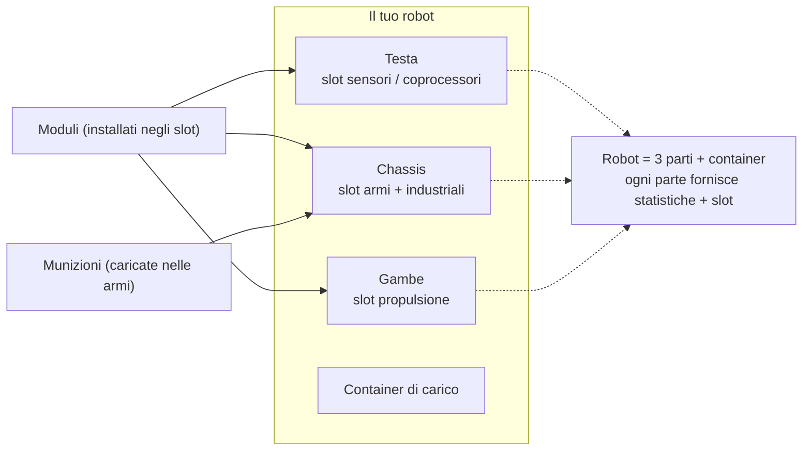

# Equipaggiamento (Fitting)

Con fitting si intende l'installazione dei **moduli** negli slot dei componenti del robot e il caricamento delle **munizioni** nelle tue armi. Tutto l'equipaggiamento è **solo da attraccati** (docked-only) — non puoi modificare il fitting in una zona.

> Le posizioni nell'interfaccia utente seguono la [panoramica dell'interfaccia client](/it/features/ui/) (la categoria **Equip** sulla barra superiore). Le meccaniche descritte di seguito sono verificate rispetto al server.

## Installare i moduli

Un robot possiede diversi **componenti** (armi, scudi, corazza, propulsione, sensori, ecc.), ciascuno dotato di una serie di **slot**.

- **Equipaggiare un modulo** — preleva un modulo da un container e installalo in uno specifico slot del componente. Il tipo di modulo deve essere valido per quello slot su quella classe di robot. Se lo slot è già occupato, il modulo esistente viene riposto nel container.
- **Scambiare moduli** — sposta un modulo tra due slot dello stesso componente.
- **Rimuovere un modulo** — rimuovi un modulo da uno slot per riporlo in un container.

Il server ricalcola le statistiche del robot dopo ogni modifica (i moduli influenzano i valori mostrati nel pannello di stato da non attraccati — vedi [combattimento](/it/features/combat/)).

## Caricare le munizioni

- **Equipaggiare munizioni** — carica munizioni compatibili in un modulo attivo (arma). Il modulo deve **accettare quel tipo di munizione** e caricherà fino alla **capacità di munizioni** del modulo. Qualsiasi munizione precedentemente caricata verrà prima riposta nel container.
- **Cambiare munizioni** — sostituisci le munizioni caricate con un diverso tipo compatibile.
- **Scaricare munizioni** — riponi le munizioni caricate in un container.

## Preset di equipaggiamento

Un **preset** è un fitting salvato che puoi riapplicare rapidamente:

- **Salva** — memorizza l'equipaggiamento attuale di un robot assegnandogli un nome.
- **Elenca** — visualizza i tuoi preset salvati.
- **Applica** — carica un preset su un robot (anche diverso) prelevando i moduli da un container.
- **Elimina** — rimuovi un preset salvato.

I preset sono pratici per riequipaggiarsi rapidamente dopo una battaglia o quando si cambia ruolo.

## Note pratiche

- **Non puoi modificare l'equipaggiamento in una zona** — tutte le operazioni richiedono di essere attraccati.
- **Prima l'estensione di abilitazione** — se non hai ricercato la classe del robot, non potrai né selezionarlo né pilotarlo.
- **Le munizioni devono corrispondere all'arma** — una definizione di munizioni non compatibile verrà rifiutata.
- **I robot imballati non possono essere usati** — disimballa un robot prima di selezionarlo o equipaggiarlo.
- **Usa i preset per riequipaggiarti in fretta** — salva una configurazione collaudata, poi applicala dopo le perdite subite.

## Categorie degli slot

I componenti di un robot (testa, chassis, gambe) forniscono **slot**, e ciascuno slot include un insieme di flag di categoria. Un modulo può essere installato in uno slot solo se i flag del modulo sono un **sottoinsieme** dei flag dello slot. Le categorie di flag sono:

`small`, `medium`, `large`, `turret`, `missile`, `melee`, `industrial`,
`ew_and_engineering`, `specialized` (uno slot specializzato accetta solo moduli specializzati), oltre agli slot strutturali `head` / `chassis` / `leg`.

I moduli possono anche essere limitati a specifici robot, e alcuni presentano il flag **unique**, consentendo di equipaggiarne solo uno di quel tipo alla volta. Gli effetti delle statistiche per singolo modulo sono consultabili nella [tabella dei robot](/content/robots/) generata.