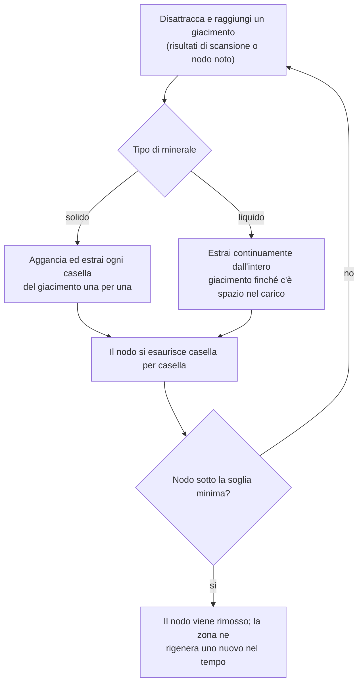
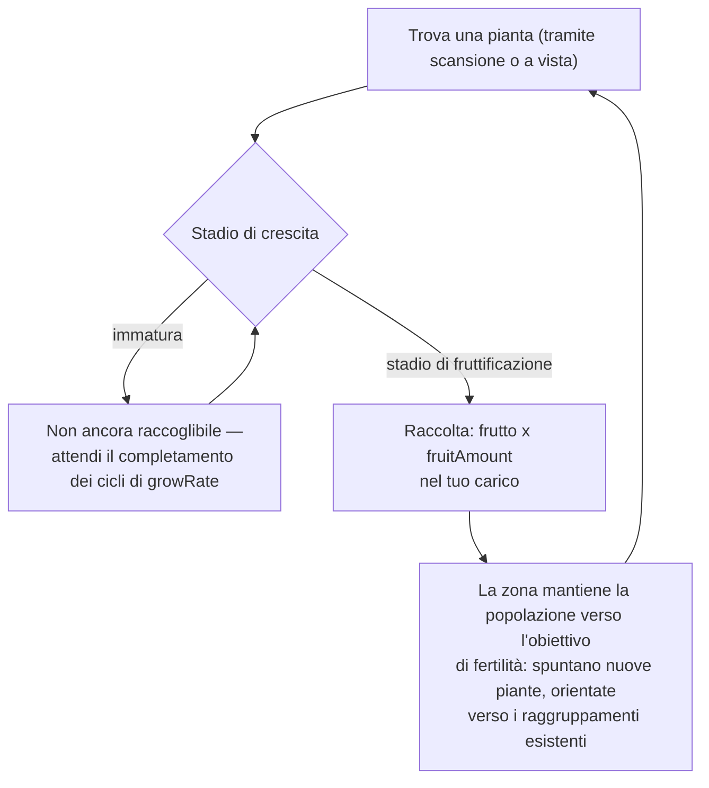
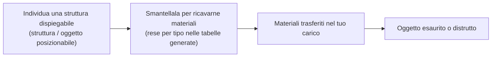

# Raccolta e scansione

Le risorse nel gioco provengono da tre fonti all'interno di una zona: **giacimenti minerari**, **piante**
e **strutture dispiegabili**. Questa pagina spiega come funziona ciascuna di esse e come si svolge il ciclo di raccolta.

> Le posizioni nell'interfaccia utente seguono la [panoramica dell'interfaccia client](/it/features/ui/): le azioni di scansione e raccolta si trovano nell'elenco delle **azioni non attraccate** (in alto a destra all'interno di una zona). I valori di resa per tipo di risorsa sono riportati nelle tabelle generate: [Contenuto → Minerali](/content/ores/) e [Contenuto → Piante](/content/plants/). Le meccaniche descritte di seguito sono verificate rispetto all'implementazione del server.

## Il ciclo di base

1. **Disattracca** ed entra in una zona (vedi [movimento](/it/features/movement/)).
2. **Scansiona** l'area con il modulo scanner del tuo robot.
3. **Raccogli** — estrai minerali, cogli i frutti delle piante o smantella le strutture dispiegabili.
4. **Attracca** e scarica il carico nel container di una base.

## Giacimenti minerari

- I minerali si trovano nel terreno sotto forma di **giacimenti (nodi)** sparsi per la zona.
- Per individuarli e registrarli è necessario un modulo **geo-scanner** installato sul robot attivo.
  Una scansione genera un **risultato di scansione**; successivamente lo si **carica**, salvandolo nel proprio elenco personale di scansioni minerarie.
- I risultati salvati possono essere **elencati, spostati, eliminati o convertiti in oggetti**
  (gli oggetti "scansione minerale" usati per la raffinazione/produzione).

- I giacimenti sono **finiti**: ogni nodo contiene una quantità totale limitata. Quando un nodo viene
  estratto al di sotto della sua soglia minima, viene rimosso e la zona **rigenera nuovi nodi** nel
  tempo fino al limite massimo configurato. Le modalità di posizionamento dei nodi e di mantenimento delle popolazioni di piante — con esempi pratici su zone reali — sono descritte in [Zone → Generazione](/zones/generation/).
- **Minerali solidi vs liquidi.** I minerali solidi si esauriscono casella per casella: si aggancia ed estrae
  ogni casella del giacimento finché non è vuota. I minerali liquidi attingono dall'intero giacimento, consentendo
  all'estrattore di funzionare ininterrottamente finché c'è spazio nella stiva. Questa semplicità è proprio il motivo per cui i minerali liquidi tendono ad avere un valore inferiore: richiedono meno abilità e attenzione per essere estratti.

### Panoramica delle statistiche di piante e minerali

Il comportamento di minerali e piante è determinato da parametri specifici per ciascun tipo. I campi rilevanti per il giocatore sono:

| Campo | Significato nel gioco |
|---|---|
| `fertility` | Quanto è comune il tipo: valore più alto = la zona cerca di mantenerne una quantità maggiore |
| `growRate` | Quanti cicli di crescita una pianta deve trascorrere in ogni stadio prima di avanzare (più alto = più lento) |
| `spreading` | Se il tipo cresce a grappoli (gruppi) oppure sparso |
| `killDistance` | Distanza minima tra due piante dello stesso tipo |
| `slope` / `minSlope` | La pendenza del terreno su cui la pianta può crescere |
| `allowedAltitudeLow/High` | La fascia altimetrica in cui la pianta può crescere |
| `allowedWaterLevelLow/High` | Fascia di distanza dalla costa (crea la vegetazione costiera) |
| `fruitingState` | Quale stadio di crescita la pianta deve raggiungere prima di produrre (diventare raccoglibile) |
| `fruitDefinition` / `fruitAmount` | Cosa produce la pianta e la quantità base |
| `maxAmount` | Limite massimo di esemplari di questo tipo presenti in un'area di elaborazione |
| `health` | Punti ferita per stadio di crescita (gli stadi più avanzati possono essere più resistenti) |
| `damageScale` | Resistenza ai danni della pianta |
| `playerSeeded` | La pianta esiste solo se piantata da un giocatore |
| `onlyOnUnprotectedZone` | Cresce solo in zone non protette (di classe beta/gamma) |

La guida di riferimento completa campo per campo (tipi, valori predefiniti, memorizzazione e utilizzo da parte del tick della zona) si trova in [Formati → Campi delle piante](/it/formats/plant-fields/).

## Piante

- Le piante **crescono nel tempo** attraversando una sequenza di stadi. Ciascuno stadio richiede un certo numero di cicli di crescita (`growRate`) prima che la pianta avanzi in modo casuale allo stadio successivo.
- Una pianta **produce frutti solo una volta raggiunto lo stadio di fruttificazione** — le piante immature non sono raccoglibili.
- La zona mantiene le popolazioni di piante verso un **obiettivo di fertilità**: se una porzione di terreno ha una densità inferiore rispetto al proprio livello di fertilità, spuntano nuove piante; il tipo selezionato tiene conto della `fertility` di ciascuna specie, e il parametro `spreading` indirizza la nuova crescita verso i raggruppamenti esistenti.

- Alcune piante sono **seminate dai giocatori** (esistono solo nei vivai dei giocatori) e altre sono **esclusive delle zone non protette**.
- Le piante possono essere **danneggiate e distrutte**; i parametri `health` e `damageScale` determinano la loro resistenza.

## Strutture dispiegabili

Le strutture dispiegabili sono oggetti posizionati all'interno di una zona (vedi [Stazioni base di alimentazione](/it/features/pbs/) per la parte relativa alle strutture). Alcune possono essere **smantellate** per ricavarne materiali. Le regole di smantellamento e le rese per tipo sono riportate nelle tabelle generate: [Contenuto → Minerali](/content/ores/) e [Contenuto → Piante](/content/plants/).

## Chioschi

Un **chiosco** è una struttura legata alle missioni: serve per **consegnare oggetti** (a distanza utile) come parte di una missione. Non costituisce una fonte di raccolta autonoma — vedi [missioni](/it/features/missions/).

## Note pratiche

- **La scansione richiede il modulo** — senza geo-scanner installato, non si ottengono risultati di scansione.
- **I risultati di scansione sono personali** — appartengono al singolo personaggio e non sono condivisi.
- **I nodi minerari riappaiono, ma lentamente** — se un'area è priva di giacimenti, significa che il nodo è esaurito, non nascosto. La rigenerazione ripristina il numero dei nodi nel tempo, non istantaneamente.
- **Raccogli ciò che è maturo** — le piante nello stadio di fruttificazione forniscono la resa completa; gli stadi precedenti non producono nulla.

<!-- TODO: only the client UI flow remains (scan screen, harvest interaction, cargo UI) —
     needs a running client. Per-type ore yields are at /content/ores/ and plant fruit
     definitions at /content/plants/ (generated from the live DB).
     Developer notes: Zone/ZoneUploadScanResult.cs (GeoScannerModule required);
     MineralScanResult*.cs (per-character repository);
     Zones/Terrains/Materials/Plants/PlantRule.cs (all plant rule fields);
     Zones/Terrains/NatureCube.cs (GrowPlants, fertility/spreading/killDistance logic);
     Zones/Terrains/Materials/Minerals/MineralLayer.cs (ore node lifecycle);
     Zone/UseItem.cs + UseItemVisitor.cs (IUsableItem harvest path);
     Zone/KioskSubmitItem.cs (mission item submission, range-limited). -->