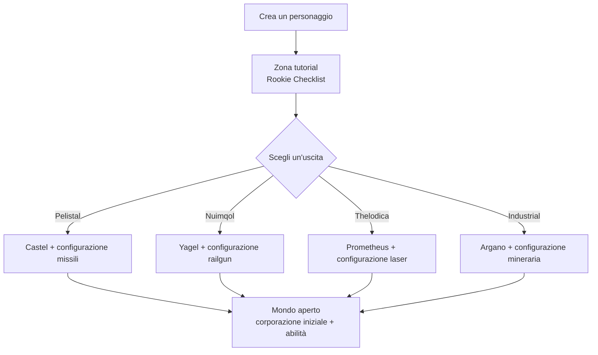

# Primi passi

Questa pagina illustra i primi passi: la creazione di un personaggio, l'ottenimento del primo robot
e le impostazioni a livello di personaggio che utilizzerai fin da subito.

> I riferimenti all'interfaccia seguono la [panoramica dell'interfaccia client](/it/features/ui/). Le meccaniche descritte di seguito sono verificate
> rispetto all'implementazione del server.

## Ottenere il gioco

Perpetuum è gratuito su [Steam](https://store.steampowered.com/app/223410/Perpetuum/).

  <a class="steam-card-link" href="https://store.steampowered.com/app/223410/Perpetuum/" target="_blank" rel="noopener">
    
    Perpetuum su Steam — free to play
  </a>

## Video introduttivi

Guide del progetto Open Perpetuum. Fai clic su una scheda per riprodurla direttamente qui.

  

    
    &#9654;
    
Perpetuum Online Tutorial Walkthrough. + Extension Advice and lots more.

  

  

    
    &#9654;
    
Syndicate Careers Help — Artifacting

  

  

    
    &#9654;
    
Open Perpetuum Tutorial — How to run multiple clients

  

## Creazione di un personaggio

- Puoi **verificare se un nome è disponibile** prima di crearlo (`characterCheckNick`).
- **Crea il personaggio** — viene associato al tuo account. Un account può contenere diversi
  personaggi; puoi giocarne uno alla volta.
- **Seleziona un personaggio** per giocare. Cambiare personaggio deseleziona quello corrente.
- Puoi **rinominare** un personaggio in seguito (il nome deve essere disponibile).
- Puoi **eliminare** un personaggio che non usi più.

## Il tuo primo robot

- Mentre sei **ancorato (docked) in una base**, puoi **richiedere il robot iniziale** (strutture della base —
  vedi la [panoramica dell'interfaccia client](/it/features/ui/) per sapere dove trovare le azioni di base).
  - La base deve avere ancora robot iniziali disponibili in magazzino — nelle basi più frequentate le scorte possono esaurirsi,
    nel qual caso la richiesta fallisce.
  - È previsto un **tempo di ricarica di 5 minuti** tra una richiesta di robot iniziale e l'altra per personaggio.
  - Il nuovo robot viene consegnato nel container pubblico della base.

- Mentre sei ancorato puoi anche **richiedere una "scatola infinita"**: un container speciale aggiunto al tuo
  inventario al costo di una **commissione di 5.000 crediti**. È un container di comodità, non una fonte
  di risorse gratuite.

## Impostazioni del personaggio

- **Avatar** — l'aspetto visivo del tuo personaggio.
- **Messaggio di stato (Mood message)** — una breve riga mostrata agli altri giocatori.
- **Nota privata** — un appunto visibile esclusivamente a te su uno dei tuoi personaggi.
- **Base principale (Home base)** — imposta o cancella la tua base principale; è il punto di attracco predefinito
  quando il gioco deve riportarti in un luogo sicuro.
- **Impostazioni** — preferenze del singolo personaggio (lettura/scrittura).
- **Blocca scambi (Block trades)** — attiva o disattiva gli scambi commerciali per un personaggio.
- **Crediti** — trasferisci crediti tra i tuoi personaggi; visualizza lo storico delle transazioni.
- **Livello account** — modifica l'e-mail/password della sessione, visualizza lo storico delle transazioni
  dell'account e la cronologia degli EP guadagnati per le attività.

## Uscire e rientrare

- **Sign out** termina la sessione; **seleziona personaggio** la riavvia.
- Se il server ti disconnette forzatamente (ad es. rientro forzato alla base), riappari ancorato — vedi [movimento](/it/features/movement/).

## Il tutorial

I nuovi personaggi iniziano nella zona di addestramento con una **Rookie Checklist** — completala:
copre tutti i concetti fondamentali e ricompensa con diversi robot completi di moduli e munizioni. Puoi
saltarla (disattraccare e raggiungere a piedi un'uscita di fazione), ma rinuncerai alle ricompense e non potrai più
tornare nella zona di addestramento in seguito. Per sapere cosa offre ciascuna delle quattro uscite di fazione,
consulta le [FAQ](/it/features/faq/#what-does-each-exit-give-me).

## Sopravvivenza

Perpetuum è un sandbox basato su rischio e ricompensa: quando il tuo robot viene distrutto lo perdi per sempre —
che tu sia docked o meno, distrutto da un giocatore o da un NPC — e riappari alla tua [base principale](#impostazioni-del-personaggio)
(dove puoi richiedere un robot iniziale gratuito se arrivi a mani vuote). Alcune regole per mantenere le perdite sostenibili:

- **Impegna solo ciò che puoi rimpiazzare.** Disattraccare è una scommessa: se il robot viene abbattuto,
  esso e tutti i moduli installati sono perduti (o diventano bottino). Prima di uscire dalla stazione,
  assicurati che la perdita sia sostenibile.
- **Conosci le zone.** Le isole protette (PvE) sono al sicuro dagli altri giocatori; le isole open-PvP sono
  ad accesso libero per i combattimenti senza alcun sistema di crimine o punizione. Consulta le [zone](/zones/)
  per consultare la mappa.
- **Conosci gli NPC.** Gli indicatori arancioni attaccano solo se provocati; gli indicatori rossi attaccano
  non appena ti avvicini. Fuggi e interrompi la linea di visuale per azzerare l'aggressività (aggro). Consulta
  [NPC e caccia PVE](/it/features/npcs/).
- **Mitiga il rischio, non limitarti ad accettarlo.** Entrare in un'isola open-PvP con il tuo miglior mech con fitting T4
  è il modo più rapido per perderlo. Un equipaggiamento economico e sostituibile che si ripaga in pochi viaggi batte
  di gran lunga un bot costoso che richiede venti spedizioni per ammortizzarsi.
- **Costruisci un ciclo sostenibile.** Qualunque cosa tu faccia — missioni, raccolta, caccia, produzione, trasporto —
  qualcuno ti pagherà in NIC. Mantieni risorse di riserva affinché una giornata sfortunata non azzeri le tue entrate.

## Cosa fare dopo

1. Seleziona il tuo robot iniziale e impara a usare la schermata di [hangar ed equipaggiamento (fitting)](/it/features/robots/).
2. Disattracca e spostati nella zona — vedi [movimento](/it/features/movement/).
3. Scansiona il terreno e comincia a raccogliere risorse — vedi [raccolta e scansione](/it/features/gathering/).
4. Ricerca le tue prime estensioni — vedi [ricerca](/it/features/research/).
5. Scegli una carriera — le [FAQ](/it/features/faq/#what-do-i-do-once-i-m-out) contengono tutte le opzioni.

<!-- TODO(Phase 1): verify client UI flow (account creation screen, character wizard).
     UI model: see features/ui.md (EVE-style, project-provided).
     Developer notes: Perpetuum.RequestHandlers.Characters/* (CharacterCreate,
     CharacterSelect, CharacterRename, CharacterSetHomeBase, ...);
     RequestStarterRobot (5-minute cooldown, base stock), RequestInfiniteBox
     (5000 credits, docked-only). -->
