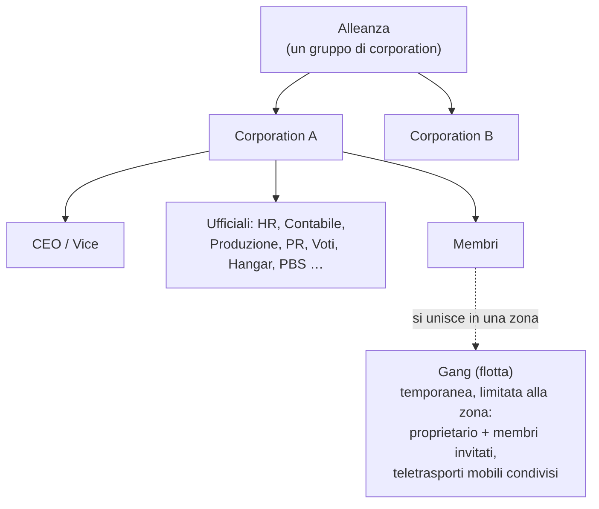

# Gruppi

Esistono tre tipi di raggruppamento: le **corporation** (la tua organizzazione principale), le **alleanze** (gruppi di corporation) e le **gang** (flotte temporanee per il gioco di zona).

> Le posizioni nell'interfaccia seguono la [panoramica della UI del client](/it/features/ui/) (il pulsante **Corporation** in alto a sinistra; la categoria **Corp Storage**; le gang dispongono di una propria finestra). Le meccaniche descritte di seguito sono verificate lato server.

## Corporation

### Unirsi e abbandonare
- **Creare** una corporation — richiede l'estensione base per la gestione della corporation (livello 1) e una quota di fondazione pari a **250.000 NIC**. Scegli il nome ufficiale, un **ID breve** (massimo 6 caratteri, visualizzato sul terreno per identificare i tuoi membri) e l'**aliquota fiscale** (tax rate) — una percentuale sui guadagni dei membri (in particolare i compensi delle missioni) che viene accreditata automaticamente sul conto della corp.
- **Candidarsi** a una corporation, oppure **invitare** un personaggio a entrare.
- **Accettare una candidatura** / **visualizzare l'elenco delle candidature** (ufficiali).
- **Rispondere** a un invito ricevuto.
- **Abbandonare**, o **annullare** una richiesta di uscita in sospeso.
- **Rimuovere un membro**, **impostare il ruolo di un membro**, **rinunciare ai propri ruoli** o impostare i membri come neutrali.

### Ruoli
Le corporation prevedono una gerarchia di ruoli. I ruoli vincolano le azioni consentite — ad esempio sbloccare nodi nell'albero tecnologico della corporation, gestire l'hangar o modificare il PBS (vedi [pbs](/it/features/pbs/)). Ruoli definiti dal server (`CorporationRole`):

- **CEO** — controllo totale.
- **Deputy CEO** (Vice CEO) — secondo in comando.
- **HR Manager** — gestione dei membri (candidature/inviti/espulsioni).
- **Corporation Delegate** / **Alliance Delegate** — agiscono per conto dell'organizzazione.
- **Accountant** (Contabile) — fondi della corp.
- **Production Manager** (Responsabile di produzione) — produzione della corp.
- **Vote Admin** — gestione delle votazioni.
- **PR Manager** (Relazioni pubbliche) — pubbliche relazioni / bacheca.
- **Accesso all'hangar (basso / medio / alto / sicuro)** — permessi hangar a più livelli, con corrispondenti livelli di **rimozione dall'hangar** e un ruolo di **hangar operator** (operatore hangar).
- **Visualizza PBS / Modifica PBS** — consultare o modificare le strutture PBS della corporation.
- **Elenco albero tecnologico / Sblocco** — visualizzare o sbloccare l'albero tecnologico della corporation.

Alcune restrizioni tipiche d'accesso: le azioni sui membri (candidature/inviti/rimozioni, assegnazione ruoli) richiedono **CEO / vice / HR manager**; la bacheca e le PR richiedono **CEO / vice / PR manager**; i fondi della corp e gli upgrade delle strutture richiedono **CEO / vice / accountant** (la produzione richiede inoltre il **production manager**); il dispiegamento delle strutture PBS richiede **CEO / vice / modifica-PBS**.

È possibile consultare la **cronologia dei ruoli** per se stessi e per gli altri membri. Lo spazio nell'hangar è in affitto (configurazione predefinita del server: 50.000 crediti per un periodo di 7 giorni).

### Informazioni e ricerca
- **Informazioni corporation / le mie info** — dettagli e stato della propria adesione.
- **Cercare** corporation.
- **Standing / reputazione** — standing e reputazione della propria corp.
- **Delegati** — personaggi che operano per conto della corp.

### Finanze
- **Donare** al portafoglio della corporation.
- **Prelevare** da esso.
- **Trasferire** fondi tra portafogli.

### Aspetto e profilo
- **Rinominare**, **impostare il colore**, **impostare le info** (profilo pubblico).
- **Logo** — fino a 5 simboli da un set predefinito, ciascuno modificabile (dimensione, trasparenza, disposizione su livelli); solo i membri autorizzati possono crearlo o modificarlo.
- **Cronologia dei nomi** — nomi precedenti.

### CEO
- **Candidarsi come CEO**, o verificare lo **stato di takeover del CEO**.
- **Il takeover nella pratica**: quando un CEO resta offline per **30 giorni**, un Deputy può avviare una procedura di takeover — si attiva un **conto alla rovescia di 48 ore**, annunciato nella finestra della corp. Il CEO o qualsiasi altro Deputy possono imporre un **veto** immediato (un veto non impedisce un tentativo successivo qualora il CEO continui a non effettuare l'accesso). Se il conto alla rovescia scade, il Deputy diventa CEO con pieni privilegi.

### Votazioni
Le corporation possono indire **votazioni**:
- **Avviare** una votazione, **definirne l'oggetto**, **elencare** le votazioni, **esprimere** un voto, **eliminare** una votazione.

## La bacheca annunci
Una bacheca avvisi gestita dalla corporation:
- **Inizializzarla**, **elencare** i messaggi, visualizzare i **nuovi annunci**, **pubblicare** un annuncio, **moderare** (modificare/rimuovere i messaggi altrui) e visualizzare i **dettagli**.

## Hangar della corporation (deposito)
Un'area di stoccaggio condivisa della corp situata presso le basi:
- **Affittare** una sezione hangar, **pagare l'affitto**, verificare il **prezzo dell'affitto**, **chiuderla**.
- **Elencare** i contenuti (tutti, o in una base specifica).
- **Cartelle** — creare/eliminare sottocartelle.
- **Impostare l'accesso** (chi può utilizzarla) e **assegnare un nome**.
- **Registri** — visualizzare, impostare e cancellare il log degli accessi all'hangar.

Nota: **non è possibile selezionare un robot dall'hangar della corp** come robot attivo (vedi [robot](/it/features/robots/)).

## Documenti della corporation
Un sistema condiviso di documenti di testo con controllo di versione per la corporation. Esistono due tipi di documenti:

- **Piano PBS** — un progetto/blueprint per la rete PBS della corporation.
- **Progetto di terraformazione** — un registro relativo a un progetto di modifica del terreno.

Operazioni: **creare**, **elencare**, **aprire**, **aggiornare il corpo** (con controllo di versione), **eliminare**, **trasferire** la proprietà, **rinnovare** (estendere il periodo di validità), **monitorare** / **interrompere il monitoraggio** (ricevere notifiche sulle modifiche) e una **lista di registrazione** (fino a 25 membri) che controlla chi può lavorare al documento.

## Alleanze

Un'alleanza riunisce più corporation:
- **Informazioni sulla mia alleanza**, **alleanze predefinite** e **cronologia dei ruoli dell'alleanza**.
- Gli standing possono avere come bersaglio le alleanze (vedi [social](/it/features/social/)).

## Gang (flotte)

Una **gang** è un gruppo temporaneo per il gioco di zona (ad esempio per condividere un teletrasporto mobile o combattere insieme):
- **Creare**, **sciogliere**, **informazioni**.
- **Invitare**, **rispondere** a un invito, **espellere**, **abbandonare**.
- **Assegnare il leader**, **impostare il ruolo**.

L'appartenenza a una gang è determinante per i **teletrasporti mobili** — solo il proprietario o un membro della gang possono utilizzarne uno (vedi [movimento](/it/features/movement/)).

## Note pratiche

- **I ruoli determinano i poteri** — la maggior parte delle azioni da ufficiale (candidature, hangar, PBS, votazioni) richiede il ruolo appropriato.
- **La tecnologia della corporation è condivisa** — lo sblocco per conto della corp impiega punti condivisi e un moltiplicatore (vedi [ricerca](/it/features/research/)).
- **L'hangar è un deposito, non una piattaforma di lancio** — non puoi effettuare l'undock montando direttamente su un robot al suo interno.
- **Le gang sono effimere** — usale per una sessione in zona, non come un'organizzazione permanente.
- **Gli standing dipendono dalla tua corp** — la reputazione della tua corporation influenza il modo in cui l'universo interagisce con te (vedi [social](/it/features/social/)).

<!-- TODO: only the corp UI remains (window layout, role picker).
     Confirmed: CorporationRole enum (21 roles incl. hangar access/remove tiers
     low/medium/high/secure, viewPBS/editPBS, TechTreeList/TechTreeUnlock, delegates);
     permission gates sampled from handlers (membership CEO/Deputy/HRManager;
     bulletin CEO/Deputy/PRManager; money+facility upgrades CEO/Deputy/Accountant;
     production +ProductionManager; PBS CEO/Deputy/editPBS); documents = pbsPlan(1) +
     terraformProject(2) (CorporationDocumentType.cs), versioned, rent extends validity,
     monitor for change notifications, register list max 25 (MAX_REGISTERED_MEMBERS).
     Developer notes: Corporations/* (apply/invite/accept, roles, leave, info, money,
     votes, bulletin, hangar, documents, histories, CEO); AllianceGetMyInfo.cs /
     AllianceGetDefaults.cs / AllianceRoleHistory.cs; Gangs/* (create/invite/kick/leave,
     leader/role). SelectActiveRobot.cs forbids corp-hangar robots. -->