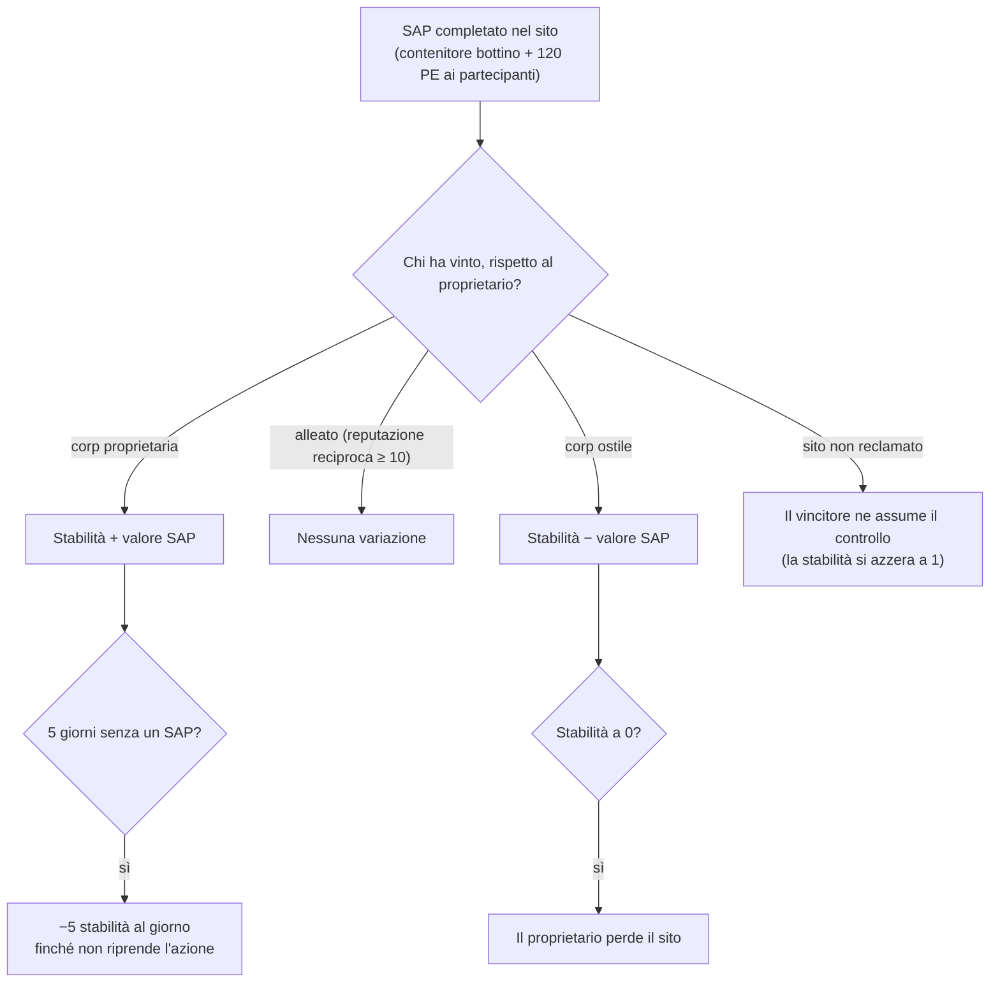

# Intrusione

L'**intrusione** è una modalità strutturata attorno ai **siti NPC** — siti gestiti dai giocatori o contesi dotati di
**stabilità**, **difesa** e **strutture**. Investi oggetti, aumenti le difese e
potenzi le strutture per controllare e trarre profitto da un sito.

> Il nome in-client per "intrusione" deve essere confermato. Le posizioni dell'interfaccia utente seguono la
> [panoramica della UI del client](/it/features/ui/). Le meccaniche seguenti sono confermate a livello di server.

## Siti e stabilità

- **Info sito** — dettagli di un sito di intrusione.
- **Stabilità** — la statistica principale del sito, un valore compreso tra **0 e 150**. Un nuovo proprietario inizia a
  **1**. La stabilità determina ogni aspetto:
  - **Soglie di bonus** (contenuto, `intrusionsitestabilitythreshold`): i bonus delle strutture
    si sbloccano a stabilità **20 / 60 / 80**; una serie di effetti aura (nucleo di intrusione,
    rilevamento, geoscansione, raccoglitore, industriale, mascheramento, estrazione, riparazione, segnali — ciascuno
    di liv. 1–3, più effetti combinati di liv. 4) si sblocca a scaglioni a **10, 20, 40, 50, 70, 80 e
    100**; i **diritti di attracco** si sbloccano a **50**; il limite dei nodi difensivi aumenta a **40**.
  - **Punti produzione** = `stabilità / 10` (max 15) — la valuta per potenziare
    le strutture (un punto per livello).
  - **Decadimento**: se non viene completato con successo alcun SAP per **5 giorni**, il sito inizia a perdere
    **5 punti stabilità al giorno** fino a quando non viene intrapresa una nuova azione.
  - **Perdita**: se la stabilità raggiunge lo **0**, il proprietario perde il sito (diventa
    non reclamato).
- **Registro stabilità** — visualizza le variazioni della stabilità di un sito.

### Chi influenza la stabilità

I cambiamenti di stabilità derivano dai **SAP** completati (vedi sotto) e dal decadimento di sistema. L'effetto
dipende da *chi* vince il SAP rispetto all'attuale proprietario:

- **Il proprietario vince** → la stabilità **aumenta** del valore del SAP.
- **Un alleato vince** (reputazione reciproca ≥ 10) → **nessuna variazione**.
- **Una corp ostile vince** → la stabilità **diminuisce** del valore del SAP.
- **Sito non reclamato** → la prima corp di giocatori vincente **ne assume la proprietà** (la stabilità
  viene reimpostata a 1).

## SAP (punti di attacco del sito)

Un **SAP** (Site Attack Point) è un obiettivo temporaneo generato in un sito. Completarlo fa apparire un **contenitore
di bottino** nella posizione del SAP, modifica la stabilità e assegna **120 PE** a ogni
personaggio partecipante. **Anche i cultisti NPC contendono i SAP**: se completano il punteggio
per primi, il SAP viene conteggiato a sfavore della tua fazione. Esistono quattro tipologie di SAP:

| SAP | Come completarlo | Valore di stabilità |
|---|---|---|
| **Hacking attivo** | usa un modulo di hacking sul SAP (fino a 120 utilizzi del modulo) | +15 |
| **Hacking passivo** | resta entro una distanza di 5 dal SAP per **8 minuti** | +10 |
| **Distruzione** | danneggia il SAP fino a distruggerlo (anche il danno degli NPC conta) | +15 |
| **Elaborazione campioni** | consegna **5–6 campioni SAP** (in lotti da 2–3, ricarica di 1,5 min, distanza 7) | +15 |

- **Invia un oggetto SAP** — all'interno di una zona, invia un campione a un SAP di elaborazione campioni.
- **Info oggetto SAP** — ispeziona i dati degli oggetti SAP (tuoi e generali).

I campioni SAP sono i materiali consumabili di questa modalità; possiedono inoltre un elevato valore di nucleo, fungendo
quindi anche da [combustibile per reattori PBS](/it/features/pbs/).

## Difesa ed effetti

- **Imposta soglia di difesa** — configura la soglia di difesa del sito (il momento in cui si attivano le difese
  automatizzate del sito).
- **Imposta bonus effetto** — definisce la configurazione del bonus aura/effetto su un sito (scelto tra il set
  di aure sbloccate dalla stabilità).
- **Potenzia una struttura** — migliora una struttura del sito: costa **1 punto produzione**
  (ovvero 10 di stabilità), consentito solo a CEO / vice / contabile, limitato a un livello massimo.
- **Imposta un messaggio del sito** — imposta un messaggio pubblico per il sito.

## Registri

- **Registro mie intrusioni** — la tua attività di intrusione.
- **Registro pubblico** — il feed pubblico delle intrusioni.
- **Registro miei siti** — l'attività registrata sui tuoi siti.
- **Registro stabilità** — le variazioni di stabilità (vedi sopra).

## Note pratiche

- **La stabilità è la statistica fondamentale**: sblocca i livelli di bonus, produce la valuta
  per i potenziamenti ed è ciò che i SAP ostili sottraggono.
- **I SAP sono contesi**: i cultisti NPC gareggiano con te; un SAP perso ti costa stabilità.
- **Non lasciare un sito inattivo**: 5 giorni senza un SAP completato con successo attivano il decadimento
  giornaliero.
- **I registri raccontano la storia**: usa i registri personali, pubblici e di stabilità per monitorare ciò che accade
  in tutti i tuoi siti.

<!-- TODO: only the in-client name for "intrusion" and the UI remain.
     Confirmed: stability 0-150, start 1 (Outpost.cs constants); bonus thresholds from
     intrusionsitestabilitythreshold (facility 20/60/80; aura effects 50-74 at tiers
     10/20/40/50/70/80/100; docking rights 50; defense nodes 40); production points =
     stability/10, facility upgrade costs 1 point, CEO/Deputy/Accountant; decay -5/day
     after 5 days idle (OutpostDecay.cs); owner-win +, ally (standing>=10) 0,
     hostile -; unowned -> winner takes it; stability 0 -> ownership lost; 120 EP per
     SAP participant (EP_WINNER, EpForActivityType.Intrusion); 4 SAP types: active
     hacking (120 module uses, +15), passive (8 min in range 5, +10), destruction
     (kill it, +15), specimen processing (5-6 specimens in 2-3 batches, 1.5 min cd,
     range 7, +15; siegeitems table: def_specimen_sap_item 2-3); SAP increase values
     from entitydefaults #increase option; NPC sap guard/invade units contest SAPs.
     Developer notes: Intrusion/IntrusionSAPSubmitItem.cs (SpecimenProcessingSAP,
     zone submit), IntrusionSAPGetItemInfo.cs / IntrusionSapItemInfo.cs,
     IntrusionSetDefenseThreshold.cs, IntrusionSiteSetEffectBonus.cs,
     IntrusionUpgradeFacility.cs, SetIntrusionSiteMessage.cs; GetIntrusionSiteInfo.cs,
     GetIntrusionLog.cs / GetIntrusionPublicLog.cs / GetIntrusionMySitesLog.cs /
     GetIntrusionStabilityLog.cs, GetStabilityBonusThresholds.cs;
     EventProcessors/AffectOutpostStability.cs; Zones/Intrusion/Outpost.cs,
     OutpostDecay.cs, SAP.cs + *SAP.cs subclasses. -->