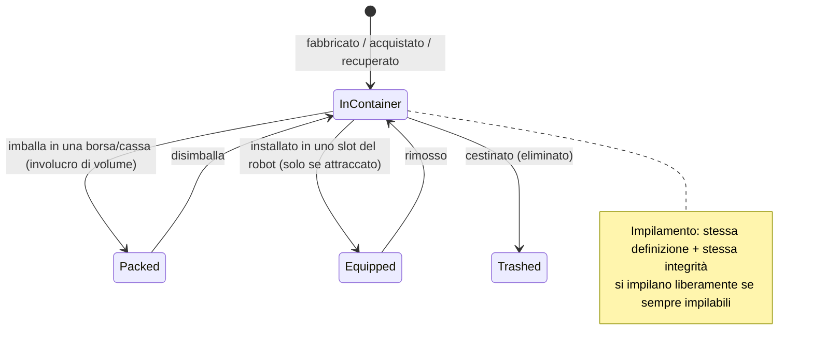

# Oggetti e inventario

Il tuo **inventario** è un insieme di **contenitori** (il contenitore pubblico della base, il
contenitore del tuo robot, borse/casse, ecc.). Questa pagina illustra come manipolare gli oggetti al loro interno.

> Le posizioni dell'interfaccia utente seguono la [panoramica dell'interfaccia utente del client](/it/features/ui/). Le meccaniche riportate di seguito sono confermate dal server.

## Contenitori

- **Elenca un contenitore** — visualizza i suoi contenuti.
- **Sposta oggetti** — sposta oggetti tra i contenitori a cui hai accesso.

Si applicano le regole di accesso: alcuni contenitori (hangar della corporazione, inventario del robot, contenitori di sistema) sono soggetti a restrizioni — vedi [robot](/it/features/robots/) e [gruppi](/it/features/groups/).

## Imballaggio e disimballaggio

- **Imballa oggetti** — inserisci gli oggetti in una borsa/cassa (un contenitore "involucro di volume") per trasportarli in modo compatto.
- **Disimballa oggetti** — estrai nuovamente gli oggetti da una borsa/cassa.

L'imballaggio è anche il modo in cui un **robot** viene compresso per lo stoccaggio/trasporto: il server rimuove il suo stato dinamico e i componenti, contrassegnandolo come *repacked* (reimballato). Un robot può essere imballato solo se è **intatto (non danneggiato)**, **non selezionato**, **non assicurato** e con un **inventario vuoto**.
Il disimballaggio ricostruisce il robot e lo ripara. Solo gli oggetti contrassegnati come *repackable* nei contenuti di gioco possono essere imballati; un robot reimballato non può essere selezionato né equipaggiato finché non viene disimballato (vedi [robot](/it/features/robots/)).

## Impilamento

Molti oggetti si impilano. Operazioni di impilamento:

- **Impila oggetti** / **impila su** / **impila selezione** — unisci oggetti dello stesso tipo in una pila (o sposta una pila su un'altra).
- **Separa una quantità** — dividi una quantità specifica da una pila.

Il server unisce solo gli oggetti che condividono la **stessa definizione e la stessa integrità**.
Gli oggetti contrassegnati come *always stackable* (minerali grezzi, munizioni, la maggior parte delle materie prime) si impilano liberamente; gli oggetti contrassegnati come *non-stackable* non si impilano mai; tutti gli altri possono essere impilati **solo se reimballati** (imballati) — pertanto, l'equipaggiamento disimballato o danneggiato rimane individuale.

## Assegnazione del nome e utilizzo

- **Rinomina un oggetto** — assegna un nome personalizzato a un oggetto.
- **Usa un oggetto** — attiva un oggetto utilizzabile (in base al contesto; in una zona questo può anche interagire con oggetti della zona — vedi [raccolta](/it/features/gathering/)).
- **Usa un oggetto lotteria** — apri/attiva un oggetto di tipo lotteria.

## Cestino e rimborsi

- **Cestina oggetti** — elimina gli oggetti (li rimuove definitivamente).
- **Rimborsa un oggetto** — una procedura di rimborso per staff/amministratori: crea l'oggetto e lo assegna a un personaggio, registrando l'operazione nel registro delle transazioni. I giocatori non possono eseguire direttamente questa operazione.

## Oggetti speciali

- **Riscattabili** — visualizza l'elenco, **riscatta** o **attiva** oggetti riscattabili (codici/concessioni).
- **Pacchetti premio (goodie packs)** — visualizza l'elenco e **riscatta** pacchetti premio (pacchetti cumulativi di oggetti).
- **Apri un regalo** — un regalo contiene un oggetto **casuale** estratto da un pool di bottino a livello di server (munizioni, minerali grezzi, plasma, kit di ricerca, moduli, capsule, vernici, booster — 221 definizioni possibili, ciascuna con il proprio intervallo di quantità).

## Note pratiche

- **L'accesso è per singolo contenitore** — puoi interagire solo con i contenitori di tua proprietà o per i quali disponi delle autorizzazioni.
- **Imballa per trasportare di più** — borse e casse ti consentono di spostare grandi quantità di oggetti in modo compatto.
- **Le pile risparmiano spazio** — unisci oggetti simili; separa la pila per prelevare esattamente ciò di cui hai bisogno.
- **L'eliminazione è permanente** — gli oggetti cestinati vanno persi definitivamente.
- **Riscattabili e pacchetti premio sono monouso** — il riscatto consuma il codice/oggetto.
- **I robot imballati sono inerti** — disimballali prima di selezionarli o equipaggiarli.
- **Solo gli oggetti imballati si impilano** — se oggetti simili non si uniscono, imballali (o riparali) prima.

<!-- TODO: only the inventory UI remains.
     Confirmed: stacking rules (Item.cs CanStackTo: same ED + same health; AttributeFlags
     alwaysStackable/nonStackable; others must be repackaged); pack rules (ItemPacker.cs:
     robot must be undamaged, not selected, not insured, empty inventory; repackable
     flag); unpack rebuilds + repairs (ItemUnpacker.cs); gifts = random draw from
     giftloots (221 defs: ammo x1500-2000, epriton/fluxore x600-1000, reactor plasma
     x10-20k, research kits, paints, capsules, named3 modules, boosters, respec tokens);
     goodie packs are campaign-based (GoodiePackRedeem: campaignID + indy selection);
     ReimburseItem = admin tool (opp_reimburselog). AttributeFlags bit positions:
     nonStackable=10, alwaysStackable=11, repackable, consumable=24, deployable=23.
     Developer notes: ListContainer.cs; RelocateItems.cs; PackItems.cs / UnpackItems.cs;
     StackTo.cs / StackSelection.cs / UnstackAmount.cs; SetItemName.cs; UseItem.cs /
     UseLotteryItem.cs; TrashItems.cs; ReimburseItem.cs (PbsReimburseRequestHander.cs);
     RedeemableItemList.cs / RedeemableItemRedeem.cs / RedeemableItemActivate.cs;
     GoodiePackList.cs / GoodiePackRedeem.cs; GiftOpen.cs. Container access:
     ContainerAccess / ContainerAccessChecker.cs. -->