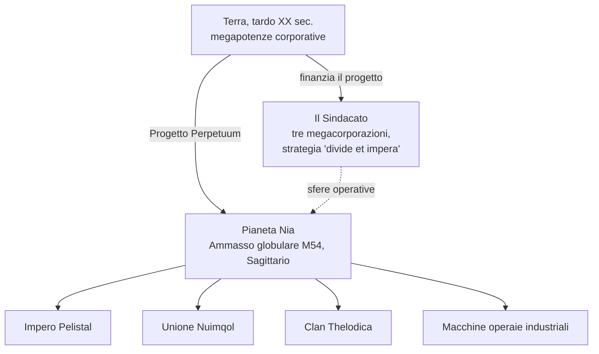

# Lore

## La scoperta di Nia

Il boom tecnologico terrestre di fine XX secolo — internet, l'integrazione informatica medica, la ricerca spaziale — abbatté le antiche frontiere fisiche e mentali. Le comunicazioni e il commercio divennero sempre più veloci ed economici, e le grandi corporazioni si trasformarono nei governi de facto delle rispettive regioni.

In quel contesto si inserì la scoperta del **pianeta Nia**, situato nell'ammasso globulare M54 del Sagittario (da cui deriva il logo del progetto). Nia orbita attorno a una stella facente parte di un sistema binario — ed è il quarto pianeta della coppia — presentando caratteristiche sorprendentemente simili alla Terra: temperatura media superficiale di circa 19 °C e densità atmosferica quasi identica a quella terrestre. Due particolarità lo contraddistinguono: i suoi oceani costituiscono barriere invalicabili per qualsiasi dispositivo a propulsione elettrica — il nucleo denso e la rapida rotazione del pianeta li mantengono perennemente carichi di energia — e appena il 17% circa della superficie è costituito da terre emerse, costantemente frammentate in isole da una rapida tettonica a zolle. Su queste terre, la vita prospera.

## I Niani

Gli abitanti di Nia sovvertono il consueto concetto di "forma di vita": si tratta di una specie sintetica, simile ai nostri robot nella forma, ma organizzata in **società** tecnologicamente avanzate e distinte — ciascuna dotata di una propria industria, apparato militare e cultura. Il traguardo che più interessa a una Terra assetata di energia è la loro **tecnologia di produzione energetica**.

Tre razze aliene lottano per il dominio definitivo lungo le catene di isole dei rispettivi territori — l'**Impero Pelistal**, l'**Unione Nuimqol** e il **Clan Thelodica** — con una popolazione dispersa di macchine operaie **Industriali** nel mezzo (questi sono gli stessi quattro gruppi che incontri come [NPC](/it/features/npcs/)).

## Il Sindacato

Il principale investitore del Progetto Perpetuum è il **Sindacato** (The Syndicate) — un'alleanza delle tre più potenti megacorporazioni terrestri, ciascuna operante nella propria sfera operativa sulla superficie:

| Corporazione | Territorio |
|---|---|
| **Truhold-Markson** | Colosso nordamericano dei beni di consumo; in espansione nel decadente dominio dei **Pelistal**. |
| **ICS — Institute of Corporate Security** | Associazione euro-russa; operativa all'interno del territorio ribelle dei **Nuimqol**. |
| **Asintec** | Egemone industriale asiatico affiancato dai partner ad alta tecnologia; impegnato in un'offensiva su larga scala contro il **Clan Thelodica**. |

La strategia è il classico *divide et impera*: mantenere in equilibrio le tre sfere contrapposte spinge le potenze aliene a farsi la guerra a vicenda anziché unirsi. Gli "Agenti" umani operano sulla superficie — raccogliendo le risorse energetiche dei Niani, studiandone le tecnologie e presidiando la pace voluta dal Sindacato.

È qui che entri in gioco tu.

<!--
Note per gli sviluppatori: riscritto nel 2026 in prosa originale basata sull'ambientazione canonica.
Una versione precedente era stata adattata dal wiki comunitario di Open Perpetuum
(perpetuum.miraheze.org: Discovery of Nia, Nia, Syndicate); quel testo è stato interamente
sostituito e non riutilizzato.
Coerenza con il backend: le tre razze aliene + Industrial corrispondono alle razze degli NPC
(vedi /it/features/npcs/); i nomi delle corporazioni corrispondono alle abbreviazioni delle zone
(zone_ICS, zone_ASI, zone_TM — le zone di classe beta in /zones/ prendono il nome dalle loro megacorporazioni).
-->
