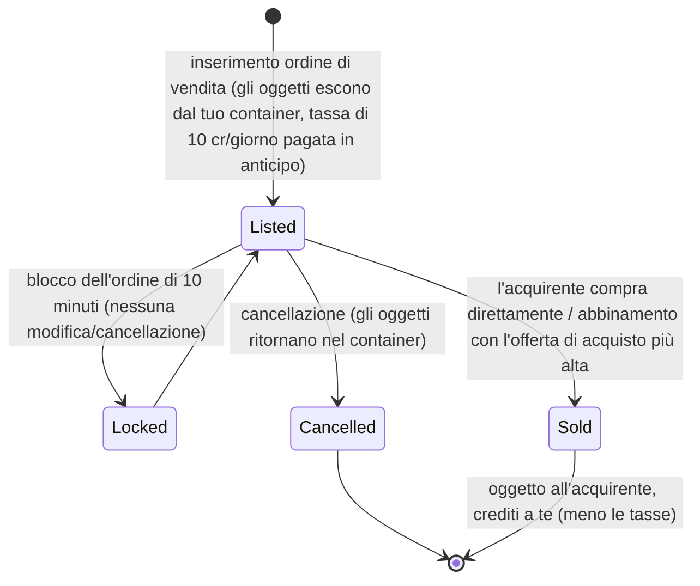

# Mercato e scambi

Il **mercato** è il luogo in cui si acquistano e si vendono oggetti presso una base. Tutte le azioni di mercato sono
**esclusive delle basi** (fai trading nella base in cui sei attraccato).

> La posizione degli elementi dell'interfaccia fa riferimento alla [panoramica dell'interfaccia client](/it/features/ui/) (la categoria **Market** nella barra superiore).
> Le meccaniche descritte di seguito sono state verificate lato server.

## Ordini di mercato

Presso il mercato della tua base attuale puoi inserire due tipi di ordini:

### Ordini di vendita
Metti in vendita degli oggetti.
- Scegli l'**oggetto**, la **quantità**, il **prezzo unitario** e la **durata** in giorni
  (minimo 1).
- L'oggetto viene prelevato dal tuo container (viene separato dallo stack se stai vendendo solo una parte di esso).
- **Tassa di inserimento** — paghi `10 crediti × durata` in anticipo (riducibile tramite
  l'estensione *market transaction fee*); la commissione viene versata alla banca centrale della base (pool di profitto di zona).
- **Protezione del prezzo (Price guard)** — se abilitata, il tuo prezzo deve rientrare entro un intervallo del **±30%** rispetto al
  **prezzo medio a 14 giorni** dell'oggetto; i prezzi al di fuori di questa fascia vengono rifiutati. *(Questa protezione è
  attualmente **disabilitata** su questo server.)*
- **Blocco dell'ordine** — un ordine non può essere modificato o cancellato per **10 minuti** dopo
  essere stato inserito.
- **Limite ordini** — puoi mantenere aperti 1 + (estensione *market sellorder expert*) ordini di vendita
  (gli ordini di acquisto hanno un proprio contatore separato).
- **Per la mia corporazione** — puoi limitare un ordine di vendita ai soli membri della tua corporazione
  (valido solo per le corporazioni non predefinite).
- Paga dal tuo portafoglio **personale** o da quello della **corporazione**, a seconda dei casi.

### Ordini di acquisto
Piazza un ordine permanente per acquistare un oggetto a un determinato prezzo.
- Il mercato lo soddisfa non appena compare una vendita corrispondente.

### Gestione degli ordini
- **Modifica un ordine** — cambia prezzo, quantità o durata.
- **Annulla un oggetto / ordine** — ritiralo (l'oggetto torna nel tuo container).
- **I miei oggetti** — visualizza i tuoi ordini aperti.
- **Abbinamento con l'offerta di acquisto più alta** — una vendita può essere instradata verso un ordine di acquisto esistente.

## Acquisto diretto

- **Compra un oggetto** — acquista istantaneamente un oggetto presente sul mercato (senza creare un ordine permanente).

## Esplorare il mercato

- **Elenco oggetti / oggetti disponibili / oggetti nel raggio d'azione** — consulta ciò che è in vendita.
- **Informazioni sul mercato** — dettagli sul mercato della base.
- **Prezzi medi** — media di mercato, media per definizione e media **globale**.
  La protezione del prezzo si basa su questi valori.

## Tassa di mercato

- **Modifica tassa di mercato** — imposta l'aliquota fiscale sul mercato. Solo i **mercati delle basi PBS**
  sono controllati dai giocatori; ovunque altrove si applica il valore predefinito fisso.
- **Registro delle tasse** — consulta la cronologia delle modifiche fiscali.

L'imposta viene detratta da ciò che il **venditore** riceve dalla vendita sul mercato. L'aliquota predefinita è del
**12%** (il venditore riceve l'88% del prezzo di vendita); la percentuale può essere ridotta tramite l'estensione *market
transaction tax* e, sui mercati controllati dai giocatori, dal proprietario della base PBS impostando
un'aliquota personalizzata.

## Scambi diretti tra giocatori

Uno **scambio (trade)** è una transazione peer-to-peer tra due personaggi attraccati nella stessa base:

- **Inizia uno scambio** — avvia una sessione con un altro giocatore.
- **Imposta / ritira la mia offerta** — inserisci oggetti o crediti dalla tua parte.
- **Accetta** — entrambe le parti devono accettare per completare lo scambio in modo atomico.
- **Annulla** — interrompi lo scambio.
- **Scambio completato / stato** — notifica di completamento e stato attuale.

Un personaggio può **bloccare gli scambi** su se stesso (consulta la [guida introduttiva](/it/features/getting-started/)).

## Il negozio di oggetti

L'**item shop** è un venditore a prezzo fisso presente nelle basi (non gestito dai giocatori). Il catalogo
completo (ogni oggetto, quantità, prezzo per valuta e requisito di reputazione) è riportato nella sezione
[Negozio di oggetti](/content/shop/).

- **Elenco** — visualizza gli articoli venduti dal negozio.
- **Acquista** — compra un oggetto in cambio di crediti.

## Trasferimento di crediti

- **Trasferisci crediti** tra i tuoi personaggi (consulta la [guida introduttiva](/it/features/getting-started/)).

## Note pratiche

- **Tutto richiede di essere attraccati** — non è possibile commerciare all'interno di una zona all'aperto.
- **Tieni conto della tassa del 12% nei tuoi prezzi** — di default i venditori ricevono l'88% del prezzo indicato
  (meno sui mercati PBS con imposte più elevate).
- **La tassa di inserimento si paga in anticipo** — un'inserzione di lunga durata costa di più anche se l'oggetto viene venduto
  il primo giorno.
- **Gli ordini riservati alla corporazione** sono un ottimo metodo per spostare beni all'interno della propria corporazione senza esporli pubblicamente.
- **Gli scambi sono atomici** — entrambe le parti devono confermare, altrimenti nessun bene viene trasferito.
- **Le tasse incidono sul costo effettivo** — calcola sempre la tassa di mercato quando definisci i tuoi prezzi.

<!-- TODO: only the client UI remains (market and trade screen flows).
     Confirmed: MarketInfoService(0.3, 10, false) registered in
     PerpetuumBootstrapper.cs -> margin +-30% vs 14-day average (MARKET_AVERAGE_DAYSBACK
     14), fee 10 credits/day (Market.MARKET_FEE), CheckAveragePrice=false on this
     server; DEFAULT_MARKET_TAX = 0.12 (seller gets 88%), player-controlled tax only on
     PBSDockingBase markets (MarketTaxHelper); order modify/cancel locked 10 min after
     submit (MARKET_CANCEL_TIME); order count = 1 + expert extension bonus;
     fee paid up front to the base's central bank. -->
     Developer notes: Markets/MarketCreateSellOrder.cs (docked, price guard vs average
     price, corp-only, unstack, corp wallet), MarketCreateBuyOrder.cs,
     MarketModifyOrder.cs, MarketCancelItem.cs, MarketBuyItem.cs, MarketItemList.cs,
     MarketAvailableItems.cs, MarketItemsInRange.cs, MarketGetMyItems.cs,
     MarketGetAveragePrices.cs / MarketGetDefinitionAveragePrice.cs /
     MarketGlobalAveragePrices.cs, MarketTaxChange.cs / MarketTaxLogList.cs;
     Trade*.cs (begin/offer/accept/cancel, atomic); ItemShopList.cs / ItemShopBuy.cs;
     CharacterTransferCredit.cs. -->