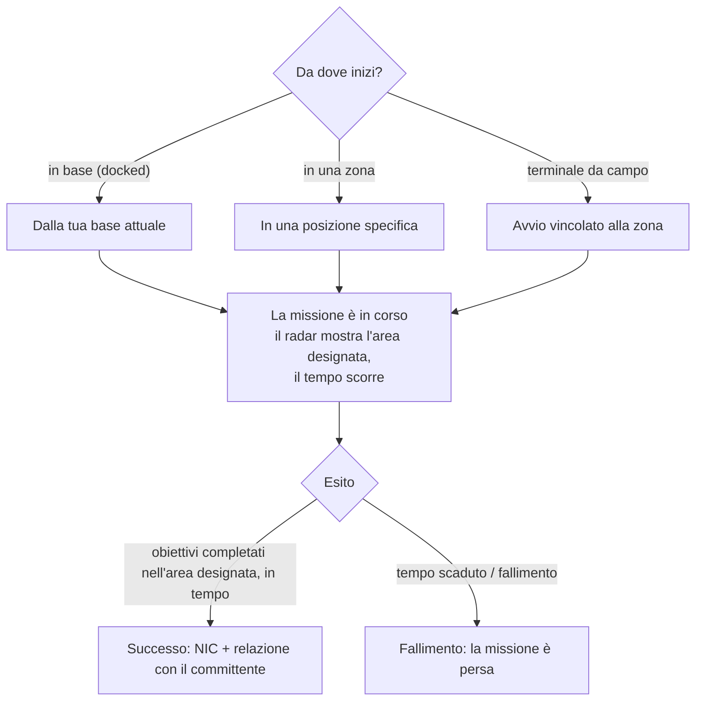

# Missioni

Le **missioni** sono obiettivi strutturati da intraprendere in una zona: consegnare oggetti, colpire bersagli,
utilizzare strutture. Rappresentano il modo principale per progredire, ottenere ricompense e attivare molti contenuti di zona
(allarmi, chioschi e alcuni hook per PBS/trasporti sono legati alle missioni).

> Le posizioni dell'interfaccia utente seguono la [panoramica della UI del client](/it/features/ui/). Le meccaniche descritte di seguito sono confermate a livello di server.

## Avviare una missione

Si avvia una missione scegliendo una **categoria** e un **livello** (i livelli sono vincolati entro un
intervallo valido), presso una specifica **posizione**:

- Se sei **attraccato alla base (docked)**, la missione parte dalla posizione della tua base attuale.
- Se ti trovi **in una zona**, specifichi la posizione direttamente.
- Le missioni possono anche iniziare **da una zona** direttamente (avvio vincolato alla zona) o **da un terminale
  da campo (field terminal)**.

Non tutte le categorie/livelli sono disponibili ovunque: la disponibilità dipende dai contenuti. L'elenco
completo delle missioni (tipo, categoria, livello, durata, ricompensa in crediti e oggetti ricompensa)
è generato in [Missions](/content/missions/).

## A cosa servono le missioni

Le missioni assolvono a due scopi contemporaneamente: ricompensano con NIC e migliorano la tua **relazione**
con la corporazione che ha emesso l'incarico (committente). Una relazione migliore è un fattore chiave per
ottenere un **rapporto delle strutture più vantaggioso (higher facility ratio)** presso i terminali di quella corporazione: i cicli di produzione e l'uso di altre strutture diventano più economici e veloci. Le relazioni possono anche *diminuire*: alcune
missioni entrano in conflitto con gli interessi di un'altra corporazione, e il briefing indica chiaramente quando ciò
comporterà una perdita di reputazione.

- **Missioni di addestramento (Training)** — semplici, pensate per le reclute; completale tutte, le ricompense
  rappresentano un ottimo aiuto iniziale.
- **Missioni regolari** disponibili in tre varianti:
  - *Combattimento* — ricognizione (scansione di robot nemici), caccia alle taglie (eliminazione di bersagli in un
    cerchio designato), distruzione e recupero (uccidi + recupera + consegna), ricognizione e recupero, taglie speciali
    (bersagli difficili da raggiungere).
  - *Industria* — geologia (scansione di un minerale con la carica corretta), raccolta (harvesting), estrazione mineraria,
    estrazione avanzata (siti di scavo sorvegliati — porta supporto armato).
  - *Logistica* — trasporto (consegna di un carico tra terminali) e recupero
    (un carico voluminoso attraverso terreni pericolosi — scorta richiesta).
- Non esiste una **missione sicura**: se vedi nemici lungo il tragitto e
  non disponi dell'equipaggiamento per difenderti, chiedi aiuto prima di perdere tutto lungo la strada.
- **Gli obiettivi contano solo nell'area designata** — la mappa della missione la evidenzia con un
  cerchio rosso sul radar; uccisioni e scansioni effettuate altrove non hanno alcun valore. Lascia scadere il tempo
  e la missione fallirà all'istante.
- **Contratti di trasporto privati** — un sistema gestito dal Syndicate (seconda scheda della finestra delle
  missioni) in cui i giocatori depositano container affinché altri giocatori li trasportino tra i terminali,
  con una ricompensa prestabilita e una **cauzione (collateral)** versata dal trasportatore (rimborsata in caso di successo, persa se
  il container viene distrutto; annullare a metà percorso rimborsa solo la metà). Mantieni i container
  sufficientemente piccoli affinché qualcuno possa effettivamente trasportarli.

## Dati e opzioni della missione

- **Dati missione (Mission data)** — dettagli di una missione.
- **Opzioni missione (Mission options)** — scelte/varianti disponibili per una missione.
- **Forniture missione (Mission supply)** — le scorte e forniture previste dalla missione.
- **Oggetti iniziali (Start items)** — gli oggetti forniti all'avvio della missione.

## Gestione di una missione

- **Elenco missioni attive (List running missions)** — le missioni attualmente in corso.
- **Annulla (Abort)** — interrompe una missione in corso.
- **Aggiungi un partecipante (Add a participant)** — include un altro personaggio nella missione (missioni multigiocatore).
- **Registro missione (Mission log)** — il registro eventi della missione.

## Consegna

- **Consegna (Deliver)** — completa un obiettivo di consegna. Può essere effettuata **in base (docked)**
  o **in una zona** (presso una posizione/eid specifica), a seconda della missione.

## Agenti

- **Elenco agenti (List agents)** — gli agenti di missione disponibili (NPC/fazioni che assegnano missioni).

## Terminali da campo

- **Informazioni terminale da campo (Field terminal info)** — ispezione di un terminale da campo in una zona (una struttura in grado di avviare
  o gestire missioni).

## Note pratiche

- **Le missioni sono il tessuto connettivo del mondo** — allarmi, chioschi e alcune strutture sono
  oggetti di missione (vedi [raccolta](/it/features/gathering/) e [combattimento](/it/features/combat/)).
- **Multigiocatore** — puoi aggiungere partecipanti per cooperare a una missione.
- **Il contesto di consegna è fondamentale** — alcune consegne richiedono di essere attraccati in base, altre richiedono di trovarsi in una
  posizione specifica nella zona.
- **Il livello viene normalizzato** — richiedere un livello fuori dall'intervallo valido viene corretto automaticamente, non genera un errore.
- **L'annullamento è la tua via d'uscita** — se una missione volge al peggio, annullala.

## Strutture di missione

Le missioni sono ancorate nelle zone attraverso delle **strutture**. Il server implementa le seguenti tipologie:

| Struttura | Funzione |
|---|---|
| **Interruttore semplice (Simple switch)** | interazione istantanea — avvicinati e l'obiettivo di missione viene completato |
| **Interruttore d'allarme (Alarm switch)** | un compito a tempo — rimani nel raggio d'azione per un periodo (definito dalle opzioni della missione), verificato ogni 2 s |
| **Fornitura oggetti (Item supply)** | a tempo come l'interruttore d'allarme, poi **genera gli oggetti direttamente nel container del tuo robot** |
| **Chiosco (Kiosk)** | un punto di **consegna oggetti** — consegna alla missione gli oggetti richiesti |

<!-- TODO: the full mission list, categories, level ranges and rewards are generated at
     /content/missions/. Verified: mission structure types
     (MissionEngine/MissionStructures: SimpleSwitch, AlarmSwitch, ItemSupply, Kiosk);
     verify the mission UI.
     Developer notes: Missions/MissionStart.cs (category, level clamp, docked vs zone
     location), Missions/MissionDeliver.cs (docked vs zone delivery), MissionAbort.cs,
     MissionData.cs / MissionGetOptions.cs / MissionGetSupply.cs / MissionStartItems.cs,
     MissionListRunning.cs / MissionListAgents.cs / MissionLogList.cs,
     MissionPlayerAddsParticipant.cs, FieldTerminalInfo.cs, MissionStartFromZone.cs;
     Services/MissionEngine/* (MissionProcessor, mission structures incl. AlarmSwitch,
     Kiosk). -->