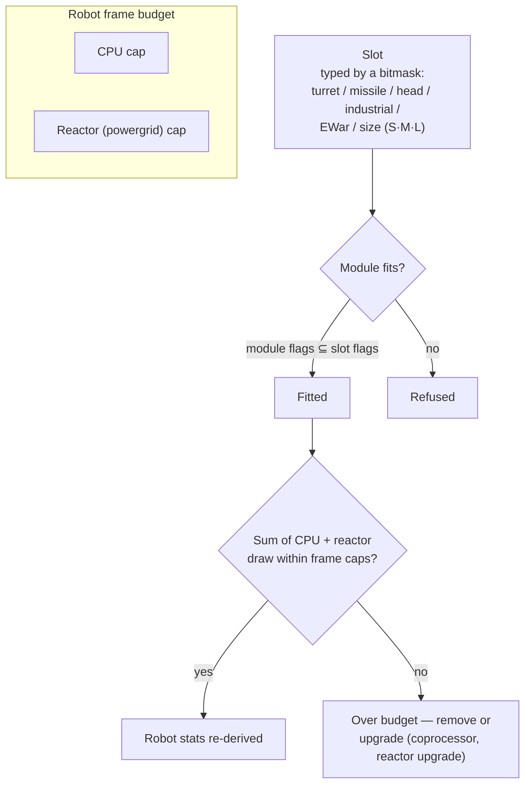

# Moduli e fitting

"Comprare un robot ti fornisce solo lo chassis." Equipaggiarlo con i moduli è il passaggio in cui un robot diventa esattamente ciò di cui hai bisogno. Con *fitting* (o allestimento) si intendono sia la configurazione dei moduli ("inviami il tuo fitting"), sia il budget di CPU e reattore che essa consuma.

## Slot e risorse

Il telaio di un robot dispone di un set fisso di **slot**, definiti dal suo chassis. Ogni slot è tipizzato da una maschera di bit (bitmask) — torretta, lanciamissili, testa, industriale, EWar/ingegneria, dimensione (small / medium / large) — e un modulo può essere alloggiato in uno slot solo quando la propria maschera di tipo è un sottoinsieme di quella dello slot. Di conseguenza, uno slot torretta su un caster accetta moduli torretta small, medium *o* large, ma nessun lanciamissili potrà mai essere inserito in uno slot torretta. I moduli per la testa (coprocessori, moduli di tuning) e quelli per chassis/gambe (piastre, frame) occupano i rispettivi slot dedicati.

Ogni modulo assorbe **CPU** e **reattore** (powergrid) dal telaio: la somma di tutto ciò che viene equipaggiato deve rimanere al di sotto di entrambi i limiti, e alcuni moduli consumano inoltre **accumulatore** (core) per ciclo. La capacità rimanente rappresenta l'*output disponibile* mostrato nella finestra di fitting. Scala approssimativa degli chassis (esempi T1/T2/T3):

| Classe telaio | CPU | Reattore | Esempio |
|---|---:|---:|---|
| Small crawler | ~250 | ~140 | Castel |
| Light mech | ~480 | ~300 | Waspish |
| Heavy mech | ~1 100 | ~1 000 | Tyrannos |
| Walker | ~3 200+ | ~1 100+ | Gropho |

Quando sei a corto di capacità: **CPU** — moduli coprocessore (ad es. il coprocessore T3 conferisce +20% di CPU) o varianti di moduli T2 (consumo inferiore). **Reattore** — potenziamenti del reattore (ad es. il T3 fornisce +20% di output al reattore) o sigillatura del reattore (riduce le radiazioni, proteggendoti anche da EnWar — vedi sotto).

## Le famiglie di moduli

I valori specifici per modello si trovano nel [catalogo degli oggetti](/content/) e nel [riferimento dei formati](/it/formats/); questa è la mappa delle famiglie.

### Armi e munizioni

Quattro tecnologie di armi, ciascuna con il proprio profilo di munizioni e distanza:

| Arma | Munizioni | Profilo di distanza | Note |
|---|---|---|---|
| **Armi da fuoco** | Proiettili | Tiro ottimale ravvicinato, falloff enorme | Proiettili che *non mancano mai il bersaglio* — ma la loro "precisione" funziona come un raggio d'area, quindi i bersagli piccoli subiscono comunque danni ridotti a causa della dispersione. |
| **Magnetiche (railgun)** | Slug | Medio raggio, falloff netto | Elevata velocità d'impatto; alto consumo energetico. |
| **Laser** | Celle energetiche | Lungo raggio | I più esigenti in termini di energia; raggi concentrati. |
| **Missili** | Missili | Lungo raggio | Il colpo a segno o mancato è determinato dalla statistica di hit-chance del *robot*, non dalla distanza. Il danno scala in base alle dimensioni del bersaglio rispetto al raggio dell'esplosione: i missili grandi contro bersagli piccoli infliggono molti meno danni. |

Il danno decresce con la distanza secondo una curva cosinusoidale uniforme: danno pieno alla distanza ottimale, zero a distanza ottimale + falloff (vedi [decadimento del danno](/it/features/combat/#tipi-di-danno)).

Le munizioni consentono di calibrare il danno: i tipi di danno primario + secondario permettono una regolazione fine contro un bersaglio specifico (vedi [tipi di danno](/it/features/combat/#tipi-di-danno)) — al costo di una leggera riduzione del danno totale rispetto alle munizioni puramente primarie.

Le torrette sono disponibili nelle dimensioni small/medium/large; **adatta la dimensione al robot** (i bot piccoli usano moduli small, i mech e gli heavy usano medium/large).

### Difesa

- **Piastre di corazza** — il pool principale di punti ferita; quando la corazza scende a zero, il robot esplode. Le piastre **LWF** (lightweight frame) sacrificano la resistenza a favore della velocità: una piastra LWF T2 moltiplica la corazza per ~0,73 ma conferisce +19% di velocità, −0,2 alla segnatura e −0,2 alla massa.
- **Generatore di scudi** — una barriera alimentata dall'accumulatore che assorbe i danni prima della corazza. Lo scudo consuma il *tuo stesso core* per assorbire i colpi: un impatto che infliggerebbe 100 danni su uno scudo 2× consuma 50 punti core anziché 100 punti corazza. Mentre lo scudo è attivo, le tue armi non possono fare fuoco. L'efficacia dell'assorbimento scala con il raggio dello scudo rispetto alla tua segnatura: gli scudi grandi su telai piccoli offrono le migliori prestazioni.
- **Riparazione corazza** — moduli di riparazione attiva (small/medium/large); la **riparazione corazza remota** raggiunge un bersaglio agganciato (alleati o una PBS), ma presenta un raggio d'azione ridotto e un ciclo più lungo.
- **Rinforzi corazza** — punti di resistenza passiva suddivisi per tipo di danno (varianti chimico / cinetico / termico / esplosivo).
- **Lega adattiva** — un modulo passivo che *apprende* la combinazione di danni subiti e ridistribuisce un pool fisso di punti di resistenza verso il tipo di danno da cui sei stato colpito maggiormente.
- **Evasione / manovra** — i moduli di riduzione della segnatura e NEXUS (vedi sotto) rendono il bersaglio più piccolo: meno danni da effetti ad area e maggiore difficoltà di aggancio.

### Energia

- **Reattore** — il limite di output sostenuto; i potenziamenti del reattore lo aumentano, mentre la sigillatura del reattore riduce le radiazioni (meno danni EnWar subiti, a fronte di un piccolo costo in termini di reattore).
- **Accumulatore (core)** — la riserva di energia di burst che alimenta i cicli dei moduli. Si ricarica nel tempo (`core_recharge_time` del telaio, ~120 ms su un crawler T1); i **ricaricatori di accumulatore** velocizzano la ricarica.
- **Iniettori di energia (core booster)** — consumano una carica per ripristinare istantaneamente l'accumulatore.
- **Trasferitori di energia** — trasmettono core dal tuo robot a un alleato agganciato (i giocatori non possono trasferirlo agli NPC).

### Elettronica

- **Potenziatore sensori (sensor booster)** — passivo, su se stessi: riduce il tempo di aggancio ed estende la portata dell'aggancio.
- **Potenziatore sensori remoto** — attivo, su bersaglio: applica lo stesso potenziamento a un alleato agganciato per ~10,5 s.
- **Coprocessori** — aumentano il limite di CPU del telaio (T1 +10% … T3 +20%).
- **Stabilizzatori d'arma** — migliorano la precisione dell'arma (riducendo il raggio dell'area effettiva) e limano leggermente la massa.
- **Moduli di tuning** (slot testa) — bonus fissi a specifiche famiglie: mod di danno (+25% di danno per famiglia di armi a livello T3), potenziamenti di estrazione (+10% a estrazione e raccolta a livello T3), potenziamenti di riparazione corazza (+16% riparazione, −8% ciclo a livello T3).

### Guerra Elettronica (EWar)

Rendi il nemico cieco e sordo:

- **Smorzatore sensori (sensor dampener)** — debuff a distanza: allunga il tempo di aggancio del bersaglio e ne riduce la portata di aggancio per ~5,5 s. Ha effetto solo se la tua potenza ECM supera la potenza dei sensori (randomizzata) del bersaglio.
- **Disturbatore sensori (sensor jammer)** — istantaneo: azzera *tutti* gli agganci del bersaglio in caso di controllo ECM riuscito.
- **ECCM** — buff personale per 20 s: aumenta la potenza dei sensori e la resistenza agli agganci, e *rimuove* i debuff vulnerabili a ECM (dampener, ragnatele/web).
- **Neuralyzer** — azzera gli agganci di **ogni** giocatore entro un raggio di ~1,65 km. Un pulsante antipanico.

Contromisure: potenza dei sensori (telaio), ECCM e mantenimento della distanza.

### Furtività e rilevamento

- **Modulo stealth** — ~10,5 s di occultamento; il consumo scala in base al raggio della tua segnatura (telaio più grande, consumo di core più rapido).
- **Target painter** — debuff di ~10,5 s che annulla la forza di occultamento del bersaglio.
- **Modulo di rilevamento** — potenziamento passivo alla tua capacità di rilevamento.

Il confronto tra forza di rilevamento e forza di occultamento determina se sia possibile vedere (e agganciare) o meno un bersaglio occultato — vedi [rilevamento e mascheramento](/it/features/combat/#rilevamento-mascheramento-e-velocita).

### Guerra Energetica (EnWar)

Drena o azzera l'energia del nemico:

- **Drenatori (vampiri di energia)** — sottraggono core da un bersaglio agganciato e lo trasferiscono al tuo accumulatore.
- **Neutralizzatori** — identici, ma il core drenato viene distrutto.
- Entrambi sono indeboliti dalla **radiazione del reattore** del bersaglio — la sigillatura rappresenta un'ottima contromisura.
- **Demobilizzatori (web)** — riduzione della velocità del bersaglio per ~5,5 s; l'effetto scala con la massa del bersaglio (i telai pesanti vengono rallentati di meno) e fallisce contro bersagli al di fuori della portata ottimale del modulo.
- **Scorcher** — un'arma elettrica che *concatena* fino a 5 bersagli, colpendo scudi e corazza con danno penetrante.

### Industriale

- **Trivellatrici** (small / large) ed **estrattori/harvester** (small / large) — i moduli di raccolta; resa, tempo di ciclo e consumo dell'accumulatore sono le statistiche fondamentali. L'estrazione mineraria conferisce EP (con un tetto giornaliero e una penalità per lo stato liquido).
- **Geoscanner** — analizza il giacimento minerario circostante con la precisione della sonda; il risultato è una mappa di ciò che si trova nel sottosuolo (vedi [raccolta](/it/features/gathering/)).
- **Escavatore** — modulo ad aura: aumenta la resa di estrazione/raccolta delle unità vicine (T3: +50%) al costo dell'occultamento.
- **Terraformazione** (zone gamma) — blocchi di terreno che sollevano, abbassano o livellano il suolo (raggio massimo 5 m) e fanno crescere piante barriera; consulta la [sezione zone](/zones/zone-gamma-z106/).
- **Controller remoti** — torrette e droni al guinzaglio: ogni modulo controller gestisce una larghezza di banda (quantità gestibile), un raggio operativo e una durata del drone (5–10 min a seconda del tier). Varianti: tattico (danno/ciclo), assalto (danno), supporto (riparazione remota), industriale (droni da estrazione/raccolta), cacciatore. Un modulo **traslatore di comando remoto** amplifica il danno dei droni, la corazza, la resa di estrazione e l'output di riparazione (T3: +7,5% ciascuno) e può estendere la larghezza di banda del controller.

### NEXUS

Networked Extension Utilization Systems: **buff di squadra**. Un modulo NEXUS emette un'aura attorno al proprio robot che potenzia i **membri della gang** (e le loro torrette/droni) all'interno del raggio dell'aura — predefinito a 10 m, rinnovabile ogni 10 s. Regole:

- un robot può gestire al massimo **3 aure NEXUS**, e al massimo **una per ciascun tipo**;
- l'aura raggiunge solo le unità appartenenti alla tua **gang**, non gli alleati generici.

L'elenco dei tipi T3 (13): velocità, corazza, scudo, farlock (portata di aggancio), potenziatore aggancio (tempo di aggancio), colpo critico, assalto (ciclo d'arma), EW (portata EWar), evasione (segnatura), riparatore, industriale (consumo di accumulatore durante la raccolta), estrattore rapido (ciclo di raccolta), ricaricatore (ricarica core). Ciascun modulo T3 conferisce circa il +7,5% alla rispettiva statistica; ad es. il NEXUS di velocità moltiplica la velocità massima per 1,075 per ogni compagno di gang entro 10 m.

### NOX

Contromisure di livello cultista: moduli **negatori** che *disabilitano* i moduli nemici all'interno del loro raggio d'azione — un **negatore di scudo** (riduce l'assorbimento dello scudo di ~90%), un **negatore di riparazione** (riduce l'output di riparazione) e un **negatore di teletrasporto** (blocca il teletrasporto). Ogni attivazione **consuma plasma** dalla tua stiva, e l'utilizzo in una zona aperta (non di addestramento) **contrassegna il tuo personaggio per il PvP**.

### Finalità speciali

- **Modulo siege hack** — lo strumento di SAP attivo: ciclo di 5 s, portata di 3 m (vedi [avamposti](/it/features/outposts/)).
- **Autodistruzione** — attiva un conto alla rovescia di 8 secondi; il raggio è visibile per 600 m. Soluzione di pulizia come ultima risorsa.
- **Rilevatore di mine** — estende il raggio di rilevamento delle mine del telaio.
- **Emettitori di blob** — schierano un emettitore che genera un campo blob; il modulo modulatore di emissione calibra il campo (vedi [combattimento](/it/features/combat/)).
- **Costruzione PBS** — il modulo utilizzato per piazzare strutture PBS nelle zone gamma.

## Regole generali

1. **Non mischiare le armi.** Montare magnetici + laser + missili su un unico bot offre solitamente prestazioni inferiori a tutte e tre le tipologie usate singolarmente; mischiare corto e lungo raggio raramente porta a buoni risultati.
2. **Attenzione alla massa.** Ogni piastra e modulo scudo aggiunge massa e segnatura — a volte la velocità conta più della difesa.
3. **Non tentare di fare tutto.** Un bot che estrae, scansiona e spara non svolgerà nessuna di queste attività bene quanto uno specialista.
4. **Adatta le dimensioni dei moduli** a quelle del robot, e mantieni un piccolo margine di CPU/reattore per i moduli di tuning che rendono una build realmente funzionale.
5. …e sì, alcuni fitting di nicchia infrangono tutte le regole sopra citate e funzionano comunque. Basta solo pianificare con cura.

<!--
Developer notes: rewritten 2026 from backend sources; no community-wiki text reused.
Verified against:
- src/Perpetuum/Robots/RobotComponent.cs (slot bitmask fitting: moduleFlagMask & slotFlagMask)
- src/Perpetuum/Modules/SlotFlags.cs (12 slot flag bits)
- src/Perpetuum/Modules/Weapons/WeaponModule.cs + FirearmWeaponModule.cs +
  MissileWeaponModule.cs (accuracy: firearms never miss, explosion radius from
  Accuracy; missiles use ParentRobot.MissileHitChance)
- src/Perpetuum/Modules/Weapons/Damage.cs (cosine falloff, critical 1.75x +/-10%,
  explosion scaling signature/explosionRadius clamped [0,1])
- src/Perpetuum/Units/Unit.cs GetResistByDamageType (resist/(resist+100))
- src/Perpetuum/Zones/DamageProcessors/DamageProcessor.cs (shield draws core,
  electric = penetrating)
- src/Perpetuum/Modules/EffectModules/ShieldGeneratorModule.cs (absorption
  modifier = shieldRadius ratio / shieldAbsorbtion; WeaponModule.cs:112 blocks
  firing while HasShieldEffect)
- src/Perpetuum/Modules/EffectModules/{Webber,SensorDampener,SensorBooster,
  Stealth,TargetPainter,Eccm,Detection,AdaptiveAlloy}.cs (durations from
  effects table: dampener/web 5.5s, stealth/paint/remote-boost 10.5s, ECCM 20s)
- src/Perpetuum/Modules/SensorJammerModule.cs + Neuralyzer.cs (lock reset,
  NEURALYZER_RANGE=1650)
- src/Perpetuum/Modules/{EnergyVampire,EnergyNeutralizer,Scorcher,
  CoreBooster,EnergyTransferer}.cs (EnWar, reactor radiation modifier, chain)
- src/Perpetuum/Modules/GangModule.cs + Zones/Effects/GangEffect.cs +
  EntitiesModule.cs:532-544 (13 aura types, gang-members-only, effects table
  auraradius=10)
- src/Perpetuum/Modules/NoxModule.cs (plasma consumption, PvP flag)
- src/Perpetuum/Modules/RemoteControl/* (bandwidth/range/lifetime, translator
  amplification)
- entitydefaults rows: named1-3 armor plates/hardeners, shield generators
  (absorbtion 2.0-2.3, radius 5-33), LWF (mass_reductor), cpu/powergrid
  upgrades, damage/mining/repairer tuning, NEXUS named3 values, NOX cultist
  values, siege hack (5s/3m), chassis core_max/powergrid_max.
Corrections vs ingested page: NEXUS auras reach gang members only (not "all
friendly units"); no "co-reactor" module exists (reactor upgrades/sealing do
that); demobilizer effect scales with target mass, no "resistance stat";
sensor suppressor = sensor dampener (5.5s debuff).
-->