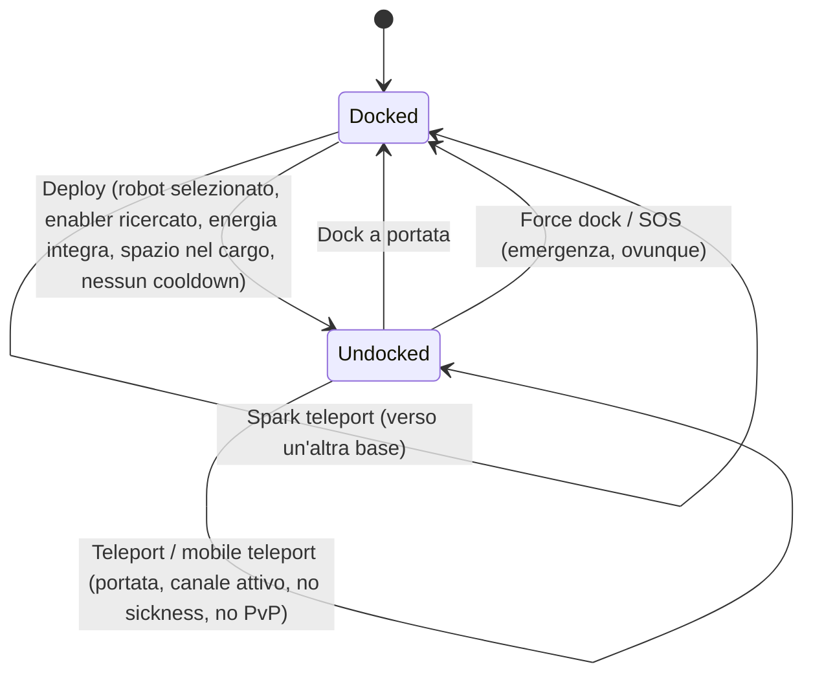

# Movimento e zone

Ti trovi sempre in uno di questi due stati: **docked** (ancorato) in una base, oppure **undocked** (disancorato) in una zona
mentre piloti da remoto il tuo robot attivo. Tutto ciò che trovi in questa pagina riguarda il passaggio tra questi stati
e lo spostamento tra le zone.

> I riferimenti all'interfaccia seguono la [panoramica dell'interfaccia client](/it/features/ui/): il **pulsante Deploy/Dock** corrisponde
> al selettore centrale nella barra superiore. Le meccaniche descritte di seguito sono verificate lato server.

## Docked vs. undocked

- **Docked** — ti trovi in una base. I tuoi robot e oggetti sono all'interno di container. Non puoi
  pilotare un robot, usare teletrasporti o scansionare, ma puoi produrre (crafting), commerciare, fare ricerca e utilizzare le
  strutture della base.
- **Undocked** — ti trovi in una zona, alla guida del tuo robot attivo. Puoi muoverti, scansionare,
  combattere e
  interagire con gli oggetti della zona, ma la maggior parte delle attività esclusive della base sono bloccate.

## Undocking (Disancoraggio)

Premi **Deploy** (al centro della barra superiore). Il server verificherà quindi tutte le seguenti condizioni:

1. Hai un **robot attivo selezionato**.
2. Il tuo personaggio ha ricercato la relativa **estensione enabler** per la classe di quel robot
   (consulta [ricerca](/it/features/research/)).
3. Il **sistema energetico** del robot è integro.
4. Il **container del robot ha spazio libero**.
5. Non sei soggetto a un **cooldown di undock** (un breve timer applicato dopo determinati eventi).

Se anche uno solo di questi controlli fallisce, l'operazione di undock viene rifiutata.

## Docking (Rientro alla base)

- **Dock** presso una base quando ti trovi entro il suo raggio di docking.
- **Force dock** è l'azione di emergenza: ti estrae immediatamente dalla zona e ti ancora alla
  base principale (TMA), anche durante il combattimento. Usala se stai perdendo uno scontro.
- **SOS** — un'azione di richiesta aiuto nella zona che ti ancora alla base corrente e segnala l'incidente.

## Coda di ingresso alla zona

Alcune zone sono affollate e utilizzano una **coda di ingresso** quando esci dalla base / effettui l'accesso:

- Controlla lo stato della coda (`zoneGetQueueInfo`).
- Imposta la lunghezza desiderata della coda (`zoneSetQueueLength`).
- Annulla l'attesa se cambi idea (`zoneCancelEnterQueue`).

## Teletrasporti

I **teletrasporti** sono strutture situate all'interno di una zona. Per utilizzarne uno:

- Devi trovarti **entro il raggio d'azione del teletrasporto**.
- Il **canale** (destinazione) deve essere **attivo** e valido.
- Non devi essere sotto l'effetto della *teleport sickness* (nausea da teletrasporto) — un breve tempo di ricarica successivo a qualsiasi teletrasporto,
  durante il quale non puoi teletrasportarti di nuovo.
- Determinati effetti (es. negazione *Nox*) o il fatto di essere **in combattimento PvP** possono bloccare i teletrasporti.

I canali di teletrasporto sono di tre tipi:

| Tipo | Effetto |
|---|---|
| **All'interno della zona** | Ti sposta in un punto casuale della stessa zona |
| **Un'altra zona** | Ti sposta in un punto casuale di una zona diversa |
| **Uscita addestramento** | Ti fa uscire da una zona di addestramento (con un'opzione per il livello di ricompensa) |

I **teletrasporti mobili** sono oggetti di teletrasporto *di proprietà* (es. teletrasporti mobili da roccaforte/mondo).
Si applicano regole aggiuntive:

- Solo il **proprietario o un membro della gang del proprietario** può utilizzarli.
- **Non possono essere utilizzati durante il PvP**.
- Ogni utilizzo applica un **tempo di ricarica** (cooldown) a quel teletrasporto.

Puoi visualizzare l'elenco dei teletrasporti e dei relativi canali, oltre a consultare i canali a livello globale.

## Spark teleport

Gli **spark teleport** sono un sistema di viaggio rapido tra basi:

- **Imposti** una destinazione spark presso una base, poi la **usi** (mentre sei docked) per saltare
  istantaneamente a un'altra base.
- Puoi **elencare, impostare, usare ed eliminare** i tuoi spark teleport.
- La base di destinazione deve **consentirti l'accesso (docking)**.
- All'arrivo, il server seleziona un robot adatto a te (uno per cui hai già ricercato
  le necessarie estensioni enabler).
- Il **numero di spark teleport che puoi memorizzare** è limitato da un'estensione
  (consulta [ricerca](/it/features/research/)); il superamento di tale limite comporterà un rifiuto.

## Portali (Gates)

I **portali** sono strutture di zona che possono essere utilizzate da qualsiasi punto (non hanno limiti di portata come
i teletrasporti). Il proprietario di una base può **rinominare** i propri portali.

## Informazioni sulla base

Puoi ispezionare qualsiasi base:

- **Info** — che cos'è e dove si trova.
- **Proprietà** — chi ne è il proprietario.
- **Strutture** — cosa offre (produzione, mercato, negozio, …).
- **I miei oggetti** — i tuoi oggetti depositati in quella base.
- **Diritti di docking** — il proprietario di una base può stabilire chi ha il permesso di attraccare.

## Possibili problemi

| Sintomo | Causa probabile |
|---|---|
| Undock rifiutato | Nessun robot attivo, estensione enabler mancante, sistema energetico danneggiato, container del robot pieno o cooldown di undock |
| Teletrasporto rifiutato | Fuori portata, canale inattivo, nausea da teletrasporto (teleport sickness), effetto Nox o in PvP |
| Teletrasporto mobile rifiutato | Non sei il proprietario né un membro della gang, oppure sei in PvP |
| Spark teleport rifiutato | La base di destinazione vieta il docking, nessun robot valido selezionabile o limite di spark teleport raggiunto |
| Bloccato all'ingresso di una zona | Coda della zona — verifica lo stato della coda o annulla l'ingresso |

<!-- TODO(Phase 1): verify client UI flow (dock/undock buttons, teleport screen).
     Developer notes: Dock.cs / Undock.cs / ForceDock.cs (TMA = baseEid 561) /
     ZoneSOS.cs; Zone/TeleportUse.cs (TeleportPlayerValidator, three
     TeleportDescriptionType strategies, mobile-teleport gang/PVP rules);
     Sparks/SparkTeleportUse.cs (docked-only, extension-count limit);
     Zone/ZoneCancelEnterQueue.cs + ZoneEnterQueueService; GateSetName.cs. -->