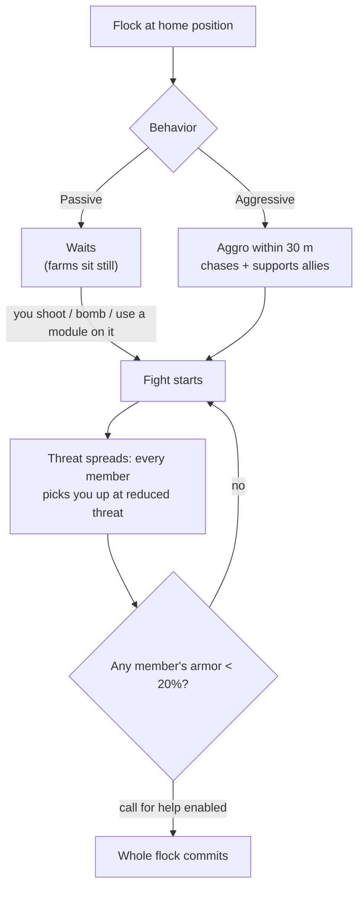

# NPC e caccia PVE

Gli NPC sono la principale fonte del gioco per il [plasma del reattore](/content/ores/),
i [kernel](/it/features/research/) e i moduli, oltre a essere un metodo affidabile per ottenere punti
estensione a qualsiasi livello. Esistono in **stormi** (*flocks*): gruppi che condividono una
posizione di origine, un raggio d'azione (*home range*), un tempo di respawn e un comportamento.

## Chi c'è là fuori

Gli NPC appartengono a quattro fazioni/razze — **Nuimqol, Pelistal, Thelodica e Industrial** —
ciascuna con diverse classi di robot (runner, crawler, mech, mech pesanti) e
gradi da 1 a 5 con statistiche e bottino crescenti. Oltre ai normali gradi:

- **Goblin** — guardie di guerra elettronica (EWar) sulle isole protette. Fragili, ma i loro
  modificatori di puntamento (*locking*) sono estremi (ti agganciano circa 5 volte più velocemente del normale, da
  una distanza circa doppia): un accampamento di goblin rende arduo combattere o estrarre risorse nelle vicinanze.
- **Elite** — rare varianti degli NPC graduati con statistiche base
  all'incirca raddoppiate e bottino migliore.
- **Observer** — NPC itineranti e aggressivi (Arbalest, Baphomet, Waspish,
  Tyrannos, Artemis, Kain, Gropho, Sequer, Seth, Mesmer…). Pattugliano ampie
  porzioni dell'isola e sono nettamente più impegnativi degli NPC graduati della
  stessa classe — i *grand observer* sulle isole protette e le loro varianti sulle isole
  aperte sono i cacciatori regolari più forti in assoluto.
- **Boss** — NPC rari e configurati individualmente. Non fuggono mai, possono
  annunciare la propria presenza a livello di intero server, e alcuni sono legati agli avamposti (ucciderli
  influenza la [stabilità dell'avamposto](/it/features/outposts/)) o generano varchi di reliquie (*relic rifts*) una volta
  sconfitti. I boss più deboli possono essere affrontati in solitaria sulle isole protette; quelli più potenti
  richiedono un gruppo dedicato.
- **Spawn del Syndicate** — una fazione speciale (il Syndicate, con i propri
  NPC nominati) che gestisce le proprie farm statiche, di solito su isole protette e
  isole aperte a bassa pericolosità.

## Passivi vs aggressivi

- Gli **stormi passivi** non attaccano mai di propria iniziativa: devi prima sparare,
  bombardare o usare un modulo attivo su di loro. La maggior parte delle farm statiche classiche è passiva.
- Gli **stormi aggressivi** entrano in aggro autonomamente quando ti trovi entro **30 m**,
  ti inseguono e supportano gli alleati impegnati in combattimento. Tutti gli Observer, la maggior parte degli spawn
  itineranti e i guardiani/invasori degli avamposti sono aggressivi.

Quando inizia uno scontro, **la minaccia (*threat*) si propaga all'intero stormo**: ogni membro
ti prende di mira a un livello di minaccia ridotto, e se la corazza di un qualsiasi membro scende sotto il **20%**,
l'intero gruppo si focalizza su di te (per gli stormi con la chiamata d'aiuto abilitata). Considera di dover
affrontare l'intero spawn nel momento stesso in cui il primo bot apre il fuoco.

## Spawn e respawn

- Gli **spawn statici** stazionano su una posizione d'origine fissa con un raggio d'azione prestabilito; i membri
  rinascono **individualmente** in base al proprio timer. Uno stormo che viene farmato
  intensamente rinasce più velocemente; uno intatto rinasce più lentamente.
- Gli **spawn itineranti** si muovono lungo l'isola: sono gli Observer e
  gli stormi di tipo convoglio, e sono solitamente aggressivi.
- **Rinforzi nei siti minerari** — gli NPC industriali al lavoro su un nodo di risorse
  dispongono di ondate di rinforzi preconfigurate: man mano che il combattimento si prolunga, ulteriori
  ondate raggiungono il nodo. Anche i boss chiamano rinforzi quando subiscono danni.
  Di conseguenza, una farm apparentemente da "un solo robot" può trasformarsi in uno scontro di gruppo; perlustra l'area prima di
  ingaggiare.

## Cosa rilasciano

Il bottino è configurato per tipo di NPC: **plasma del reattore della razza dell'isola**,
**kernel** (comuni, hitech, industriali e specifici di fazione), componenti di moduli
e, più raramente, moduli imballati. I gradi più alti e le tipologie speciali rilasciano quantità maggiori.

Ogni abbattimento conferisce inoltre **punti estensione** (EP), configurati per tipo di NPC — e
raddoppiati sulle isole aperte (di livello beta).

## Vantaggi di livello delle zone

Le isole sono suddivise in tre fasce: protette (alpha), aperte PvE (beta) e aperte
PvP (gamma). La caccia diventa più pericolosa, ma anche più remunerativa, man mano che ci si spinge
più a fondo:

- **Esplosioni alla distruzione** — sulle isole protette, la distruzione di un robot *non*
  provoca un'esplosione. Sulle isole aperte (beta e gamma), ogni robot distrutto — giocatore
  o NPC — esplode infliggendo danni ad area. Le esplosioni a catena velocizzano il
  farming e rendono i punti di gank ancora più letali.
- **EP raddoppiati** — la ricompensa base in EP di qualsiasi attività è raddoppiata sulle isole
  di livello beta.
- **Missioni migliori** — le missioni di livello più alto si trovano sulle isole aperte,
  e anche i loro EP di missione sono raddoppiati.
- **Monete missione di fazione** — le missioni sulle isole aperte ricompensano con la moneta di missione
  della rispettiva fazione (moneta Nuimqol / Pelistal / Thelodica) anziché con la moneta universale.
  Le monete di fazione possono anche essere vendute direttamente ai terminali delle isole aperte,
  mentre la moneta universale può essere acquistata dove quelle di fazione non sono disponibili.

## Note pratiche

- **Valuta lo stormo prima di ingaggiare** — conta i membri, annota i gradi e
  se lo spawn è aggressivo; una farm passiva in cui ti sei addentrato può comunque
  contare fino a cinque bot.
- **Sfrutta la gittata** — gli spawn statici rimangono all'interno del proprio raggio d'azione; posizionarsi
  per colpi puliti a lungo raggio è solitamente la strategia più economica per vincere.
- **I siti di risorse sono trappole** — a causa dei rinforzi nei siti minerari, più a lungo
  combatti, più avversari compariranno.
- **Observer in movimento** — se stai esplorando, cercando manufatti o affrontando un lungo
  trasporto, un Observer aggressivo sul tuo cammino impone uno scontro o una deviazione.

<!--
Written from scratch against the server backend, 2026-09-27:
Zones/NpcSystem/Flocks/ (Flock.cs, NormalFlock.cs — group respawns, adaptive
respawn multiplier), AI/Behaviors/ (Passive vs Aggressive; threat spread at
50%, call-for-help at 20% armor in SmartCreature.cs), AI/BodyPullThreatHelper.cs
(30 m aggro range, aggressive-only body-pull), Reinforcements/ + npcreinforcements
(mining-site and boss waves at HP thresholds), NpcSpecialType + npcbossinfo
(boss respawn noise, outpost stability links, server-wide announce),
entitydefaults (rank1-5 + dps/interceptor/scout/miniboss/elite variants, 30
elite definitions with ~2x modifiers; 13 def_npc_roaming_* observers; goblin
lancer/shark with 5x lock-time / 2x lock-range modifiers),
npcloot (26k rows: race plasma, common/hitech/industrial/race kernels,
modules), NpcEp.cs + GetNpcKillEp (EP per NPC, x2 on beta),
Unit.DoExplosion (death AoE suppressed on protected zones, active on
beta/gamma; radius from signature, damage from remaining core),
MissionLocation.cs (race-specific mission coins; universal coin on protected
zones), ZoneConfiguration (IsAlpha/IsBeta/IsGamma).
An earlier version of this page was adapted from the Open Perpetuum
community wiki (perpetuum.miraheze.org) and has been fully rewritten from
backend sources; no text was reused.
The ingested "TAP" section was dropped: no teleport-attractor concept exists
in this backend (no definition, code or table).
-->