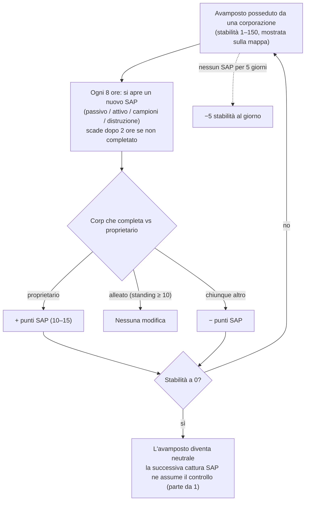

# Avamposti e SAP

Sulle isole open-PvP, **gli avamposti possono essere posseduti dalle corporazioni dei giocatori**.
Il controllo è misurato da un indicatore di **stabilità** (0–150) mostrato sopra l'avamposto
nella vista mappa. Il sistema **SAP** (Service Access Point) è il meccanismo che fa variare tale indicatore,
determinando il passaggio di proprietà degli avamposti.

## Le regole

- Quando la corporazione **proprietaria** completa un SAP, la stabilità **aumenta**
  del valore in punti del SAP.
- Quando a completarlo è una **corporazione alleata del proprietario** (standing reciproco pari a +10 o superiore),
  la stabilità **non cambia**.
- Quando a completarlo è **chiunque altro**, la stabilità **diminuisce** della
  stessa quantità.
- A **zero**, l'avamposto perde la proprietà e diventa neutrale. Completare
  qualsiasi SAP su un avamposto neutrale lo **cattura** (la corporazione che lo completa
  diventa proprietaria, partendo da una stabilità di 1).
- **Decadimento**: se non viene completato alcun SAP per **5 giorni**, l'avamposto inizia a perdere
  **5 punti di stabilità al giorno** finché non ne viene completato uno (o finché non viene perso).

## I quattro tipi di SAP

Ogni 8 ore un avamposto attiva un nuovo SAP — appartenente a una delle quattro tipologie. Ciascuna tipologia presenta
un proprio valore in punti e una specifica modalità di completamento:

| Tipo | Come si completa | Punti | Tipologia di ricompensa |
|---|---|---|---|
| **Passivo** | Rimani all'interno del raggio del SAP per **8 minuti**. Il progresso è individuale (il tempo continuo trascorso da ciascun giocatore nel raggio); chi ottiene il progresso personale più elevato ne prende il controllo. | +10 | Plasma di fazione (scala con la stabilità), kit di ricerca, booster EP. |
| **Attivo** | Aggancia il SAP e mantieni attivo un **modulo di hacking SAP** — circa 120 cicli del modulo (5 s ciascuno), ossia ~10 minuti. Il progresso si conserva se ci si ferma o ci si allontana; individuale. | +15 | Plasma, kernel, kit di ricerca e **nuclei reattore** (produzione di robot). |
| **Campioni** | Porta **oggetti campione** al SAP (entro 7 m) e consegna i 5–6 richiesti. Ogni consegna ha un tempo di ricarica di 90 secondi; il progresso è individuale. | +15 | Plasma, kernel, kit di ricerca. |
| **Distruzione** | Abbattilo: **30.000 corazza** e **150 di resistenza a tutti e quattro i tipi di danno** (riduzione del 60%), **segnatura di 6 m** — le armi piccole risultano le più efficaci. Il conteggio dei danni è **corporativo, non individuale**, quindi intere flotte possono fare fuoco contemporaneamente; la corporazione con il maggior danno inflitto alla sua distruzione applica l'esito. | ±15 | **Munizioni PvP** di fazione, plasma, kernel. |

Tutti e quattro i SAP **trasmettono i migliori punteggi attuali** (top 10) a chiunque
si trovi nelle vicinanze, e **scadono dopo 2 ore** se non vengono completati.

### Negare la cattura al nemico

Poiché il progresso del tipo Distruzione è corporativo e il segno della variazione di stabilità
dipende da chi prevale, una tattica comune consiste nel **infliggere abbastanza danni da scalare la vetta
della classifica ma senza completare il SAP**: se la corporazione proprietaria finisce per distruggerlo,
sarà comunque la *tua* corporazione a risultare vincitrice, e la variazione di stabilità
verrà sottratta al proprietario.

## Monitoraggio e previsione

- La **carica di scansione intrusioni** in un geoscanner, attivata vicino
  all'avamposto, segnala il **tempo rimanente fino al prossimo SAP** per gli avamposti nel raggio d'azione
  (sulle isole open-PvP la stessa carica segnala invece lo stato dei rinforzi NPC).
- I SAP inviano un preavviso ai giocatori vicini poco prima della loro apertura.
- La trasmissione dei migliori punteggi del SAP consente di **monitorare un SAP conteso in
  tempo reale** e decidere se intervenire per contestarlo.

## Altri fattori che influenzano la stabilità

- **Reliquie SAP** — oggetti reliquia che compaiono a una distanza di 90–350 m dall'avamposto (tempo di ricomparsa di 4 ore, durata fino a 12 ore). Attivarne una applica **immediatamente ±1 di stabilità**
  (a favore della propria corporazione), attiva lo stato PvP e assegna EP insieme a un contenitore di plasma.
- **Guardiani e invasori** — i boss NPC dell'avamposto:
  - Gli NPC **Guardiani** restano a ridosso dell'avamposto (~35 m). Ucciderne uno **riduce sempre**
    la stabilità di 3, indipendentemente da chi lo abbatte; ricompaiono dopo ~6 ore.
  - Gli NPC **Invasori** pattugliano fino a ~300 m. Ucciderne uno **aumenta** la stabilità di
    2 a favore della corporazione esecutrice; ricompaiono dopo ~6 ore.

## L'importanza degli avamposti

Possedere un avamposto garantisce alla corporazione i relativi bonus (produzione, strutture
difensive, effetti) e costituisce l'elemento portante del gioco territoriale open-PvP — consulta
la sezione [PBS](/it/features/pbs/) per scoprire le strutture che trasformano un avamposto in una vera e propria base
operativa.

<!--
Written from scratch against the server backend, 2026-09-27:
Zones/Intrusion/Outpost.cs (stability 0-150, capture at 1, ally threshold
+10, EP to participants), OutpostDecay.cs (5-day grace, -5/day), SAP.cs +
PassiveHackingSAP.cs / ActiveHackingSAP.cs / SpecimenProcessingSAP.cs /
DestructionSAP.cs (8-min passive, 120x5s active, 5-6 specimen items with 90s
cooldown, corporate destruction score, 2h expiry, top-10 broadcast),
entitydefaults options (#increase=n10/n15), siegeitems (def_specimen_sap_item
2-3 x 5-6), def_sap_destruction stats (30k armor, 150 res all types, 6m
signature), def_siege_hack_module (5s cycle), intrusionsitestabilitythreshold
+ intrusionsaps, intrusionloot (plasma/kernels/research kits/cores/PvP ammo
by stability tier), npcbossinfo + npcflock (guard -3 @ ~35m, invader +2 @
~300m, 6h respawn), OutpostRelicManager.cs + SAPRelic.cs (90-350m spawn,
4h respawn, 12h lifespan, +1 stability, PvP flag), Scanner.Intrusion.cs
(next-SAP-time scan), EntitiesModule.cs (8h SAP interval).
An earlier version of this page was adapted from the Open Perpetuum
community wiki (perpetuum.miraheze.org) and has been fully rewritten from
backend sources; no text was reused.
Note: the ingested text had several numbers this server contradicts (3-day
decay vs 5-day, 10-min passive vs 8-min, "no resistances" vs 150 all types,
3 km invader range vs 300 m).
-->