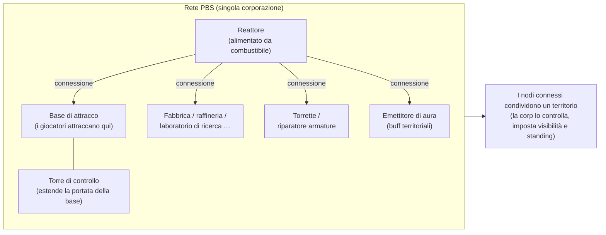
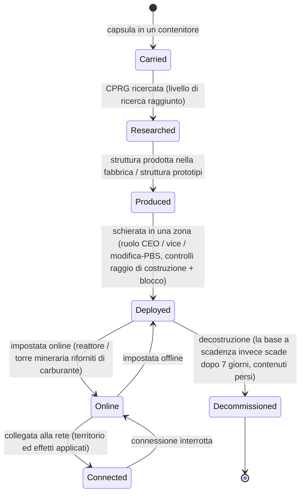

# Stazioni base energetiche (PBS)

Una **PBS** (Power Base Station) è una struttura posizionabile all'interno di una zona. Gli oggetti PBS possono essere
**connessi** in una **rete**, che definisce **territori** e attiva **effetti**.
Si tratta di un'attività di corporazione/struttura: la maggior parte delle azioni richiede il ruolo
di corporazione appropriato.

> Le posizioni dell'interfaccia utente seguono la [panoramica dell'interfaccia client](/it/features/ui/). Il nome in-game nel client per "PBS" deve
> ancora essere confermato. Le meccaniche sottostanti sono state verificate lato server.

## Cosa fa una PBS

- È un **nodo** in una **rete** PBS.
- I nodi connessi formano un **territorio** condiviso controllato dalla corporazione proprietaria.
- Una rete può proiettare **effetti** (buff/controlli) sul proprio territorio.
- Alcune strutture PBS possono essere **alimentate** con oggetti (combustibile) per funzionare.

## Famiglie di strutture

Ogni struttura PBS è disponibile nei livelli **piccolo / medio / grande** (small / medium / large). È necessario trasportare la
**capsula**, ricercare l'oggetto (CPRG) e **schierare** l'oggetto — lo schieramento è
vincolato ai permessi (vedere sotto). Le famiglie:

| Famiglia | Strutture | Ruolo |
|---|---|---|
| Energia | reattore, pozzo di energia, batteria centrale, trasmettitore centrale | generano, immagazzinano e distribuiscono l'**energia del nucleo** necessaria per tutto |
| Attracco | base di attracco, base di attracco a scadenza, torre di controllo | punto di attracco per i giocatori; la torre di controllo estende la portata della base |
| Produzione | fabbrica, raffineria, riprocessore, riparazione, prototipatore, laboratorio di ricerca, forgia di calibrazione (CPRG), forgia per kit di ricerca, potenziamento produzione | le strutture di [produzione](/it/features/production/), presenti nella zona invece che nella base principale |
| Difesa | torrette (laser / rail / missili / guerra elettronica), riparatore armature | difesa automatizzata del territorio |
| Effetti | emettitore di aura, fornitore di effetti, torre masker, torre mineraria | proiettano i bonus d'effetto del territorio; la torre mineraria estrae minerali automaticamente |
| Trasporto | nodo autostradale | si collega all'**autostrada** della zona (linee di viaggio rapido) |
| Costruzione | modulo di costruzione | il costruttore utilizzato per piazzare le altre strutture |

### Effetti dell'emettitore di aura

L'emettitore di aura fornisce il buff territoriale principale. Ciascun livello proietta uno dei tre
**bonus base scalati per livello**:

- **piccolo** — sensori liv.1 / ingegneria liv.1 / industria liv.1
- **medio** — gli stessi tre al liv.2
- **grande** — gli stessi tre al liv.3

I sensori estendono la portata di scansione/ricognizione, l'ingegneria accelera la costruzione, l'industria accelera
la produzione.

### La base di attracco a scadenza

Una base PBS speciale con una **durata fissa di 7 giorni** (168 ore nei dati di gioco). **Non può
essere decostruita**: **scade o viene distrutta**. La durata residua viene
notificata tramite annunci in-game (topic del canale della base, posta e MOTD); una volta esaurito
il tempo, la base viene distrutta e il suo contenuto andrà perso. Questo rappresenta il modello di "affitto" per l'attracco
PBS: non si paga un canone, ma si ha una finestra temporale limitata.

## Schieramento

- **Verifica schieramento** — prima del piazzamento, verifica se una PBS può essere schierata in una determinata posizione
  (controlli di pendenza, ostacoli e permessi). Richiede un ruolo di corporazione
  (**CEO / vice / modifica-PBS**).
- Lo schieramento utilizza il **raggio di costruzione** e il **raggio di blocco** della struttura.

## Rete e connessioni

- **Ottieni rete** — visualizza la rete PBS di cui fai parte.
- **Info nodo** — dettagli su un nodo PBS.
- **Rinomina nodo**.
- **Crea connessione** — collega due nodi PBS. (Connettersi a una rete che possiede già
  una base di attracco innesca un caso specifico di trasferimento di proprietà.)
- **Interrompi connessione** — scollega due nodi.
- **Imposta peso connessione** — regola la potenza/priorità di una connessione.

## Controllo e stato

- **Imposta online** — porta un nodo online/offline.
- **Imposta un effetto** — configura l'effetto proiettato da un nodo.
- **Imposta decostruzione base** — contrassegna una base per la decostruzione.

## Territorio

- **Ottieni territori** — elenca i territori controllati dalla tua rete.
- **Imposta visibilità territorio** — controlla se il territorio è visibile ad altri.
- **Imposta limite di reputazione (standing)** — limita l'accesso in base alla reputazione.
- **Imposta offset di rinforzo** — regola il comportamento del timer di rinforzo.

## Alimentazione

- **Info alimentazione** — ciò di cui una PBS ha bisogno e il suo stato di alimentazione attuale.
- **Inserisci oggetti** — inserisce oggetti per alimentare/far funzionare la PBS.

Le strutture alimentabili sono il **reattore** e la **torre mineraria**. L'alimentazione converte
oggetti dotati di un valore energetico (le `corecalories` per unità) nella riserva di energia
del nucleo del nodo fino al suo valore massimo; qualsiasi giocatore a portata può alimentare un nodo. Risorse utilizzabili:

| Combustibile | Nucleo per unità |
|---|---|
| Reactor booster class C | 8.000.000 |
| Reactor booster class B | 4.000.000 |
| Reactor booster class A | 2.000.000 |
| Campione SAP (intrusione) | 600.000 (variante flux: 28.000) |
| Blocco di energia gamma | 2.000 |
| Munizioni per potenziamento nucleo | 1.000 |
| Minerale grezzo (espitium) | 400 |
| Minerale grezzo (vitricyl / prilumium / chollonin) | 300 |
| Minerale grezzo (axicol) | 40 |

I booster rappresentano il combustibile più efficiente; il minerale grezzo è la soluzione economica di ripiego.

## Rimborsi

- **Ottieni / imposta info rimborsi** — configura i rimborsi per i costi correlati alle PBS.

## Registri

- **Registri PBS** — esamina le attività PBS (connessioni, schieramenti, ecc.).

## Note pratiche

- **È un'attività per ufficiali** — lo schieramento e la maggior parte dei comandi richiedono un ruolo di corporazione.
- **Le connessioni definiscono il territorio** — la rete costruita corrisponde all'area controllata.
- **Verifica sempre prima lo schieramento** — mostra il motivo per cui un posizionamento fallirebbe (pendenza, ostacoli,
  permessi) prima di confermare.
- **L'alimentazione la mantiene attiva** — reattori e torri minerarie consumano combustibile (booster
  o minerali grezzi) per sostenere la riserva del nucleo.
- **La base a scadenza è vincolata nel tempo** — 7 giorni, nessuna decostruzione; pianifica in anticipo la rimozione degli asset.
- **La visibilità del territorio e la reputazione (standing)** permettono di aprire o chiudere la propria zona ad altri.

## Torrette di difesa

Non sono pilotabili dai giocatori: vengono schierate come strutture difensive PBS. Le torrette sono assemblate a partire da
componenti come qualsiasi altro robot, ma sono ancorate a una piattaforma PBS e non possono essere pilotate.

| Torretta | Ruolo |
|---|---|
| PBS Turret | Difesa generica PBS |
| PBS EW Turret | Guerra elettronica (disturbo di scudi/armature) |
| PBS Laser Turret | Difesa con armi ad energia/raggio |
| PBS Missile Turret | Difesa missilistica |
| PBS Rail Turret | Difesa a proiettili (EM) |
| Police guard tower | Difesa della polizia NPC di zona |

Consulta il [riferimento ai robot](/content/robots/) per i dettagli sui singoli componenti.

<!-- TODO: only the in-client name for PBS and the UI remain (structure list, network
     editor, feeding screen).
     Confirmed: 416 def_pbs_* definitions, S/M/L tiers with capsule/cprg/pr/object
     variants; aura emitter #effect=N93..101 = pbs sensors/engineering/industry lvl1-3
     (EffectType enum); feedable = reactor + mining tower (IPBSFeedable), fuel =
     definitionconfig.corecalories (boosters A/B/C 2/4/8M, SAP 600k/28k, gamma block
     2k, ore espitium 400 / vitricyl+prilumium+chollonin 300 / axicol 40);
     ExpiringPBSDockingBase: lifetime 168 h from definitionconfig.lifetime, no
     deconstruction, announcer channel topic + mail, kill on expiry. -->
     Developer notes: Zone/PBS/PBSCheckDeployment.cs (construction/blocking radius,
     CEO/deputy/editPBS role), PBSMakeConnection.cs / PBSBreakConnection.cs,
     PBSSetConnectionWeight.cs, PBSSetOnline.cs, PBSSetEffect.cs, PBSSetBaseDeconstruct.cs,
     PBSGetNetwork.cs, PBSNodeInfo.cs, PBSRenameNode.cs, PBSGetTerritories.cs,
     PBSSetTerritoryVisibility.cs, PBSSetStandingLimit.cs, PBSSetReinforceOffset.cs,
     PBSFeedableInfo.cs / PBSFeedItemsHander.cs, PBSGetReimburseInfo.cs /
     PBSSetReimburseInfo.cs, PbsGetLog.cs; Zones/PBS/* (IPBSObject, ConnectionHandler). -->