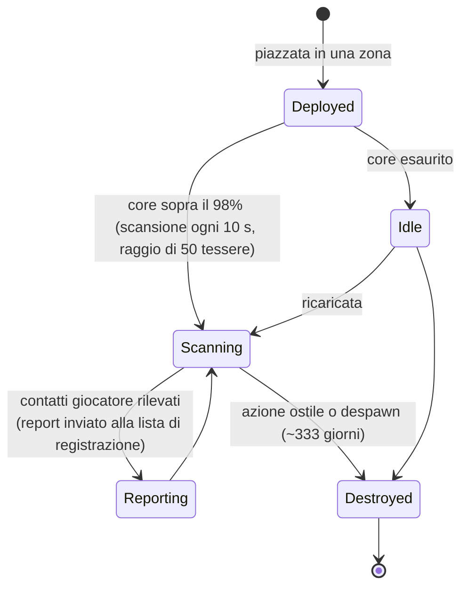

# Sonde di prossimità

Le sonde si dividono in due famiglie:

- **Sonde di visibilità (prossimità)** — piccoli dispositivi che posizioni in una zona per **sorvegliare un'area**. Quando sono alimentate scansionano le unità dei giocatori attorno a loro e inviano report ai personaggi che hai registrato. Si tratta di uno strumento di ricognizione e sorveglianza.
- **Sonde minerarie** — un **modulo** montato sul tuo robot (livelli da *noob* fino a *standard*, *industrial*, *named*, *elite* e *artifact*) più **munizioni sonda specifiche per minerale** (varianti tessera / direzione / area per ogni minerale). Lanciandone una si ottiene un risultato di scansione per quel minerale nell'area, memorizzato per personaggio (vedi [raccolta → scansione](/it/features/gathering/)).

> I riferimenti all'interfaccia seguono la [panoramica della UI del client](/it/features/ui/). Le meccaniche descritte di seguito sono verificate con il server.

## Gestire le tue sonde

- **Elenco delle sonde** — visualizza le sonde in tuo possesso.
- **Informazioni di registrazione** — stato e informazioni di registrazione per una sonda.
- **Imposta registrazione** — associa i personaggi alla lista dei report della sonda.
- **Imposta un nome** — assegna un'etichetta alla sonda.
- **Rimuovi la registrazione** di una sonda (in una zona) — interrompi la sorveglianza / cancella la registrazione.

### Come funziona una sonda di visibilità

- È **alimentata dal core**: scansiona solo quando il suo core è quasi pieno (sopra il 98% di `core_max`); una sonda scarica rimane inattiva.
- Quando è attiva, scansiona **ogni 10 secondi** la presenza di robot di altri giocatori entro il suo **raggio di rilevamento (50 tessere)** e invia un report (l'ID del personaggio e la posizione di ogni contatto) a tutti i membri presenti nella lista di registrazione.
- La **registrazione** è un'attività aziendale: puoi registrare solo i **membri della tua stessa corporazione**, e il **CEO e il deputy sono sempre inclusi automaticamente** nella lista. La lista ha una dimensione massima.
- **Durata vitale**: una sonda schierata scompare dopo il suo `despawn_time` definito dai dati di gioco (per la sonda di visibilità è impostato a circa 333 giorni) oppure quando viene distrutta.

## Eventi del ciclo di vita

Il server notifica gli eventi del ciclo di vita delle sonde non appena si verificano:
- **created**, **updated**, **dead** — una sonda viene schierata, invia un report o viene distrutta.

Questi arrivano come notifiche push; non sei tu a inviarli, ma reagisci alla loro ricezione.

## Note pratiche

- **Registra prima di leggere** — una sonda invia report solo ai personaggi registrati.
- **Le sonde possono morire** — un'azione ostile o la scadenza del tempo possono eliminare una sonda; monitora gli eventi del ciclo di vita.
- **Assegna loro un nome** — quando hai diverse sonde sul campo, le etichette aiutano a mantenere l'ordine.
- **Ricognizione, non combattimento** — le sonde raccolgono informazioni; non combattono.

<!-- TODO: only the UI remains (probe list, registration picker).
     Confirmed: visibility probe (def_visibility_probe): core_max 50, active only at
     core>98%, 10 s scan interval (ProximityDevice.cs _probingInterval), detection via
     blob_emission 10 / blob_emission_radius 50, report = characterID + x/y per contact
     pushed to registered characters (ProximityProbe.OnUnitsFound); registration =
     own-corp members only, CEO+Deputy always included, max count
     (ProximityProbeRegisterSet.cs); despawn_time 28,800,000 s (~333 d) on the capsule;
     stealth_strength 275 / detection_strength 45. Mining probes: tiered modules
     (noob/standard/industrial1-2/named1-3/elite t2-t4/artifact) + per-ore tile/
     direction/area ammo (79 def_*probe* definitions).
     Developer notes: ProximityProbeList.cs / ProximityProbeGetRegistrationInfo.cs /
     ProximityProbeRegisterSet.cs / ProximityProbeSetName.cs; Zone/ProximityProbeRemove.cs;
     Zones/ProximityProbes/ProximityProbe.cs + ProximityProbeDeployer.cs +
     ProximityDevice.cs; Zones/Blobs/* (blob emission/stealth); lifecycle events via
     ProximityProbeCreated/Update/Dead/Info commands. -->
     Developer notes: ProximityProbeList.cs / ProximityProbeGetRegistrationInfo.cs /
     ProximityProbeRegisterSet.cs / ProximityProbeSetName.cs; Zone/ProximityProbeRemove.cs;
     Zones/ProximityProbes/ProximityProbe.cs + ProximityProbeDeployer.cs; lifecycle
     events via ProximityProbeCreated/Update/Dead/Info commands. -->