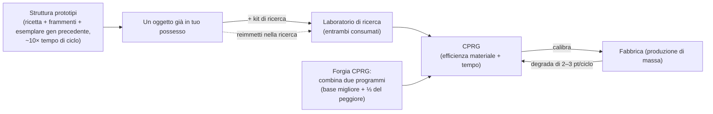

# Produzione

La produzione è il modo in cui trasformi risorse grezze e componenti in oggetti utilizzabili. Si svolge presso una **struttura di produzione** (una fabbrica o "mill") nella base in cui sei attraccato. Tutto ciò che è descritto qui è utilizzabile **esclusivamente quando si è attraccati**.

> Le posizioni nell'interfaccia utente seguono la [panoramica dell'interfaccia utente del client](/it/features/ui/) (le categorie **Raffineria / Riciclaggio / Riparazione / Assicurazione** nella barra superiore). Le meccaniche descritte di seguito sono verificate con il server.

## Linee di produzione

Una **linea di produzione** è una ricetta salvata: definisce cosa produrre e a partire da cosa. L'elenco completo dei componenti per ciascun oggetto fabbricabile (con i relativi livelli di ricerca) è generato in [Ricette](/content/recipes/). Una linea viene avviata per un determinato numero di **cicli (round)**.

- **Elenco linee** — visualizza le tue linee disponibili.
- **Avvia una linea** — eseguila in una struttura per un numero di cicli a scelta (minimo 1).
  - Puoi pagare attingendo dal tuo **portafoglio personale** o dal **portafoglio della corporazione**.
  - I componenti di partenza possono essere cercati nel tuo **inventario** o nei tuoi **robot**.
- **Calibra una linea** — regola le impostazioni di una linea.
- **Imposta cicli** — scegli quanti cicli eseguire.
- **Verifica prossimo ciclo** — visualizza in anteprima cosa consumerà/produrrà il prossimo ciclo.
- **Annulla** — interrompe una produzione in corso.
- **Elimina una linea** — rimuove una linea salvata.

L'esecuzione di una linea consuma componenti (e crediti) e produce l'oggetto finale nel corso dei cicli.

## Operazioni istantanee (one-shot)

Si tratta di azioni singole anziché di linee su più cicli. Ognuna dispone di una variante di **Verifica (Query)** che mostra in anteprima costi e resa prima di confermare.

- **Raffina** — materie prime → beni di consumo, utilizzando la ricetta dell'oggetto (vedi [Ricette](/content/recipes/)). Scegli la quantità dell'oggetto finale da produrre; i materiali nominali richiesti dalla ricetta sono scalati da un moltiplicatore di materiale pari a `1 + 50/(bonus + 100)`, dove *bonus* è la tua abilità di raffinazione (estensioni + punti struttura + punti reputazione). Senza alcun bonus consumerai il **150%** della ricetta nominale; con il bonus massimo il consumo scende verso il **100%**.
- **Ricicla / ritratta** — scompone un oggetto nei suoi componenti di ricetta originari (la ricetta inversa). La resa è calcolata come `nominale × (1 − 75/(bonus + 100)) × rapporto di integrità dell'oggetto`: senza bonus abilità la resa base è del **25%**, migliorabile verso il 100%, e un **oggetto danneggiato rende proporzionalmente meno** (riparalo prima se è di valore). Vengono riciclati solo i lotti interi (quantità predefinite complete); le rimanenze restano intatte. Gli oggetti di missione vengono eliminati, non riciclati.
- **Ripara** — ripristina la piena integrità di un oggetto o robot danneggiato. Il costo è pari a `(% integrità mancante) × valore materiale dell'oggetto × 75/(bonus + 100)`. Il "valore materiale" viene calcolato ricorsivamente: la ricetta dell'oggetto viene scomposta in materie prime e prezzata in base alle **medie del mercato globale**, quindi il costo di riparazione varia con il mercato. Il moltiplicatore di abilità parte dal **75%** senza alcun bonus e tende a 0 con il bonus massimo.
- **Componenti di ricerca** — produce componenti di ricerca (verifica + avvio).

## Il ciclo di vita degli oggetti (il processo circolare)

La creazione degli oggetti è un ciclo continuo che coinvolge tre strutture collegate:

1. **Ricerca (ingegneria inversa)** — inserisci nel laboratorio di ricerca un'unità dell'oggetto che desideri produrre, insieme a un **kit di ricerca** di livello pari o superiore al livello di ricerca dell'oggetto (i kit vanno dal livello 0 al 10). Entrambi gli elementi vengono **consumati** e l'operazione genera un **CPRG** per quell'oggetto. I punti di efficienza del programma risultante partono dalla base specifica dell'oggetto (la maggior parte degli oggetti ha 50, le munizioni un valore più alto, le torrette fino a 90) e aumentano di *livello del kit eccedente il livello richiesto × 5*, più il tuo bonus di abilità di ricerca (fino a ulteriori +50). Di conseguenza, un kit di un paio di livelli superiore all'oggetto — unito a buone estensioni di produzione — è ciò che trasforma un programma base 50/50 in uno altamente competitivo. È così che nuovi oggetti entrano nel tuo catalogo di produzione.
2. **La fabbrica (produzione di massa)** — produce in serie a partire dal programma. Ogni ciclo **degrada** i valori di efficienza della linea (2–3 punti per ciclo, a seconda della categoria dell'oggetto; vedi [CPRG](#cprg-programmi-di-calibrazione)): quando lo spreco diventa eccessivo, calibra un nuovo programma sulla linea. Gli oggetti prototipo richiedono inoltre un **esemplare della generazione precedente** come componente (un modulo standard per creare un prototipo T2, un T2 per creare un T3), che viene consumato nel processo.
3. **La struttura prototipi** — produce direttamente un **prototipo** di un oggetto: richiede i materiali della ricetta, frammenti di robot *e* l'esemplare della generazione precedente, a circa **10 volte il tempo di ciclo della fabbrica** (più il consueto moltiplicatore di tempo). Puoi creare prototipi solo per gli oggetti sbloccati nel tuo albero tecnologico. I prototipi costano notevolmente di più rispetto ai loro equivalenti standard; il loro scopo principale è essere **analizzati tramite ricerca per ottenere programmi di alta qualità** (la ricerca su un prototipo sblocca il livello/tier successivo), oppure essere equipaggiati sul robot quando l'oggetto è troppo raro da ottenere come bottino e troppo costoso sul mercato.

## Progressione dei tier

La maggior parte dei moduli e dei robot è suddivisa in **tier da T1 a T4** (indicati dal badge del tier nel client; le sequenze di definizione `standard → named1 → named2 → named3`, seguite dalle linee speciali `elitet4`/`artifact`). Le regole:

- **Ogni tier è un oggetto distinto con il proprio nodo nell'albero tecnologico.** Lo sblocco di un nodo costa punti ricerca (ottenuti dai kernel) e richiede il **nodo genitore**; pertanto, i tier devono essere sbloccati in ordine sequenziale. Puoi creare un **prototipo** (o avviare la produzione di massa) solo per un oggetto il cui nodo sia già sbloccato: non c'è modo di fabbricare un tier superiore senza la relativa ricerca.
- **Ogni tier superiore consuma un esemplare del tier precedente** come componente (oltre a materiali e frammenti di robot). Un oggetto T1 non può quindi mai essere "convertito direttamente" in un T3: il prototipo T3 richiede un oggetto **T2**, e tale esemplare viene **consumato**, non convertito: il risultato finale è un oggetto completamente nuovo.
- La pagina di ciascun oggetto mostra la relativa **linea di progressione tier** — l'intera catena `T1 → T2 → T3 → T4` sotto forma di collegamenti — e le [pagine dei nodi dell'albero tecnologico](/content/techtree/) indicano il nodo genitore/successivo e i costi in punti per ciascun tier.

Ad esempio, la linea del modulo estrattore piccolo: [estrattore piccolo standard (T1)](/content/items/standard-small-driller/) →
[modulo estrattore piccolo Biroter 5050 (T2)](/content/items/named1-small-driller/) →
[modulo estrattore piccolo Sublimator Low-D (T3)](/content/items/named2-small-driller/) →
[modulo estrattore piccolo Scraper-990 (T4)](/content/items/named3-small-driller/) —
e lo stesso schema vale per ogni famiglia di moduli o robot.

## Prototipi e kit di ricerca

- **Prototipo** — produce un oggetto prototipo (avvia + verifica). È consentito un prototipo per slot; ulteriori slot paralleli per prototipi si ottengono tramite le estensioni di produzione.
- **Unisci kit di ricerca** — combina più kit di ricerca per ottenerne uno di livello superiore (esegui + verifica). Un kit di livello più alto riduce il tempo di ricerca e aumenta l'efficienza del programma risultante.

## CPRG (programmi di calibrazione)

Un **CPRG** (programma di calibrazione) è la base su cui opera una linea di produzione: è un programma specifico per oggetto dotato di punti di **efficienza dei materiali** e di **efficienza temporale** (da 0 a 100 ciascuno). Se ne ottiene uno **ricercando l'oggetto** presso un laboratorio di ricerca (il livello di ricerca determina quali oggetti puoi effettivamente produrre), oppure attivando una **capsula di calibrazione**.

- Un CPRG appena ricercato parte con **50/50** punti.
- **Forgia CPRG** presso la forgia dei programmi di calibrazione: combina due CPRG per lo stesso oggetto; il risultato mantiene come base i punti del programma migliore e aggiunge un terzo di quelli del programma inferiore. La forgiatura richiede tempo e costa crediti (tempo × prezzo al secondo della struttura).
- **Calibra una linea** con un CPRG per impostarne i valori di efficienza. Ogni ciclo di produzione **degrada** l'efficienza della linea (in base a un valore di decalibrazione specifico per oggetto), quindi le linee peggiorano nel tempo: ricalibra prima di cicli lunghi.

I valori di efficienza alimentano le formule della fabbrica (per ciclo di produzione):

- **Materiali consumati** = ricetta × `1 + 50/(punti materiale + abilità + 100 + bonusFabbrica)` — un nuovo CPRG da 50 punti senza abilità e senza bonus di produzione di massa dall'albero tecnologico consuma circa il **133%** della ricetta nominale.
- **Tempo di produzione** = tempo base della struttura (3.600 s per ciclo in una fabbrica) × `1 + 100/(punti tempo + abilità + 100)` × moltiplicatore di durata dell'oggetto — un nuovo CPRG senza abilità impiega circa **1 ora e 40 minuti** per oggetto.
- **Prezzo** = tempo di produzione × prezzo al secondo della struttura (7 crediti/s per la fabbrica PBS, 3 per i laboratori di ricerca PBS grandi/medi) × moltiplicatore di prezzo dell'oggetto (1–10).
- I CPRG legati alle missioni sono gratuiti e fissati a 10 secondi.

## Assicurazione

La struttura assicurativa assicura **i tuoi robot**, non i prodotti della produzione:

- **Acquista** una polizza per un robot (deve essere integro, sballato e non un robot iniziale), visualizza l'**elenco** delle tue polizze, effettua una **verifica** di una polizza, **elimina** una polizza.
- La copertura dura **15 giorni** (+ giorni bonus da estensioni); puoi detenere polizze per 1 + (bonus estensione) robot.
- Ogni robot ha una **tariffa** e un **risarcimento** predefiniti nei dati di gioco (la tabella `insuranceprices`, 67 definizioni di robot); la tariffa è scontata da un bonus estensione sulle tariffe e può essere pagata dal portafoglio della corporazione.
- Se il robot assicurato viene distrutto, il **risarcimento viene pagato in crediti** (il robot resta comunque perso) — vedi [combattimento](/it/features/combat/).

## Struttura e stato

- **Info / descrizione struttura** — ciò che offre una struttura di produzione.
- **In corso (personale / corporazione)** — ciò che è attualmente in produzione.
- **Cronologia di produzione** — le tue produzioni passate.
- **Elenco componenti** — componenti di produzione disponibili.
- **Info server** — stato del server di produzione.

## Note pratiche

- **Devi essere attraccato a una base dotata di una struttura di produzione.**
- **Verifica prima di avviare** — le opzioni di verifica mostrano costi e resa, evitando di sprecare componenti per un errore.
- **Portafoglio della corporazione** — puoi spendere fondi della corporazione per la produzione, se disponi dei relativi permessi.
- **I componenti possono provenire anche dai robot** — una linea può prelevare i componenti di partenza dai robot equipaggiati, non solo dal tuo inventario.
- **Ricicla a piena integrità** — un oggetto danneggiato rende meno; ripara gli oggetti di valore prima di ritrattarli.
- **I moltiplicatori di abilità sono le vere leve economiche** — i bonus per raffinazione/riciclo/riparazione/fabbrica scalano tutti allo stesso modo; investire in estensioni di produzione ripaga con risparmi di materiale a ogni ciclo.
- **L'assicurazione è una rete di sicurezza per i robot** — acquistala per i setup più costosi prima di affrontare il PvP nello spazio profondo.
- **I kit di ricerca sono il requisito chiave** — il livello di ricerca di un oggetto (1–9) determina quali kit possono decodificarlo, e utilizzare un kit di diversi livelli superiore all'oggetto è il modo più economico per incrementare l'efficienza del programma risultante.

<!--
Developer notes: rewritten 2026 from backend sources; no community-wiki text reused.
Verified against:
- refine = 1 output per unit, input = nominal x (1+50/(bonus+100)) (Refinery.cs);
- recycle = reverse recipe x (1-75/(bonus+100)) x healthRatio, whole batches only,
  mission items deleted (ReprocessSessionMember.cs);
- repair price = (1-healthRatio) x PriceCalculator world-market value x
  75/(bonus+100) (Repair.cs + PriceCalculator.cs);
- ResearchLab.cs (StartResearch/EndResearch: source item + research kit both
  consumed; kit level must be >= itemresearchlevels.researchlevel (1-9);
  efficiency = per-item base + levelDifference*5 + (1-100/(100+skill))*50);
- itemresearchlevels (1101 rows, levels 1-9), research kits def_research_kit_0..10
  (#level option), RandomResearchKit (mission kits, fake 100/100);
- calibrationdefaults (per-CPRG base efficiencies 50-90; default fallback 50/50;
  CalibrationProgram.OnInsertToDb sets 50/50);
- PBSFacilities.cs CalculateResultingPoints (forge = better base + weak/3 +
  (1-100/(100+skill))*25);
- productiondecalibration (2-3 points decrease per round per category,
  distorsion 0.5-1%);
- Prototyper.cs (StartPrototype: components include previous-gen specimen via the
  components table — e.g. T2 NEXUS consumes 1x standard module, T3 consumes 1x T2;
  time = 10x cycle x multiplier; tech-tree unlock check in
  ProductionPrototypeStart.cs);
- prototypes table (339 rows, standard->prototype mapping);
- Mill.cs (CalculateFinalMaterialMultiplier 1+50/(pts+skill+100+millBonus) with
  tech-tree mass-production bonus; CalculateFinalTimeMultiplier;
  productionduration table);
- Insurance: InsuraceFacility.cs (15d + time-extension bonus, 1+slot-extension
  policies, noob bot excluded, must be single+unpacked), InsuranceDescription.cs
  (payout in credits via central bank), insuranceprices (67 robot definitions,
  payout = 80x fee except noob/arkhe2 at 4x).
- Facility options (entitydefaults): def_pbs_facility_mill #perSecondPrice=7
  #productionTime=3600; refinery #materialEfficiency=0.95;
  calibration_program_forge #perSecondPrice=7; def_production_public_factory
  #materialEfficiency=0.6 #manufactureTime=3600 #perSecondPrice=3.
Developer files: Production/ProductionLineStart.cs (PrepareProductionForPublicContainer,
LineStartInMill, corp wallet, search-in-robots, rounds); Production/ProductionLine*.cs;
Production/ProductionRefine*.cs, ProductionReprocess*.cs, ProductionRepair*.cs,
ProductionResearch*.cs (query+run pairs); Production/ProductionPrototype*.cs,
ProductionMergeResearchKitsMulti*.cs; Production/ProductionCPRG*.cs,
ProductionGetCPRGFromLine*.cs; Production/ProductionInsurance*.cs;
Production/ProductionFacility*.cs, ProductionInProgress*.cs, ProductionHistory.cs;
Services/ProductionEngine/Facilities/*.cs; Services/ProductionEngine/PBSFacilities.cs;
Services/ProductionEngine/ResearchKits/*.cs; Services/ProductionEngine/CalibrationPrograms/*;
Services/Insurance/InsuranceHelper.cs; Items/PriceCalculator.cs.
Corrections vs ingested page: no "decoder" item exists (research kits are the
level-gated inputs); the "researched to 100%" claim is wrong (tech-tree unlock is
the gate; research levels run 1-9); prototype time is 10x the mill cycle; specimen
consumption verified from the components table; insurance payout is 80x the fee.
-->