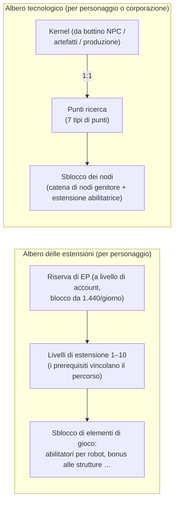

# Ricerca

Esistono **due sistemi di progressione distinti**. Entrambi sono utilizzabili solo quando si è attraccati.

> Le posizioni dell'interfaccia utente seguono la [panoramica dell'interfaccia del client](/it/features/ui/) (finestra Personaggio → estensioni; l'albero tecnologico ha la propria finestra). Le meccaniche descritte di seguito sono verificate rispetto al server.

## L'albero delle estensioni (abilità del personaggio)

Le estensioni sono livelli di abilità per singolo personaggio che sbloccano elementi di gioco — in particolare le **estensioni abilitatrici** che consentono di pilotare una specifica classe di robot (necessarie per salpare e selezionare un robot, vedi [movimento](/it/features/movement/) e [robot](/it/features/robots/)).

### Come funziona l'apprendimento

- Devi essere **attraccato** per poter apprendere.
- Ciascuna estensione può essere portata ai **livelli 1–10** (il livello 10 è il limite massimo).
- Il **livello 1 costa crediti** (il `price` dell'estensione), prelevati dal tuo portafoglio.
- **Ogni livello costa Punti Estensione (EP)** secondo una tabella fissa grado × livello:
  per i livelli 1–5 il costo è `60 × grado × livello`; per i livelli 6–10 passa a
  `grado × (1440, 2520, 3840, 5400, 12000)`. I dieci livelli di un'estensione di grado 1 costano
  da 60 a 6.000 EP, per un totale di 13.500 EP; un'estensione di grado 10 costa dieci volte tanto per ciascun livello.
- I **prerequisiti** devono essere già stati appresi prima di poter sbloccare un'estensione (l'elenco "prerequire").
- Gli EP costituiscono una **riserva a livello di account**: sono condivisi tra i tuoi personaggi e vengono accumulati nel tempo (vedi "Fonti di EP" di seguito).

### Gestione delle estensioni

- **Elenco categorie / ottieni tutto / elenco apprese / elenco prerequisiti** — sfoglia l'albero e visualizza ciò che già possiedi.
- **Punti disponibili** — visualizza la tua riserva attuale di EP.
- **Rimuovi un livello** — abbassa di un singolo livello un'estensione.
- **Reimposta estensioni del personaggio** — ripristina l'intero albero per un personaggio.
- **Libera EP bloccati** — sblocca gli EP trattenuti (ad es. dopo la rimozione di livelli).
- **Acquista un potenziamento EP** — un acceleratore a pagamento che incrementa il guadagno di EP.
- **Registro giornaliero EP per attività** — visualizza quanti EP hai guadagnato giocando.

### Fonti di EP

Gli EP non sono una valuta acquistabile direttamente — maturano tramite un **accredito giornaliero**:

- Ogni account riceve **1.440 EP al giorno** (assegnati una volta al giorno, tra le 08:00 e le 11:00 ora del server, tramite la procedura `extensionPointsAdd`). Il codice definisce anche una quota raddoppiata di **2.880 EP** per gli account con abbonamento a pagamento, ma la procedura attuale eroga la quota base a tutti gli account.
- I **potenziamenti a pagamento** (acquisti di potenziamenti EP) si aggiungono a tale quota.
- I tuoi **EP disponibili** = totale degli accrediti giornalieri ricevuti − penalità − EP spesi in gioco. (Il registro giornaliero degli EP per attività mostra il dettaglio dei guadagni giornalieri.)

**Catalogo completo** — ogni estensione (grado, prezzo di livello 1, bonus, prerequisiti) è disponibile in [Estensioni](/content/extensions/), e ogni nodo dell'albero tecnologico (oggetto sbloccato, estensione abilitatrice, costi in punti) è disponibile in [Albero tecnologico](/content/techtree/).

## L'albero tecnologico (sblocchi)

L'albero tecnologico è un grafo di **nodi** che vengono sbloccati spendendo **punti ricerca**. A differenza degli EP (riserva di account), i punti dell'albero tecnologico vengono **ottenuti consumando "kernel"** — oggetti che vengono analizzati e poi consegnati.

### Come funziona

- **Ricerca kernel** — consegna oggetti kernel da un contenitore. Ciascun kernel si converte **1:1** in punti ricerca di uno specifico **tipo di punto**; i kernel vengono consumati. Esistono sette tipi di kernel, uno per ciascun tipo di punto: Theodica, Pelistal, Nüimqol, Industrial, Common, HiTech e NewTech.
- **Sbloccare un nodo** — spendi i punti ricerca richiesti. Un nodo può essere sbloccato solo se:
  - tutti i suoi **nodi genitore** sono già stati sbloccati, e
  - hai appreso l'**estensione abilitatrice** del nodo con il tuo personaggio.
- **Sblocchi per corporazione** — disponendo del ruolo aziendale appropriato, un nodo può essere sbloccato **per la corporazione** (condiviso). Gli sblocchi corporativi costano di più (si applica un moltiplicatore di prezzo per corporazione) e vengono pagati con i punti della corporazione.
- **Dona** — dona punti ricerca (ad es. alla tua corporazione).
- **Info / registri** — visualizza i dettagli dei nodi e la cronologia dei tuoi sblocchi e ricerche.

### Perché è importante

I nodi sbloccati dell'albero tecnologico regolano l'accesso a contenuti e funzionalità di livello superiore. Verifica i prerequisiti di un nodo (catena di nodi genitore + estensione abilitatrice) prima di spendere punti.

## Note pratiche

- **Le estensioni abilitatrici vincolano i robot** — non puoi pilotare una classe di robot che non hai ricercato (è lo stesso controllo che impedisce di salpare o selezionare il mezzo).
- **Il livello 1 è l'unico costo in crediti** nell'albero delle estensioni; oltre a quello, i costi sono interamente in EP.
- **L'albero tecnologico è irreversibile** — i punti spesi per uno sblocco non possono essere recuperati; pianifica attentamente il tuo percorso.
- **La tecnologia corporativa è un lavoro di squadra** — utilizza punti condivisi e un moltiplicatore di costo.

<!-- TODO: only the research UI remains (window layout, point display).
     Confirmed: EP earn = 1440/day flat via dbo.extensionPointsAdd (08:00-11:00 window,
     once per day; 2880 bonus constant exists in GiveExtensionPointsService for paid
     subscriptions but the current SP pays base to all); available = batches -
     penalties - spent (extensionPointsAvailable fn); EP cost table in
     Services/ExtensionService/ExtensionPoints.cs (60*rank*level for levels 1-5, then
     rank*(1440,2520,3840,5400,12000)); kernels convert 1:1 (TechTreeResearch.cs), 7
     kernel definitions -> point types n1..n7 (Theodica/Pelistal/Nuimqol/Industrial/
     Common/HiTech/NewTech).
     Developer notes: Extensions/ExtensionBuyForPoints.cs (docked, prereq, level cap 10,
     level-1 credit price, EP by rank/level, account pool, training-char free);
     Extensions/ExtensionGetAvailablePoints.cs; Extensions/ExtensionBuyEpBoost.cs,
     ExtensionFreeLockedEp.cs, ExtensionRemoveLevel.cs, ExtensionResetCharacter.cs;
     EpForActivityDailyLog.cs; TechTree/TechTreeResearch.cs (kernels → points);
     TechTree/TechTreeUnlock.cs (parent chain + enabler extension, corp multiplier);
     TechTree/TechTreeDonate.cs; Services/ExtensionService/GiveExtensionPointsService.cs;
     Services/ExtensionService/ExtensionPoints.cs. -->
     Developer notes: Extensions/ExtensionBuyForPoints.cs (docked, prereq, level cap 10,
     level-1 credit price, EP by rank/level, account pool, training-char free);
     Extensions/ExtensionGetAvailablePoints.cs; Extensions/ExtensionBuyEpBoost.cs,
     ExtensionFreeLockedEp.cs, ExtensionRemoveLevel.cs, ExtensionResetCharacter.cs;
     EpForActivityDailyLog.cs; TechTree/TechTreeResearch.cs (kernels → points);
     TechTree/TechTreeUnlock.cs (parent chain + enabler extension, corp multiplier);
     TechTree/TechTreeDonate.cs. -->