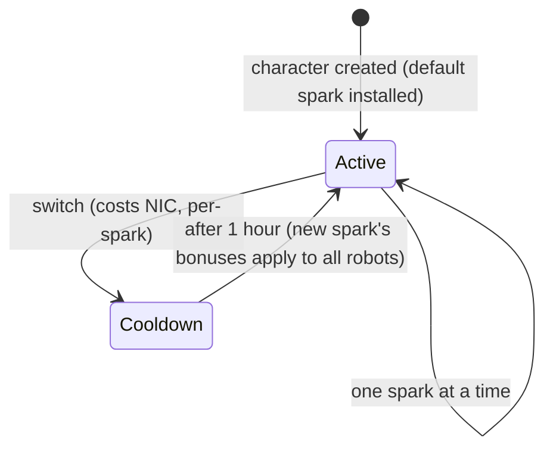

# Scintille (Sparks)

Una **scintilla** (spark) è una specializzazione di nanorobot installata sul tuo personaggio. Finché è attiva, i suoi bonus si applicano a ogni robot che piloti: la scintilla per la linea da combattimento di una fazione, ad esempio, aumenta il danno delle armi e la probabilità di colpo critico livello dopo livello, mentre una linea industriale aumenta la capacità del core e la resa mineraria.

Ogni personaggio possiede una **scintilla predefinita** assegnata alla creazione. Oltre a questa, le scintille sono suddivise in famiglie: le linee base predefinite, le linee per fazione di combattimento/industriali/sociali (tre livelli ciascuna), le linee a pagamento del Syndicate e linee speciali limitate; inoltre, i bonus esatti di una scintilla sono semplicemente un pacchetto di livelli di abilità prefissati consultabili nella [pagina delle estensioni](/content/extensions/). La [panoramica delle famiglie riportata di seguito](#famiglie-di-scintille) rimanda direttamente alle scintille di ciascuna famiglia.

## Sbloccare (autorizzare) una scintilla

Installare una scintilla che non possiedi ancora richiede prima di **sbloccarla** (esclusivamente mentre sei attraccato). A seconda della scintilla, il server verifica:

- un **prezzo** in NIC (le linee a pagamento, ad esempio le scintille di utilità del Syndicate e le scintille speciali limitate),
- la **reputazione** (standing) con la megacorporazione sviluppatrice (le linee specifiche di una fazione richiedono una reputazione minima con la megacorp di tale fazione, accumulata completando le relative [missioni](/it/features/missions/)),
- oppure un **oggetto** prelevato dal tuo inventario (alcune scintille speciali si sbloccano tramite un oggetto chiave).

Lo sblocco avviene una sola volta: una volta sbloccata, la scintilla rimane nella tua collezione.

## Cambiare le scintille

- Puoi avere solo **una scintilla attiva** alla volta; installarne un'altra sostituisce la precedente.
- Ogni cambio **costa NIC** — l'importo dipende dalla scintilla (le linee comuni costano 10k, le linee speciali a pagamento fino a un milione).
- È previsto un **tempo di ricarica di un'ora** tra un cambio e l'altro: il server tiene traccia di quando la tua scintilla attuale è stata attivata e rifiuterà una nuova richiesta fino allo scadere del tempo.

Poiché il cambio comporta sempre un costo in NIC e richiede un'ora di attesa, scegli la scintilla più adatta all'attività a cui dedichi la maggior parte del tempo, considerando la rispecializzazione come una decisione occasionale piuttosto che legata alla singola sessione.
<!-- sparkfamilies:generated -->

## Famiglie di scintille

Una panoramica delle 47 scintille suddivise in 6 famiglie: un riquadro per famiglia (numero di scintille, modalità di sblocco della linea), nell'ordine in cui le linee sono state aggiunte (da sinistra a destra, dall'alto verso il basso). **Fai clic su un riquadro per passare direttamente alle scintille di quella famiglia in basso.** **Scorri con il cursore sul diagramma per ingrandire**, trascina per spostarti e usa il pulsante ⟲ per reimpostare la visualizzazione.

<button type="button" class="zoommap-reset" title="Reimposta lo zoom">⟲</button>
<svg class="zoommap" xmlns="http://www.w3.org/2000/svg" viewBox="0 0 1008 278" width="960" height="264" role="img" aria-label="Spark families: 6 families, 47 sparks; click a family to jump to its sparks below">
  <rect x="0" y="0" width="1008" height="278" fill="#10151f" stroke="#39445a" stroke-width="1"/>
  <g><title>Event &amp; special: 9 sparks, unlocks with free</title><a href="#family-special"><rect x="24" y="40" width="300" height="84" rx="10" fill="#10151f" stroke="#c8d2e0" stroke-width="1.5"/><text x="174" y="68" text-anchor="middle" fill="#e8eefc" font-size="15" font-weight="700">Event &amp; special</text><text x="174" y="92" text-anchor="middle" fill="#c8d2e0" font-size="12">9 scintille · gratis</text></a></g>
  <g><title>TM (Truhold-Markson): 9 sparks, unlocks with TM standing</title><a href="#family-tm"><rect x="354" y="40" width="300" height="84" rx="10" fill="#10151f" stroke="#41d3ff" stroke-width="1.5"/><text x="504" y="68" text-anchor="middle" fill="#e8eefc" font-size="15" font-weight="700">TM (Truhold-Markson)</text><text x="504" y="92" text-anchor="middle" fill="#41d3ff" font-size="12">9 scintille · standing TM</text></a></g>
  <g><title>ICS: 9 sparks, unlocks with ICS standing</title><a href="#family-ics"><rect x="684" y="40" width="300" height="84" rx="10" fill="#10151f" stroke="#6ee7a0" stroke-width="1.5"/><text x="834" y="68" text-anchor="middle" fill="#e8eefc" font-size="15" font-weight="700">ICS</text><text x="834" y="92" text-anchor="middle" fill="#6ee7a0" font-size="12">9 scintille · standing ICS</text></a></g>
  <g><title>ASI: 9 sparks, unlocks with ASI standing</title><a href="#family-asi"><rect x="24" y="154" width="300" height="84" rx="10" fill="#10151f" stroke="#f5a05a" stroke-width="1.5"/><text x="174" y="182" text-anchor="middle" fill="#e8eefc" font-size="15" font-weight="700">ASI</text><text x="174" y="206" text-anchor="middle" fill="#f5a05a" font-size="12">9 scintille · standing ASI</text></a></g>
  <g><title>Syndicate (NIC): 5 sparks, unlocks with NIC price</title><a href="#family-syndicate"><rect x="354" y="154" width="300" height="84" rx="10" fill="#10151f" stroke="#a78bfa" stroke-width="1.5"/><text x="504" y="182" text-anchor="middle" fill="#e8eefc" font-size="15" font-weight="700">Syndicate (NIC)</text><text x="504" y="206" text-anchor="middle" fill="#a78bfa" font-size="12">5 scintille · prezzo in NIC</text></a></g>
  <g><title>Limited: 6 sparks, unlocks with NIC price</title><a href="#family-limited"><rect x="684" y="154" width="300" height="84" rx="10" fill="#10151f" stroke="#f472b6" stroke-width="1.5"/><text x="834" y="182" text-anchor="middle" fill="#e8eefc" font-size="15" font-weight="700">Limited</text><text x="834" y="206" text-anchor="middle" fill="#f472b6" font-size="12">6 scintille · prezzo in NIC</text></a></g>
</svg>

### Event &amp; special (9)

Sblocco: nessuno — queste sono le linee base predefinite. Ciascun cambio costa NIC (l'importo varia in base alla scintilla, consulta le schede) e richiede un tempo di ricarica di un'ora — vedi [Cambiare le scintille](#cambiare-le-scintille) sopra.

ww

sblocco nessun costo · cambio 10k NIC

Scintilla predefinita — installata alla creazione del personaggio

wi

sblocco nessun costo · cambio 10k NIC

Scintilla predefinita — installata alla creazione del personaggio

ws

sblocco nessun costo · cambio 10k NIC

Scintilla predefinita — installata alla creazione del personaggio

iw

sblocco nessun costo · cambio 10k NIC

Scintilla predefinita — installata alla creazione del personaggio

ii

sblocco nessun costo · cambio 10k NIC

Scintilla predefinita — installata alla creazione del personaggio

is

sblocco nessun costo · cambio 10k NIC

Scintilla predefinita — installata alla creazione del personaggio

sw

sblocco nessun costo · cambio 10k NIC

Scintilla predefinita — installata alla creazione del personaggio

si

sblocco nessun costo · cambio 10k NIC

Scintilla predefinita — installata alla creazione del personaggio

ss

sblocco nessun costo · cambio 10k NIC

Scintilla predefinita — installata alla creazione del personaggio

### TM (Truhold-Markson) (9)

Sblocco: reputazione con la megacorporazione TM (2 → 4 → 6 in base al livello). Ciascun cambio costa NIC (l'importo varia in base alla scintilla, consulta le schede) e richiede un tempo di ricarica di un'ora — vedi [Cambiare le scintille](#cambiare-le-scintille) sopra.

Combat Lvl1

sblocco standing 2 con TM · cambio 10k NIC

Include 2 livelli di estensione

Combat Lvl2

sblocco standing 4 con TM · cambio 100k NIC

Include 3 livelli di estensione

Combat Lvl3

sblocco standing 6 con TM · cambio 1M NIC

Include 3 livelli di estensione

Indy Lvl1

sblocco standing 2 con TM · cambio 10k NIC

Include 2 livelli di estensione

Indy Lvl2

sblocco standing 4 con TM · cambio 100k NIC

Include 3 livelli di estensione

Indy Lvl3

sblocco standing 6 con TM · cambio 1M NIC

Include 3 livelli di estensione

Social Lvl1

sblocco standing 2 con TM · cambio 10k NIC

Include 2 livelli di estensione

Social Lvl2

sblocco standing 4 con TM · cambio 100k NIC

Include 3 livelli di estensione

Social Lvl3

sblocco standing 6 con TM · cambio 1M NIC

Include 3 livelli di estensione

### ICS (9)

Sblocco: reputazione con la megacorporazione ICS (2 → 4 → 6 in base al livello). Ciascun cambio costa NIC (l'importo varia in base alla scintilla, consulta le schede) e richiede un tempo di ricarica di un'ora — vedi [Cambiare le scintille](#cambiare-le-scintille) sopra.

Combat Lvl1

sblocco standing 2 con ICS · cambio 10k NIC

Include 2 livelli di estensione

Combat Lvl2

sblocco standing 4 con ICS · cambio 100k NIC

Include 3 livelli di estensione

Combat Lvl3

sblocco standing 6 con ICS · cambio 1M NIC

Include 3 livelli di estensione

Indy Lvl1

sblocco standing 2 con ICS · cambio 10k NIC

Include 2 livelli di estensione

Indy Lvl2

sblocco standing 4 con ICS · cambio 100k NIC

Include 3 livelli di estensione

Indy Lvl3

sblocco standing 6 con ICS · cambio 1M NIC

Include 3 livelli di estensione

Social Lvl1

sblocco standing 2 con ICS · cambio 10k NIC

Include 2 livelli di estensione

Social Lvl2

sblocco standing 4 con ICS · cambio 100k NIC

Include 3 livelli di estensione

Social Lvl3

sblocco standing 6 con ICS · cambio 1M NIC

Include 3 livelli di estensione

### ASI (9)

Sblocco: reputazione con la megacorporazione ASI (2 → 4 → 6 in base al livello). Ciascun cambio costa NIC (l'importo varia in base alla scintilla, consulta le schede) e richiede un tempo di ricarica di un'ora — vedi [Cambiare le scintille](#cambiare-le-scintille) sopra.

Combat Lvl1

sblocco standing 2 con ASI · cambio 10k NIC

Include 2 livelli di estensione

Combat Lvl2

sblocco standing 4 con ASI · cambio 100k NIC

Include 3 livelli di estensione

Combat Lvl3

sblocco standing 6 con ASI · cambio 1M NIC

Include 3 livelli di estensione

Indy Lvl1

sblocco standing 2 con ASI · cambio 10k NIC

Include 2 livelli di estensione

Indy Lvl2

sblocco standing 4 con ASI · cambio 100k NIC

Include 3 livelli di estensione

Indy Lvl3

sblocco standing 6 con ASI · cambio 1M NIC

Include 3 livelli di estensione

Social Lvl1

sblocco standing 2 con ASI · cambio 10k NIC

Include 5 livelli di estensione

Social Lvl2

sblocco standing 4 con ASI · cambio 100k NIC

Include 6 livelli di estensione

Social Lvl3

sblocco standing 6 con ASI · cambio 1M NIC

Include 6 livelli di estensione

### Syndicate (NIC) (5)

Sblocco: un prezzo in NIC (1M per scintilla). Ciascun cambio costa NIC (l'importo varia in base alla scintilla, consulta le schede) e richiede un tempo di ricarica di un'ora — vedi [Cambiare le scintille](#cambiare-le-scintille) sopra.

Syndicate Nic Combat

sblocco 1M NIC · cambio 100k NIC

Include 2 livelli di estensione

Syndicate Nic Scout

sblocco 1M NIC · cambio 100k NIC

Include 2 livelli di estensione

Syndicate Nic Coreboost

sblocco 1M NIC · cambio 100k NIC

Include 2 livelli di estensione

Syndicate Nic Allresist

sblocco 1M NIC · cambio 100k NIC

Include 4 livelli di estensione

Syndicate Nic Fitboost

sblocco 1M NIC · cambio 100k NIC

Include 2 livelli di estensione

### Limited (6)

Sblocco: un prezzo in NIC (25–50M per scintilla). Ciascun cambio costa NIC (l'importo varia in base alla scintilla, consulta le schede) e richiede un tempo di ricarica di un'ora — vedi [Cambiare le scintille](#cambiare-le-scintille) sopra.

Anniversary Combat

sblocco 25M NIC · cambio 1M NIC

Include 6 livelli di estensione

Anniversary Logistic

sblocco 25M NIC · cambio 1M NIC

Include 6 livelli di estensione

Amazon c1 Combat

sblocco 25M NIC · cambio 1M NIC

Include 2 livelli di estensione

Amazon c1 Indy

sblocco 25M NIC · cambio 1M NIC

Include 2 livelli di estensione

Steam a

sblocco 50M NIC · cambio 1M NIC

Include 2 livelli di estensione

Steam b

sblocco 50M NIC · cambio 1M NIC

Include 2 livelli di estensione

<!--
Written from scratch against the server backend, 2026-09-27:
RequestHandlers/Sparks/SparkUnlock.cs (unlock rules: price, standing, item),
RequestHandlers/Sparks/SparkChange.cs + Services/Sparks/SparkHelper.cs
(60-minute switch cooldown, per-spark change price),
Services/Sparks/Spark.cs, sparks + sparkextensions tables (47 sparks, per-line
bonus bundles).
An earlier version of this page was adapted from the Open Perpetuum
community wiki (perpetuum.miraheze.org) and has been fully rewritten from
backend sources; no text was reused.
-->