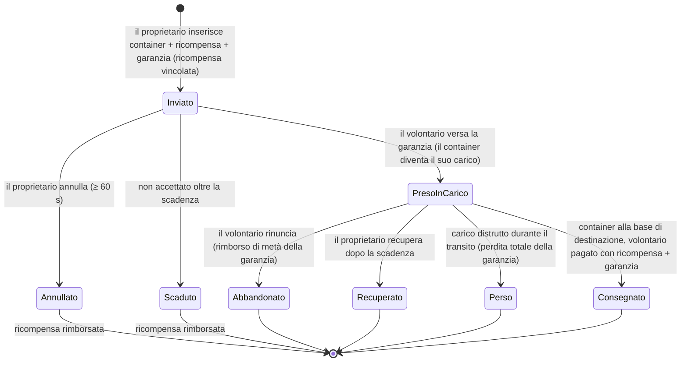

# Trasporto (spedizione di oggetti)

Un **incarico di trasporto** sposta un container di oggetti da una base all'altra tramite un
**vettore volontario** retribuito. Si tratta di un mercato a due vie: il **proprietario** pubblica una
spedizione, un **volontario** la prende in carico e la consegna.

> I riferimenti all'interfaccia seguono la [panoramica dell'interfaccia utente del client](/it/features/ui/) (la categoria **Incarichi** nella
> barra superiore). Le meccaniche descritte di seguito sono verificate lato server.

## Le due parti

- **Proprietario (committente)** — pubblica una spedizione: un container da spostare, da una **base di origine**
  a una **base di destinazione**, a fronte di una **ricompensa**, con una **garanzia** (collaterale) e una **durata**.
- **Volontario (vettore)** — accetta l'incarico, trasporta il container e lo consegna.

## Pubblicare un trasporto (proprietario)

**Invia un trasporto** specificando:
- il **container** (un contenitore con volume) da spedire,
- la **ricompensa** da pagare alla consegna,
- la **garanzia** (un deposito cauzionale versato dal vettore),
- la **base di origine** e la **base di destinazione**,
- una **durata** (in giorni) per cui l'incarico rimane aperto.

Al momento dell'invio, la **ricompensa viene trattenuta** dal tuo portafoglio (deposito di garanzia / escrow).

## Accettare un trasporto (volontario)

- **Prendi in carico** un incarico — versi la **garanzia** come deposito cauzionale e il container
  diventa il carico che dovrai trasportare.

## Consegna e recupero

- **Consegna** — porta il container alla base di destinazione. Al momento della consegna al **volontario vengono
  pagate ricompensa + garanzia**, e il proprietario riceve la merce.
- **Recupera** — il proprietario (o il volontario, nel caso pertinente) recupera il
  container riportandolo in una base; al momento del recupero la **garanzia viene restituita** e la **ricompensa
  viene riaccreditata** al proprietario.

## Annullamento / rinuncia

- **Annulla** — annulla l'incarico.
- **Rinuncia** — il volontario abbandona l'incarico. La rinuncia comporta una **penale sulla garanzia**:
  viene rimborsata solo la **metà** della garanzia (il resto viene trattenuto) — la costante di
  penalità è 0.5 in `TransportAssignment.cs`.

## Ispezione

- **Elenco** trasporti, **mostra contenuto** di uno specifico trasporto, **informazioni sul container**, **è in corso?**
  e il **registro dei trasporti**.

## Il flusso di denaro (in sintesi)

La **ricompensa** è il pagamento dovuto dal proprietario, vincolato al momento dell'invio e corrisposto solo alla consegna.
La **garanzia** è il deposito del volontario: versata al proprietario al momento della presa in carico, trattenuta durante il
transito della merce e restituita (insieme alla ricompensa) alla consegna.

| Evento | Condizione | Proprietario | Volontario | Container |
|---|---|---|---|---|
| Invio | — | ricompensa vincolata in escrow | — | spostato nel deposito trasporti |
| Presa in carico | non accettato | riceve la garanzia cauzionale | versa la garanzia | diventa il carico del volontario |
| Consegna | alla base di destinazione | merce ricevuta | riceve **ricompensa + garanzia** | consegnato |
| Annullamento | non accettato, ≥ 60 s dopo l'invio | ricompensa rimborsata | — | torna alla base di origine |
| Rinuncia | preso in carico | ricompensa rimborsata | rimborsata **metà** della garanzia (penalità 0.5) | torna alla base di origine |
| Scadenza | non accettato, oltre la scadenza | ricompensa rimborsata | — | torna alla base di origine |
| Recupero | preso in carico **e** oltre la scadenza | ricompensa rimborsata | — | torna alla base di origine (immediatamente se attraccato, altrimenti al prossimo attracco del volontario) |
| Carico distrutto | durante il transito | ricompensa rimborsata **+ intera garanzia** | intera garanzia persa | distrutto/perso |

## Note pratiche

- **Nessuna commissione** — l'unico denaro movimentato è costituito da ricompensa e garanzia.
- **La ricompensa è vincolata in escrow** — il proprietario non può spenderla fino alla risoluzione del trasporto.
- **La garanzia è il deposito del vettore** — versarla è ciò che ti permette di prendere in carico una spedizione;
  perdere il carico durante il tragitto comporta la perdita dell'**intero** importo.
- **Rinunciare ha un costo** — abbandonare un trasporto comporta la perdita di metà della tua garanzia.
- **La durata conta, ma solo finché non è accettato** — la scadenza impostata all'invio chiude automaticamente
  solo gli incarichi che nessuno ha preso in carico (il server ripulisce gli incarichi scaduti non accettati
  a cadenza oraria). Un incarico **preso in carico** non scade mai da solo; la via di fuga del proprietario è
  il **Recupero**, che diventa disponibile una volta superata la scadenza e richiama il carico
  (e la ricompensa) alla base di origine — immediatamente se il vettore è attraccato, oppure
  automaticamente al suo prossimo attracco.
- **Controlla il contenuto prima di accettare** — ispeziona cosa c'è nel container e verifica la rotta.

<!-- TODO: only the client UI remains (assignments screen layout).
     Money model confirmed: reward escrowed at submit (CashInOnSubmit), collateral paid
     by the volunteer on take (TakeCollateral -> PayCollateralToPrincipal), delivery pays
     volunteer reward+collateral (PayOutReward); cancel needs 60s after creation;
     expiry = submit time + client duration days (<=0 -> 1), cleaned hourly by
     MissionProcessor (_transportAssignmentInterval 1h), taken=0 only; retrieve requires
     expiry passed + taken, auto-completes on next dock; destroyed cargo refunds reward
     and forfeits full collateral to the owner.
     Developer notes: TransportAssignments/TransportAssignmentSubmit.cs;
     Services/MissionEngine/TransportAssignments/TransportAssignment.cs (reward/collateral
     escrow, PayOutReward = reward+collateral, PaybackCollateral, PaybackHalfCollateral
     = COLLATERAL_PENALTY on give-up, RetrieveToBasePublicContainer, expiry);
     TransportAssignmentTake/Deliver/Retrieve/Cancel/GiveUp/List/ListContent/
     ContainerInfo/Running/Log. -->