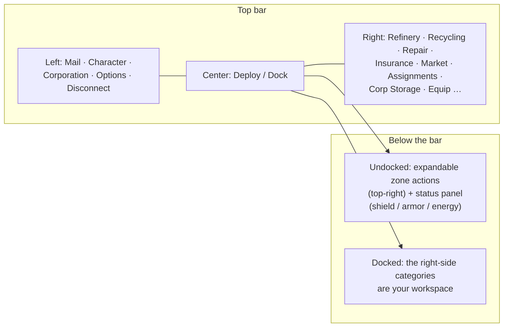

# Panoramica dell'interfaccia utente del client

Il client è un'interfaccia in **stile EVE Online**: una visuale dello spazio/zona a schermo intero con
**finestre mobili e ridimensionabili** fluttuanti che possono essere **chiuse e riaperte** a piacimento.
I collegamenti sono specifici per sistema — vedere le pagine collegate di seguito.

> Questo layout è un modello di lavoro fornito dal progetto, utilizzato per descrivere la disposizione
> delle azioni. I nomi esatti delle schermate potrebbero differire leggermente; la struttura rappresenta il riferimento.

## La barra superiore

Una barra persistente nella parte superiore dello schermo.

| Area | Contenuti |
|---|---|
| **Sinistra** | Pulsanti principali: **Mail**, **Character**, **Corporation**, altre **Options** e **Disconnect** |
| **Centro** | Il pulsante **Deploy / Dock** — il selettore principale per alternare lo stato ancorato⇄non ancorato (vedere [movement](/it/features/movement/)) |
| **Destra** | Categorie di azioni sotto forma di pulsanti: **Refinery**, **Recycling**, **Repair**, **Insurance**, **Market**, **Assignments** (trasporti), **Corp Storage**, **Equip**, … |

Le categorie sul lato destro aprono le rispettive finestre di sistema:

| Pulsante | Apre / azione | Pagina wiki |
|---|---|---|
| Refinery | Lavora le risorse grezze in componenti | [production](/it/features/production/) |
| Recycling | Scompone gli oggetti in materiali di base | [production](/it/features/production/) |
| Repair | Ripara robot/moduli danneggiati | [production](/it/features/production/) |
| Insurance | Polizze assicurative per produzione/robot | [production](/it/features/production/) |
| Market | Ordini di mercato e acquisti diretti | [market](/it/features/market/) |
| Assignments | Incarichi di trasporto (spedizioni) | [transport](/it/features/transport/) |
| Corp Storage | Hangar/deposito della corporazione | [groups](/it/features/groups/) |
| Equip | Equipaggia moduli e munizioni sul tuo robot attivo | [robots](/it/features/robots/) |

## Stato ancorato (Docked)

Mentre si è **ancorati** (*docked*), le categorie di azioni sul lato destro rappresentano l'area di lavoro principale: è possibile raffinare,
commerciare, equipaggiare e gestire il deposito senza lasciare la base. Il pulsante Deploy consente di sganciarsi ed entrare
nella zona (vedere [movement](/it/features/movement/) per i prerequisiti di sgancio).

## Stato non ancorato (Undocked)

Mentre si è **non ancorati** (*undocked*, pilotando il proprio robot attivo in una zona):

- L'area in **alto a destra** ottiene un **pulsante di azioni espandibile**: cliccandolo, si apre verso il basso un elenco
  di azioni di zona aggiuntive (scansione, azioni di raccolta/interazione, strumenti di zona —
  le azioni documentate in [gathering](/it/features/gathering/) e [combat](/it/features/combat/)).
- Il **pannello di stato principale** mostra le condizioni del robot: **scudo, corazza/scafo, energia**
  e il relativo stato di combattimento — gli stessi dati a cui fa riferimento la pagina [combat](/it/features/combat/)
  (ad es. il controllo di sgancio "sistema energetico intatto").
- Le categorie utilizzabili solo alla base (refinery, market, …) non sono disponibili finché non si effettua nuovamente l'attracco.

## Finestre comuni

La maggior parte dei sistemi si apre in una finestra mobile standard: barra del titolo, pulsante di chiusura, bordi
ridimensionabili, contenuti a schede o a elenco. I sistemi ripetuti (inventario/contenitori, mercato, linee di produzione)
possono avere più finestre aperte contemporaneamente.

- **Inventario / contenitori** — visualizzare un contenitore, spostare/impilare/imballare oggetti, rinominare, eliminare —
  vedere [items](/it/features/items/).
- **Finestra del personaggio** (pulsante in alto a sinistra) — profilo, estensioni (ricerca), impostazioni,
  crediti — vedere [getting-started](/it/features/getting-started/) e [research](/it/features/research/).
- **Finestra della corporazione** (pulsante in alto a sinistra) — informazioni sulla corporazione, hangar, documenti, votazioni,
  bollettino — vedere [groups](/it/features/groups/).
- **Finestra della posta** (pulsante in alto a sinistra) — posta personale e collettiva — vedere [social](/it/features/social/).

## Convenzioni usate in questa wiki

- **"Barra superiore → X"** = il pulsante chiamato X sulla barra superiore.
- **"Azioni non ancorate"** = l'elenco espandibile in alto a destra quando ci si trova in una zona.
- **Pulsante Deploy/Dock** = il selettore centrale nella barra superiore.

<!-- Note: this page is the agreed UI model (project-provided). If the real client
     differs in button names or placement, update this page first — every other
     features/ page references the conventions defined here. -->