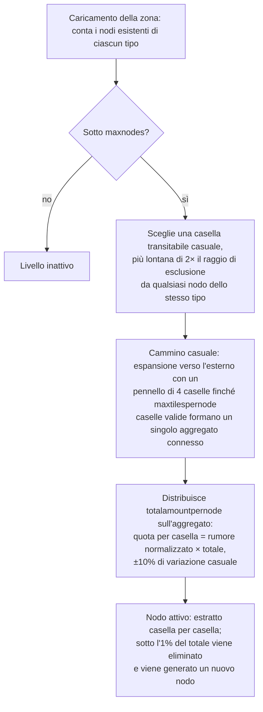

# Generazione delle risorse della zona

Questa pagina spiega come il server mantiene rifornite le risorse di una zona. Entrambi i sistemi operano
continuamente in background mentre la zona è caricata; nessuna azione da parte del giocatore è
richiesta per farli avanzare.

## Configurazione delle risorse della zona

Ogni zona è configurata nel database tramite due elenchi indipendenti:

- **Configurazione dei minerali** (`mineralconfigs`) — una riga per ciascun tipo di minerale presente nella zona,
  con quattro parametri per tipo:
  | Colonna | Significato |
  |---|---|
  | `maxnodes` | Quanti nodi di questo tipo la zona mantiene |
  | `maxtilespernode` | Numero massimo di caselle che un singolo nodo può coprire |
  | `totalamountpernode` | Materiale totale in un nodo appena generato, distribuito sulle sue caselle |
  | `minthreshold` | Rapporto minimo di riempimento per casella (0–1); le caselle al di sotto di questa soglia dopo l'estrazione vengono scartate |
- **Configurazione delle piante** (`zones.fertility` + un set di regole per le piante) — l'obiettivo di
  copertura vegetale della zona (una percentuale) e l'elenco delle specie vegetali autorizzate a crescere in essa
  (il comportamento di ciascuna specie è definito in un file di regole documentato in
  [Piante](/it/content/plants/)).

Le zone prive di una configurazione per i minerali (arene, zone di addestramento, roccaforti, alcune zone
gamma) non hanno alcuno strato minerario.

## Nodi minerari

### Come viene posizionato un nodo

Quando una zona viene caricata, il livello di ciascun tipo di minerale conta i nodi esistenti (salvati nella
tabella `mineralnodes`) e ne genera di nuovi finché non viene raggiunto `maxnodes`. Un nuovo nodo viene
posizionato tramite un **cammino casuale**:

1. Sceglie una casella transitabile casuale.
2. Deve essere lontana dal nodo esistente più vicino dello stesso tipo — il raggio di esclusione
   è ricavato da `maxtilespernode` (`√(maxtilespernode/π) × 2`, quindi il punto iniziale
   deve trovarsi ad almeno il doppio di tale distanza), così che i nodi non si fondano mai in un unico gigantesco deposito.
3. Dalla casella iniziale, un cammino si espande casualmente verso l'esterno (un pennello di 4 caselle alla volta),
   raggruppando fino a `maxtilespernode` caselle valide in un unico aggregato connesso.
4. Il materiale `totalamountpernode` del nodo viene distribuito sull'aggregato: la quota di ciascuna casella
   è il suo valore di rumore (normalizzato) moltiplicato per il totale, con una variazione casuale del ±10%,
   così che non esistano due nodi dello stesso tipo identici tra loro.

Una casella è valida per un nodo solo se si trova all'interno della zona, non è un'isola, non è
protetta dalla terraformazione PBS ed è transitabile. Due tipi rari presentano **zone di esclusione** attorno
alle basi di attracco e ai teletrasporti: l'**epriton** mantiene una distanza minima, mentre il **minerale flux**
mantiene il doppio di tale distanza — pertanto il minerale flux non si trova mai nelle immediate vicinanze di una base.

### Come viene consumato un nodo

- L'estrazione rimuove il materiale casella per casella.
- Un nodo che scende sotto **l'1% del suo totale configurato** viene eliminato, e viene generato
  un nuovo nodo (tornando al passaggio 1) per mantenere la zona a `maxnodes`.
- I nodi di minerale flux guidano inoltre lo **spawning di NPC** — i nodi che vengono estratti (o rimossi)
  pubblicano eventi a cui il sistema NPC è in ascolto, motivo per cui i siti di minerale flux attirano
  l'attenzione.

## Piante

### La scansione delle piante

La zona è suddivisa in **caselle 32×32**. Un gestore delle piante scorre queste caselle in ordine,
elaborandone una per tick, a un ritmo tale che un **passaggio completo sull'intera zona richiede circa 8 ore**
(modificabile per ciascuna zona). Ogni "cubo" 32×32 viene elaborato secondo una sequenza fissa:

1. **Convalida** — elimina le piante non valide (terreno errato, morte, fuori posto).
2. **Crescita** — fa avanzare ciascuna pianta nelle sue fasi di crescita (vedi
   [raccolta](/it/features/gathering/) per `growRate` e fruttificazione).
3. **Generazione** — aggiunge nuove piante dove il cubo si trova al di sotto del suo obiettivo di fertilità.
4. **Danno alle mura** — l'altezza di blocco delle piante si riduce nel tempo.
5. **Eliminazione per distanza** — impone la distanza minima tra piante dello stesso tipo (`killDistance`).
6. **Rigenerazione del materiale** — una piccola quantità di materiale da frutto si rigenera.

### Come viene scelta una nuova pianta

Una casella può germogliare solo se il file della zona le assegna un **potenziale di generazione** (un byte per casella
incorporato nel livello delle piante della zona — 0 significa che la casella non germoglia mai). A ogni tick, per
ciascuna casella idonea:

- **Controllo iniziale della fertilità della zona**: se la copertura di piante bloccanti del cubo raggiunge già
  il `fertility%` delle sue caselle di terra, non si genera nulla di nuovo.
- **Probabilità per casella**: un'estrazione casuale deve superare il potenziale di generazione della casella.
- **Selezione della specie**:
  - Se la casella **non ha piante adiacenti**, la specie viene estratta con un sorteggio ponderato
    in cui il peso di ciascuna specie consentita è la sua `fertility` (le specie piantate dai giocatori sono
    escluse dalla generazione naturale).
  - Se **ne ha**, si effettua un lancio della moneta: 50% di probabilità per la specie adiacente attualmente *dominante*
    (la più diffusa nelle vicinanze), 50% per un'estrazione di **propagazione** ponderata in base a
    `(conteggio vicini × spreading)` per ciascuna specie — questo è ciò che porta i gruppi
    a espandersi con la propria specie.
- **Tetti massimi e distanze**: una specie con un tetto `maxAmount` viene saltata quando la zona ne contiene
  già a sufficienza, e una casella situata entro la `killDistance` da un'altra pianta dello stesso tipo viene
  ignorata.

### Cosa significa per i giocatori

- La densità della vegetazione è vincolata dalla fertilità della zona — non vedrete mai una zona con
  il 100% di copertura vegetale se la sua fertilità è 20.
- Gli aggregati sono la norma: la propagazione fa sì che ciascuna specie espanda le proprie macchie, per cui una
  zona tende a formare territori distinti di specie anziché una miscela uniforme.
- Le specie con `killDistance` (ad es. alcune piante di alto valore) sono distribuite a intervalli regolari, il che
  rende prevedibile la loro posizione una volta individuata la prima.
- I nuovi nodi compaiono ovunque atterri il cammino casuale — non esiste una "zona mineraria fissa" su una
  zona; la scansione è sempre necessaria (vedi [raccolta](/it/features/gathering/)).

<!-- Note per gli sviluppatori: TerrainsModule.cs (costruzione dei livelli per zona: OreLayer per
     Solid, LiquidLayer per Liquid, GravelLayer per TrainingZone; reintegro in LoadMineralNodes);
     MineralLayer.cs (LoadMineralNodes: elimina nodi <1%, genera fino a maxnodes;
     FluxOre -> OreNpcSpawnMessage su diminuzione/scadenza);
     Generators/MineralNodeGeneratorBase.cs (FindStartPosition zone di esclusione + spaziatura,
     NormalizeNoise, CreateMineralNode variazione casuale); RandomWalkMineralNodeGenerator.cs
     (pennello flood-fill 4, limite di 50k passi); MineralNodeRepository.cs (tabella mineralnodes,
     valori compressi per casella); PlantHandler.cs (aree 32x32, scansione completa 8h,
     PlantsGrowthTimerOverrideMin, modalità scanner); NatureCube.cs (pipeline ProcessAll,
     logica di fertilità/generazione/killDistance in SpawnPlants, GetNewPlantRule 50/50 dominante vs
     propagazione); PlantRuleExtensions.cs (estrazioni ponderate su fertilità + propagazione);
     PlantInfo.cs (il byte di generazione per casella proviene dal file del livello vegetale della zona,
     mai assegnato dal codice del server). -->
