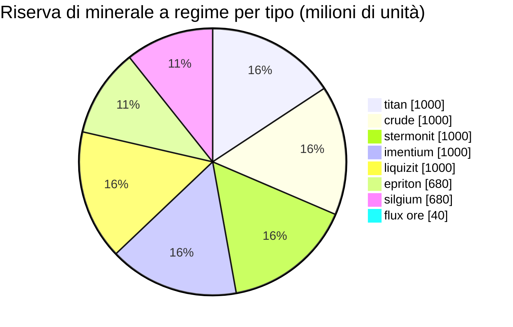

# Daoden (zone_ASI) — esempio pratico

  <a href="/it/zones/map/">
    
    <strong>Mappa del mondo</strong> — dove si trova questa zona rispetto a tutte le altre, con le connessioni dei teletrasporti. Apri la mappa completa.
  </a>

Dove si trovano le colonne di teletrasporto di questa zona (punti, etichettati con la destinazione — oscurati dove
la colonna è attualmente disattivata), i punti di atterraggio dei teletrasporti in arrivo da altre
zone (cerchi tratteggiati) e i portali di uscita (rombi) ove presenti. Le posizioni corrispondono alle
coordinate delle caselle registrate dal server.
Le linee tratteggiate collegano le coppie di colonne di teletrasporto locali (interne alla zona).

Una zona **PvP aperta** di livello alpha — la configurazione mineraria più ricca del gioco e
il luogo in cui si trovano le tipologie rare. Tutto ciò che possiede New Virginia, più epriton, silgium e
i siti di minerale flux che attirano gli attacchi degli NPC.

| Parametro | Valore |
|---|---|
| ID zona | 2 |
| Tipo | PvP (aperta) |
| Protezione | [Beta](/it/zones/protection/) — PvP aperto, terreno standard |
| Dimensione | 2048 × 2048 caselle |
| Fertilità | 20 |
| Set di regole per le piante | 2 — 19 specie (incluse piante raccoglibili di alto livello) |
| Tipi di minerale | 8 (titan, crude, stermonit, imentium, liquizit, epriton, silgium, flux ore) |
| Totale nodi minerari | 64 (8 per tipo) |

## Configurazione dei minerali

| Materiale | Nodi | Max caselle/nodo | Totale per nodo | Soglia minima |
|---|---|---|---|---|
| [titan](/it/content/ores/titan/) | 8 | 500 | 125,000,000 | 0.5 |
| [crude](/it/content/ores/crude/) | 8 | 1257 | 125,000,000 | 0.5 |
| [stermonit](/it/content/ores/stermonit/) | 8 | 500 | 125,000,000 | 0.5 |
| [imentium](/it/content/ores/imentium/) | 8 | 500 | 125,000,000 | 0.5 |
| [liquizit](/it/content/ores/liquizit/) | 8 | 500 | 125,000,000 | 0.5 |
| [epriton](/it/content/ores/epriton/) | 8 | 500 | 85,000,000 | 0.5 |
| [silgium](/it/content/ores/silgium/) | 8 | 500 | 85,000,000 | 0.5 |
| [fluxore](/it/content/ores/fluxore/) | 8 | 300 | 5,000,000 | 0.5 |

Aspetti di rilievo:

- **8× nodi in più rispetto a New Virginia**, ma ogni nodo è più piccolo (500 caselle contro 1.000): il
  raggio di cammino scende da 34 a 24 caselle per i minerali standard. La scansione è più importante
  in questo contesto — i depositi sono più frammentati e più numerosi.
- **Epriton e silgium** presentano totali ridotti (85 M contro 125 M) — valore più alto, scorte
  più rare. L'epriton osserva inoltre una **distanza minima dalle basi e dai teletrasporti**, quindi
  i suoi nodi non si generano mai vicino a un punto di ingresso.
- **Il minerale flux rappresenta il caso limite**: appena 5 M per nodo su 300 caselle (~16.600 per
  casella — un flusso modesto, non un deposito massiccio), 8 nodi e una zona di esclusione pari al
  **doppio** della distanza dell'epriton dalle basi. L'estrazione di un nodo flux invia eventi di generazione al
  sistema NPC — i siti di flux sono contesi per definizione (vedi [Sistemi di intrusione e NPC](/it/features/intrusion/)).
- Riserva a regime: circa 6,4 miliardi di unità di materiale in totale.

## Mix vegetale

Il set di regole 2 consente 19 specie — il mix alpha completo: le specie base, più **devrinol**,
**wall**, **titanplant** e le **piante raccoglibili di alto livello** (electroplant superiore,
albero di ferro superiore, rustbush superiore, slimeroot superiore). La fertilità è sempre 20, quindi la densità è la
stessa di New Virginia — ciò che cambia è *quali* specie possono aggiudicarsi l'estrazione di fertilità. I
pesi di `fertility` specifici delle specie di alto livello stabiliscono con quale frequenza esse superino
le erbe comuni.

Le regole per ciascuna specie sono disponibili in [Piante](/it/content/plants/); le rese per minerale in
[Minerali](/it/content/ores/).

## Cosa significa per il giocatore

- L'intera gamma di minerali è disponibile, inclusa l'economia del minerale flux — tuttavia è PvP
  aperto, quindi tutto ciò che viene estratto può essere sottratto da altri giocatori (vedi
  [trasporto](/it/features/transport/) per movimentare merci in sicurezza tra le basi).
- Aspettatevi pressione da parte degli NPC vicino ai nodi di minerale flux; il generatore monitora gli eventi di estrazione
  su tali nodi.
- La raccolta delle piante qui è mirata alle varianti di alto livello, che offrono frutti migliori rispetto
  alle specie di basso livello presenti nelle zone iniziali.

<!-- Note per gli sviluppatori: riga della tabella zones con id 2 (zonetype 2 = PvP, protected 0, fertility 20,
     plantruleset 2); 8 righe in mineralconfigs (7 standard + fluxore 8/300/5M);
     MineralNodeGeneratorBase.KeepOutDist: Epriton = MINERAL_DISTANCE_FROM_BASE_MIN,
     FluxOre = 2x; MineralLayer.OnNodeDecrease/OnNodeExpired -> OreNpcSpawnMessage per
     FluxOre; plantrules rulesetid 2 = 19 file (4 raccoglibili, incl. devrinol e
     wall). -->
