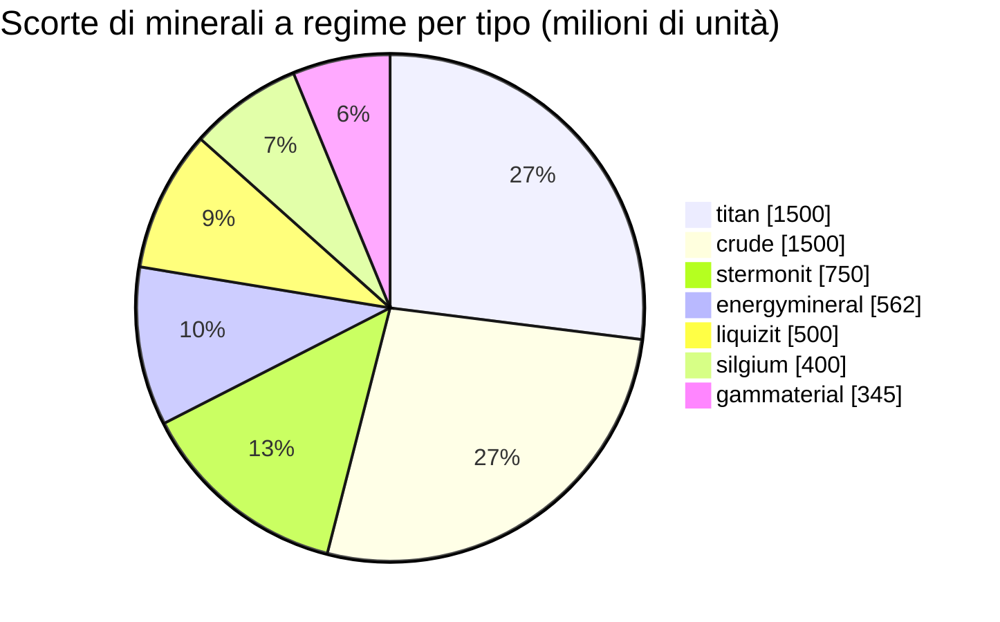

<!-- Generated by tools/generate from the live database (source: zones, mineralconfigs, plantrules, teleportdescriptions, strongholdexitconfig).
     Do not edit by hand; regenerate instead. -->
# Xiantor (zone_asi_g_4)

  <a href="/it/zones/map/">
    
    <strong>Mappa del mondo</strong> — dove si trova questa zona tra tutte le altre, con i collegamenti di teletrasporto. Apri la mappa completa.
  </a>

Posizioni delle colonne di teletrasporto di questa zona (punti con etichetta di destinazione — oscurati se la colonna è disattivata), punti di arrivo dei teletrasporti da altre zone (cerchi tratteggiati) e varchi di uscita (rombi) ove presenti. Le posizioni sono le coordinate delle tessere registrate dal server.

Un'isola PvP aperta e terraformabile (gamma) di Daoden (ASI) — il terreno può essere rimodellato dai giocatori. Mantiene 7 tipi di minerale.

| Dato | Valore |
|---|---|
| ID zona | 39 |
| Tipo | PvP |
| Protezione | [Gamma](/it/zones/protection/) — PvP aperto, terraformabile |
| Dimensioni | 2048×2048 caselle |
| Fertilità | 20 |
| Specie vegetali | 17 (set di regole 4) |
| Tipi di minerale | 7 |
| Nodi di minerale totali | 55 |
| Basi di attracco max. | 100 |

## Configurazione minerale

La generazione dei nodi mantenuta da questa zona. Le rese per minerale e le formule di generazione si trovano in [Minerali](/it/content/ores/) (la sezione di questa zona è collegata sotto).

| Materiale | Nodi | Caselle max./nodo | Totale per nodo | Soglia min. |
|---|---|---|---|---|
| [titan](/it/content/ores/titan/) | 10 | 707 | 150M | 0.5 |
| [crude](/it/content/ores/crude/) | 6 | 1.257k | 250M | 0.5 |
| [stermonit](/it/content/ores/stermonit/) | 8 | 314 | 93.75M | 0.5 |
| [liquizit](/it/content/ores/liquizit/) | 5 | 1.257k | 100M | 0.5 |
| [silgium](/it/content/ores/silgium/) | 8 | 314 | 50M | 0.5 |
| [gammaterial](/it/content/ores/gammaterial/) | 3 | 707 | 115M | 0.5 |
| [energymineral](/it/content/ores/energymineral/) | 15 | 350 | 37.5M | 0.5 |

[Indice delle zone](/it/zones/zone-index/) · [Mappa del mondo](/it/zones/map/#beta) · [Livelli di protezione](/it/zones/protection/)
