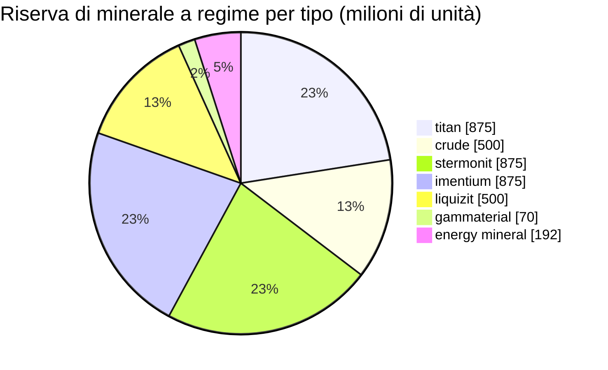

# zone_gamma_z106 — esempio pratico

  <a href="/it/zones/map/">
    
    <strong>Mappa del mondo</strong> — dove si trova questa zona rispetto a tutte le altre, con le connessioni dei teletrasporti. Apri la mappa completa.
  </a>

Dove si trovano le colonne di teletrasporto di questa zona (punti, etichettati con la destinazione — oscurati dove
la colonna è attualmente disattivata), i punti di atterraggio dei teletrasporti in arrivo da altre
zone (cerchi tratteggiati) e i portali di uscita (rombi) ove presenti. Le posizioni corrispondono alle
coordinate delle caselle registrate dal server.

Una zona **PvP aperta** di alto livello: terraformabile, a bassa fertilità, con varianti di piante di livello 2 e
un'economia mineraria più ristretta. Questa è la conformazione tipica da "fine gioco" per una zona — meno risorse,
maggiormente contese.

| Parametro | Valore |
|---|---|
| ID zona | 106 |
| Tipo | PvP (aperta) |
| Protezione | [Gamma](/it/zones/protection/) — PvP aperto, terraformabile |
| Dimensione | 2048 × 2048 caselle |
| Fertilità | 15 |
| Terraformabile | sì (limite tecnologico PBS 2) |
| Set di regole per le piante | 22 — 17 specie ("Regole per piante gamma", mix livello 2) |
| Tipi di minerale | 7 (titan, crude, stermonit, imentium, liquizit, gammaterial, minerale energetico) |
| Totale nodi minerari | 44 |

## Configurazione dei minerali

| Materiale | Nodi | Max caselle/nodo | Totale per nodo | Soglia minima |
|---|---|---|---|---|
| [titan](/it/content/ores/titan/) | 7 | 600 | 125,000,000 | 0.5 |
| [crude](/it/content/ores/crude/) | 4 | 600 | 125,000,000 | 0.5 |
| [stermonit](/it/content/ores/stermonit/) | 7 | 600 | 125,000,000 | 0.5 |
| [imentium](/it/content/ores/imentium/) | 7 | 600 | 125,000,000 | 0.5 |
| [liquizit](/it/content/ores/liquizit/) | 4 | 600 | 125,000,000 | 0.5 |
| [gammaterial](/it/content/ores/gammaterial/) | 7 | 100 | 10,000,000 | 0.5 |
| [energymineral](/it/content/ores/energymineral/) | 8 | 300 | 24,000,000 | 0.5 |

Aspetti di rilievo:

- **Meno nodi rispetto alle zone alpha** (44 contro 64 a Daoden): crude e liquizit scendono a
  soli 4 nodi ciascuno. Gli importi per nodo sono identici a quelli dei minerali standard di livello alpha,
  dunque la riserva a regime (~3,9 miliardi di unità in totale) è più ridotta e lenta nel ricostituirsi.
- **Due tipi esotici**: **gammaterial** in piccoli nodi da 100 caselle (raggio di cammino di 10 caselle —
  piccoli, semplici da individuare, ~1,4 M per nodo) ed **energy mineral** a 24 M per nodo.
- Nessun epriton, nessun minerale flux — i minerali rari ed economici rimangono esclusivi del livello alpha.

## Mix vegetale

Il set di regole 22 consente 17 specie: quelle di base, oltre alle **varianti di livello 2** — albero di ferro
superiore t2 e rustbush superiore t2 come specie selvatiche raccoglibili, e le **piante seminate di livello 2**
(electroplant superiore t2, slimeroot superiore t2). Le piante seminate hanno la proprietà `playerSeeded` — esse
**non** compaiono mai spontaneamente; esistono unicamente nelle coltivazioni dei giocatori (vedi
[raccolta → piante](/it/features/gathering/)).

La fertilità è pari a **15**, non a 20: un cubo 32×32 può contenere al massimo ~15% di piante bloccanti, pertanto
la copertura vegetale è visibilmente più rada rispetto alle zone alpha, e l'estrazione di fertilità ha
meno margine di riempimento prima che il cubo si saturi.

Le regole per specie (compresi i quantitativi di frutti t2) sono indicate in
[Piante](/it/content/plants/); le rese per minerale in [Minerali](/it/content/ores/).

## Cosa significa per il giocatore

- Economia più snella e lenta: meno nodi di minerali comuni comporta che la pressione di estrazione sia
  avvertita più rapidamente — un nodo esaurito di crude richiede più tempo per essere rimpiazzato dalla zona.
- Vegetazione più rada: con il 15% di fertilità, il suolo aperto è la norma e le macchie di vegetazione
  costituiscono l'eccezione.
- La raccolta ad alto rendimento riguarda qui le piante selvatiche di livello 2 albero di ferro / rustbush,
  oltre alla gestione di coltivazioni private con le specie seminate t2 electroplant e slimeroot.
- La terraformazione (limite tecnologico PBS 2) consente ai giocatori di rimodellare il terreno stesso
  (vedi [Power base station (PBS)](/it/features/pbs/)).

<!-- Note per gli sviluppatori: riga della tabella zones con id 106 (zonetype 2 = PvP, protected 0, fertility 15,
     terraformable 1, pbsTechLimit 2, plantruleset 22); mineralconfigs 7 righe (crude
     e liquizit 4 nodi ciascuno); plantrules rulesetid 22 = 17 file, nota "Gamma
     Plant Rules"; electroplant_seeded_t2.txt / slimeroot_seeded_t2.txt impostano
     playerSeeded=n1 (ereditato tramite source= da electroplant_hi.txt /
     slimeroot_hi.txt) -> escluse dalle comparse naturali in
     PlantRuleExtensions.GetWinnerPlantTypeBasedOnFertility. -->
