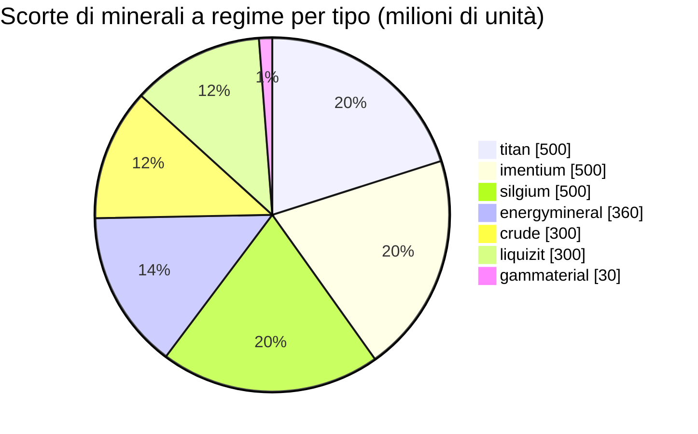

<!-- Generated by tools/generate from the live database (source: zones, mineralconfigs, plantrules, teleportdescriptions, strongholdexitconfig).
     Do not edit by hand; regenerate instead. -->
# zone_gamma_z122

  <a href="/it/zones/map/">
    
    <strong>Mappa del mondo</strong> — dove si trova questa zona tra tutte le altre, con i collegamenti di teletrasporto. Apri la mappa completa.
  </a>

Posizioni delle colonne di teletrasporto di questa zona (punti con etichetta di destinazione — oscurati se la colonna è disattivata), punti di arrivo dei teletrasporti da altre zone (cerchi tratteggiati) e varchi di uscita (rombi) ove presenti. Le posizioni sono le coordinate delle tessere registrate dal server.

Un'isola PvP aperta e terraformabile (gamma) di frontier belt — il terreno può essere rimodellato dai giocatori. Mantiene 7 tipi di minerale.

| Dato | Valore |
|---|---|
| ID zona | 122 |
| Tipo | PvP |
| Protezione | [Gamma](/it/zones/protection/) — PvP aperto, terraformabile |
| Dimensioni | 2048×2048 caselle |
| Livello (Tier) | T3 (registrato dal server) |
| Fertilità | 15 |
| Specie vegetali | 16 (set di regole 13) |
| Tipi di minerale | 7 |
| Nodi di minerale totali | 34 |
| Limite tecnologico PBS | 3 |
| Basi di attracco max. | 2 |

## Configurazione minerale

La generazione dei nodi mantenuta da questa zona. Le rese per minerale e le formule di generazione si trovano in [Minerali](/it/content/ores/) (la sezione di questa zona è collegata sotto).

| Materiale | Nodi | Caselle max./nodo | Totale per nodo | Soglia min. |
|---|---|---|---|---|
| [titan](/it/content/ores/titan/) | 5 | 600 | 100M | 0.5 |
| [crude](/it/content/ores/crude/) | 3 | 600 | 100M | 0.5 |
| [imentium](/it/content/ores/imentium/) | 5 | 600 | 100M | 0.5 |
| [liquizit](/it/content/ores/liquizit/) | 3 | 600 | 100M | 0.5 |
| [silgium](/it/content/ores/silgium/) | 5 | 600 | 100M | 0.5 |
| [gammaterial](/it/content/ores/gammaterial/) | 3 | 100 | 10M | 0.5 |
| [energymineral](/it/content/ores/energymineral/) | 10 | 300 | 36M | 0.5 |

[Indice delle zone](/it/zones/zone-index/) · [Mappa del mondo](/it/zones/map/#t3) · [Livelli di protezione](/it/zones/protection/)
