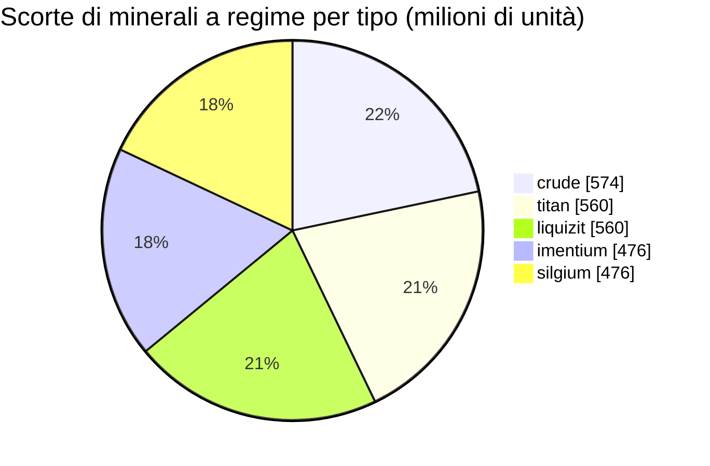

<!-- Generated by tools/generate from the live database (source: zones, mineralconfigs, plantrules, teleportdescriptions, strongholdexitconfig).
     Do not edit by hand; regenerate instead. -->
# Attalica (zone_ICS)

  <a href="/it/zones/map/">
    
    <strong>Mappa del mondo</strong> — dove si trova questa zona tra tutte le altre, con i collegamenti di teletrasporto. Apri la mappa completa.
  </a>

Posizioni delle colonne di teletrasporto di questa zona (punti con etichetta di destinazione — oscurati se la colonna è disattivata), punti di arrivo dei teletrasporti da altre zone (cerchi tratteggiati) e varchi di uscita (rombi) ove presenti. Le posizioni sono le coordinate delle tessere registrate dal server. Le linee tratteggiate collegano le coppie di colonne di teletrasporto locali (interne alla zona).

Una zona protetta (Alpha) di Attalica (ICS) — al sicuro dagli attacchi dei giocatori, la normale area di raccolta per la galassia Attalica (ICS). Mantiene 5 tipi di minerale.

| Dato | Valore |
|---|---|
| ID zona | 1 |
| Tipo | PvE |
| Protezione | [Alpha](/it/zones/protection/) — protetta, PvP disabilitato |
| Dimensioni | 2048×2048 caselle |
| Fertilità | 20 |
| Specie vegetali | 15 (set di regole 1) |
| Tipi di minerale | 5 |
| Nodi di minerale totali | 35 |
| Basi di attracco max. | nessuna |

## Configurazione minerale

La generazione dei nodi mantenuta da questa zona. Le rese per minerale e le formule di generazione si trovano in [Minerali](/it/content/ores/) (la sezione di questa zona è collegata sotto).

| Materiale | Nodi | Caselle max./nodo | Totale per nodo | Soglia min. |
|---|---|---|---|---|
| [titan](/it/content/ores/titan/) | 7 | 625 | 80M | 0.5 |
| [crude](/it/content/ores/crude/) | 7 | 1k | 82.125M | 0.5 |
| [imentium](/it/content/ores/imentium/) | 7 | 625 | 68M | 0.5 |
| [liquizit](/it/content/ores/liquizit/) | 7 | 625 | 80M | 0.5 |
| [silgium](/it/content/ores/silgium/) | 7 | 625 | 68M | 0.5 |

[Indice delle zone](/it/zones/zone-index/) · [Mappa del mondo](/it/zones/map/#alpha) · [Livelli di protezione](/it/zones/protection/)
