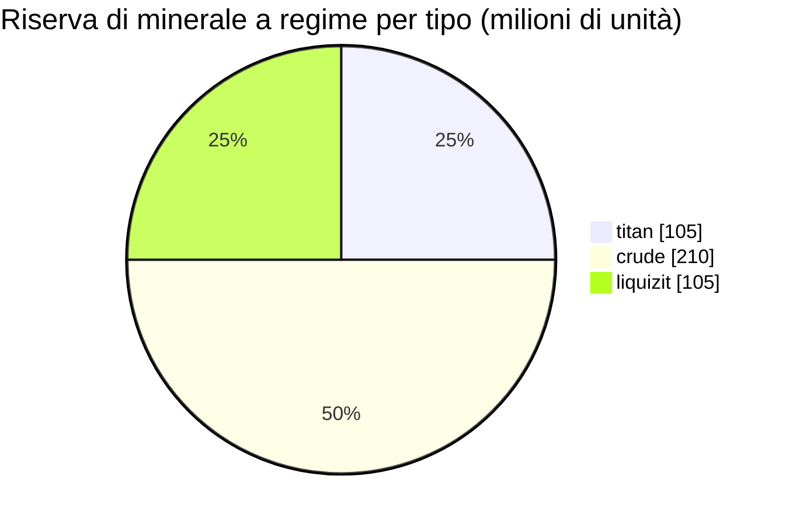

# New Virginia (zone_TM) — esempio pratico

  <a href="/it/zones/map/">
    
    <strong>Mappa del mondo</strong> — dove si trova questa zona rispetto a tutte le altre, con le connessioni dei teletrasporti. Apri la mappa completa.
  </a>

Dove si trovano le colonne di teletrasporto di questa zona (punti, etichettati con la destinazione — oscurati dove
la colonna è attualmente disattivata), i punti di atterraggio dei teletrasporti in arrivo da altre
zone (cerchi tratteggiati) e i portali di uscita (rombi) ove presenti. Le posizioni corrispondono alle
coordinate delle caselle registrate dal server.
Le linee tratteggiate collegano le coppie di colonne di teletrasporto locali (interne alla zona).

Una zona **PvE protetta** di livello iniziale — un luogo sicuro in cui i nuovi personaggi effettuano la raccolta. La sua
configurazione mostra l'estremo più semplice dello spettro: pochi tipi di minerale, nodi grandi e
il mix vegetale di base.

| Parametro | Valore |
|---|---|
| ID zona | 0 |
| Tipo | PvE (protetta) |
| Protezione | [Alpha](/it/zones/protection/) — protetta, PvP disabilitato |
| Dimensione | 2048 × 2048 caselle |
| Fertilità | 20 |
| Set di regole per le piante | 0 — 15 specie (mix base "tm pve") |
| Tipi di minerale | 3 (titan, crude, liquizit) |
| Totale nodi minerari | 21 (7 per tipo) |

## Configurazione dei minerali

| Materiale | Nodi | Max caselle/nodo | Totale per nodo | Soglia minima |
|---|---|---|---|---|
| [titan](/it/content/ores/titan/) | 7 | 1000 | 15,000,000 | 0.5 |
| [crude](/it/content/ores/crude/) | 7 | 1257 | 30,000,000 | 0.5 |
| [liquizit](/it/content/ores/liquizit/) | 7 | 1000 | 15,000,000 | 0.5 |

Aspetti di rilievo:

- **Nodi grandi e radi** — 1.000–1.257 caselle ciascuno (raggio di cammino
  `(int)√(tiles/π)×2` = 34–40 caselle), quindi ogni nodo costituisce un grande aggregato, e vi sono solo 7
  nodi per tipo per zona. La riserva a regime ammonta a circa 420 milioni di unità di materiale in totale
  (105 M titan + 210 M crude + 105 M liquizit).
- **Nessun tipo raro** — nessun epriton, nessun minerale flux, quindi non vi sono zone di esclusione attorno
  alle basi né siti minerari che provocano lo spawn di NPC.
- Una `minthreshold` di 0.5 indica che una casella è utilizzabile solo se il riempimento di rumore del nodo in quel punto è pari ad
  almeno la metà del valore massimo — i bordi di ogni aggregato sono sottili.

Le rese per tipo (ciò che un'unità di ciascun minerale produce mediante raffinazione e le formule di
generazione dei nodi alla base dei numeri soprastanti) sono consultabili in [Minerali](/it/content/ores/).

## Mix vegetale

Il set di regole 0 consente 15 specie — il set introduttivo di base: erba (a/b), pino, cespugli (a/b),
rango, albero di rame, canna, nanograno, rustbush/slimeroot/electroplant di basso livello, bonsai
e albero di ferro di basso livello. Nessun muro, nessun devrinol, nessuna pianta raccoglibile di alto livello.

Con una fertilità di 20, un cubo 32×32 può contenere al massimo ~20% di piante bloccanti; sull'intera
mappa 2048×2048 questo rappresenta un limite superiore di circa 838.000 caselle di vegetazione (inferiore nella pratica,
dato che acqua e isole non costituiscono terreno). La selezione delle specie è ponderata in base alla `fertility` di ciascuna regola,
per cui le erbe e i cespugli di base predominano mentre le specie raccoglibili di basso livello
rimangono rare.

Le regole complete per ciascuna specie (growRate, frutti, salute) sono disponibili in [Piante](/it/content/plants/).

## Cosa significa per il giocatore

- Economia iniziale sicura: tre minerali comuni in aggregati ampi e facili da scansionare.
- Le piante raccoglibili qui sono le varianti di basso livello — le piante di alto valore (varianti
  superiori di electroplant/albero di ferro/rustbush/slimeroot) compaiono nelle zone avanzate.
- Poiché la zona è protetta, il rischio PvP è l'unico elemento assente dal ciclo
  di raccolta (vedi [movimento](/it/features/movement/) per l'accesso alle zone).

<!-- Note per gli sviluppatori: riga della tabella zones con id 0 (zonetype 1 = PvE, protected 1, fertility 20,
     plantruleset 0); 3 righe in mineralconfigs (titan/crude/liquizit, 7 nodi ciascuno);
     plantrules rulesetid 0 = 15 file, nota "tm pve". Formula del raggio dei nodi e
     semantica delle soglie: vedi generation.md. -->
