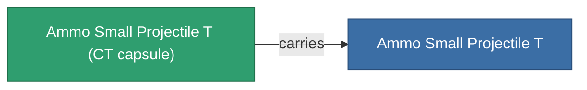

<!-- Generated by tools/generate from the live database (source: entitydefaults definition 5924, aggregatevalues via aggregatefields).
     Do not edit by hand; regenerate instead. -->

# Ammo Small Projectile T

|  |  |
|---|---|
| 定義 | `def_ammo_small_projectile_t` |
| ティア | – |
| 耐久 | 100 |
| 容量 | 0.5 |
| 質量 | 0.1 |
| カテゴリ | Ammo / Projectiles |
| 備考 | toxic ammo small |

## 統計

| フィールド | 値 |
|---|---|
| damage_chemical | 6 |
| damage_explosive | 1 |
| damage_kinetic | 1 |
| damage_thermal | 1 |
| damage_toxic | 20 |

## 輸送カプセル

A transport capsule (CT) exists for this item — it is how the item moves between players and zones.

<!-- production:generated -->
## 製造

**コンポーネント5個から製造** — コンポーネントを組立てて製造します（全リストは[レシピ](/ja/content/recipes/)を参照）:

**設計図:** [Ammo Small Projectile T Cprg](/ja/content/items/ammo-small-projectile-t-cprg/)

<svg class="prod-card-icon" aria-hidden="true"><use href="#mi-grid"/></svg><a class="prod-card-name" href="/ja/content/items/axicoline/">Axicoline</a>

必要: <b>100</b>

<svg class="prod-card-icon" aria-hidden="true"><use href="#mi-grid"/></svg><a class="prod-card-name" href="/ja/content/items/phlobotil/">Phlobotil</a>

必要: <b>100</b>

<svg class="prod-card-icon" aria-hidden="true"><use href="#mi-grid"/></svg><a class="prod-card-name" href="/ja/content/items/polynitrocol/">Polynitrocol</a>

必要: <b>100</b>

<svg class="prod-card-icon" aria-hidden="true"><use href="#mi-grid"/></svg><a class="prod-card-name" href="/ja/content/items/polynucleit/">Polynucleit</a>

必要: <b>100</b>

<svg class="prod-card-icon" aria-hidden="true"><use href="#mi-grid"/></svg><a class="prod-card-name" href="/ja/content/items/titanium/">Titanium</a>

必要: <b>100</b>

