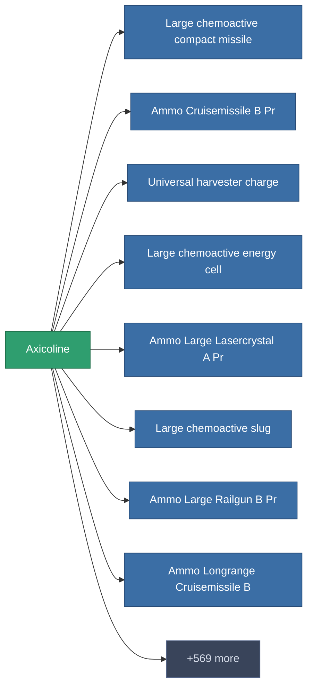

<!-- Generated by tools/generate from the live database (source: entitydefaults definition 4606, aggregatevalues via aggregatefields).
     Do not edit by hand; regenerate instead. -->

# Axicoline

|  |  |
|---|---|
| 定義 | `def_axicoline` |
| ティア | – |
| 耐久 | 100 |
| 容量 | 0 |
| 質量 | 0.15 |
| カテゴリ | Materials |

_統計なし — このアイテムには集約値がありません。_

<!-- production:generated -->
## 製造

**コンポーネント2個から製造** — コンポーネントを組立てて製造します（全リストは[レシピ](/ja/content/recipes/)を参照）:

<svg class="prod-card-icon" aria-hidden="true"><use href="#mi-grid"/></svg><a class="prod-card-name" href="/ja/content/items/liquizit/">Liquizit</a>

必要: <b>50</b>

<svg class="prod-card-icon" aria-hidden="true"><use href="#mi-grid"/></svg><a class="prod-card-name" href="/ja/content/ores/titan/">Titan</a>

必要: <b>25</b>

## 製造に使用

**577個のアイテムのコンポーネント** — これを使って製造できるものの例（全リストは[レシピ](/ja/content/recipes/)を参照）。

