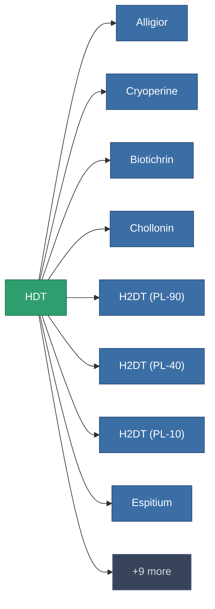

<!-- Generated by tools/generate from the live database (source: entitydefaults definition 170, aggregatevalues via aggregatefields).
     Do not edit by hand; regenerate instead. -->

# HDT

|  |  |
|---|---|
| 定義 | `def_crude` |
| ティア | – |
| 耐久 | 100 |
| 容量 | 0 |
| 質量 | 0.02 |
| カテゴリ | Materials |

_統計なし — このアイテムには集約値がありません。_

<!-- production:generated -->
## 製造に使用

**17個のアイテムのコンポーネント** — これを使って製造できるものの例（全リストは[レシピ](/ja/content/recipes/)を参照）。

