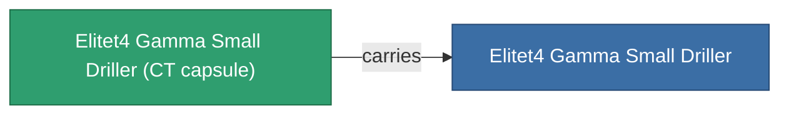

<!-- Generated by tools/generate from the live database (source: entitydefaults definition 6215, aggregatevalues via aggregatefields).
     Do not edit by hand; regenerate instead. -->

# Elitet4 Gamma Small Driller

|  |  |
|---|---|
| 定義 | `def_elitet4_gamma_small_driller` |
| ティア | T4 (special) |
| 耐久 | 100 |
| 容量 | 1 |
| 質量 | 300 |
| カテゴリ | Modules / Enhancements |
| 備考 | elite module |

## 統計

| フィールド | 値 |
|---|---|
| core_usage | 20 |
| cpu_usage | 43 |
| cycle_time | 11.75k |
| optimal_range | 3.5 |
| powergrid_usage | 31 |

## 輸送カプセル

A transport capsule (CT) exists for this item — it is how the item moves between players and zones.

## 購入場所

Fixed-price vendors that sell this item (see the [Item shop](/ja/content/shop/) for the full catalog).

| Vendor | Qty | Credits | UniCoin |
|---|---|---|---|
| Daoden outpost | ∞ | 500M | 25k |

<!-- production:generated -->
## 製造

**コンポーネント4個から製造** — コンポーネントを組立てて製造します（全リストは[レシピ](/ja/content/recipes/)を参照）:

**設計図:** [Elitet4 Gamma Small Driller Cprg](/content/items/elitet4-gamma-small-driller-cprg/)

<svg class="prod-card-icon" aria-hidden="true"><use href="#mi-grid"/></svg><a class="prod-card-name" href="/ja/content/items/material-boss-gamma-nuimqol/">Material Boss Gamma Nuimqol</a>

必要: <b>67</b>

<svg class="prod-card-icon" aria-hidden="true"><use href="#mi-grid"/></svg><a class="prod-card-name" href="/ja/content/items/material-boss-gamma-pelistal/">Material Boss Gamma Pelistal</a>

必要: <b>67</b>

<svg class="prod-card-icon" aria-hidden="true"><use href="#mi-grid"/></svg><a class="prod-card-name" href="/ja/content/items/material-boss-gamma-thelodica/">Material Boss Gamma Thelodica</a>

必要: <b>67</b>

<svg class="prod-card-icon" aria-hidden="true"><use href="#mi-panel"/></svg><a class="prod-card-name" href="/ja/content/items/named3-small-driller/">Scraper-990 small miner module</a>

必要: <b>1</b>

