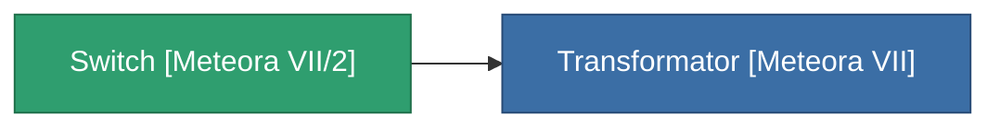

<!-- Generated by tools/generate from the live database (source: entitydefaults definition 4154, aggregatevalues via aggregatefields).
     Do not edit by hand; regenerate instead. -->

# Switch [Meteora VII/2]

|  |  |
|---|---|
| 定義 | `def_missionitem_ics_ii_level02_exp3_07_t04` |
| ティア | – |
| 耐久 | 100 |
| 容量 | 0.01 |
| 質量 | 50 |
| カテゴリ | Mission items |

_統計なし — このアイテムには集約値がありません。_

<!-- production:generated -->
## 製造に使用

**1個のアイテムのコンポーネント** — これを使用して生産するすべて:

