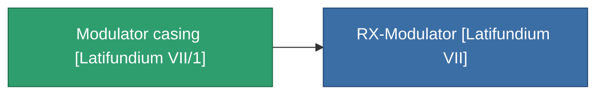

<!-- Generated by tools/generate from the live database (source: entitydefaults definition 3822, aggregatevalues via aggregatefields).
     Do not edit by hand; regenerate instead. -->

# Modulator casing [Latifundium VII/1]

|  |  |
|---|---|
| 定義 | `def_missionitem_tm_ii_level01_exp3_07_t01` |
| ティア | – |
| 耐久 | 100 |
| 容量 | 0.01 |
| 質量 | 50 |
| カテゴリ | Mission items |

_統計なし — このアイテムには集約値がありません。_

<!-- production:generated -->
## 製造に使用

**1個のアイテムのコンポーネント** — これを使用して生産するすべて:

