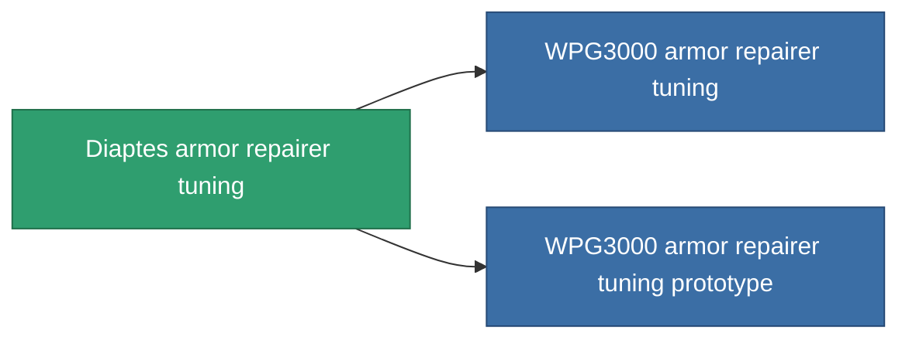

<!-- Generated by tools/generate from the live database (source: entitydefaults definition 1063, aggregatevalues via aggregatefields).
     Do not edit by hand; regenerate instead. -->

# Diaptes armor repairer tuning

|  |  |
|---|---|
| 定義 | `def_named1_armor_repairer_upgrade` |
| ティア | T2 |
| 耐久 | 100 |
| 容量 | 0.5 |
| 質量 | 270 |
| カテゴリ | Modules / Repair |
| Tier line | [Standard armor repairer tuning](/ja/content/items/standard-armor-repairer-upgrade/) (T1) → **Diaptes armor repairer tuning** (T2) → [WPG3000 armor repairer tuning](/ja/content/items/named2-armor-repairer-upgrade/) (T3) → [Apogenion armor repairer tuning](/ja/content/items/named3-armor-repairer-upgrade/) (T4) |

## 統計

| フィールド | 値 |
|---|---|
| armor_repair_amount_modifier | 1.08 |
| armor_repair_cycle_time_modifier | 0.96 |
| cpu_usage | 32 |
| powergrid_usage | 22 |

<!-- production:generated -->
## 製造

**コンポーネント8個から製造 、研究レベル 4** — コンポーネントを組立てて製造します（全リストは[レシピ](/ja/content/recipes/)を参照）:

**設計図:** [Diaptes armor repairer tuning CT](/ja/content/items/named1-armor-repairer-upgrade-cprg/)

<svg class="prod-card-icon" aria-hidden="true"><use href="#mi-grid"/></svg><a class="prod-card-name" href="/ja/content/items/axicol/">Cryoperine</a>

必要: <b>50</b>

<svg class="prod-card-icon" aria-hidden="true"><use href="#mi-grid"/></svg><a class="prod-card-name" href="/ja/content/items/chollonin/">Chollonin</a>

必要: <b>50</b>

<svg class="prod-card-icon" aria-hidden="true"><use href="#mi-grid"/></svg><a class="prod-card-name" href="/ja/content/items/plasteosine/">Plasteosine</a>

必要: <b>150</b>

<svg class="prod-card-icon" aria-hidden="true"><use href="#mi-crystal"/></svg><a class="prod-card-name" href="/ja/content/items/robotshard-common-basic/">Damaged common fragment</a>

必要: <b>15</b>

<svg class="prod-card-icon" aria-hidden="true"><use href="#mi-crystal"/></svg><a class="prod-card-name" href="/ja/content/items/robotshard-nuimqol-basic/">Damaged nuimqol fragment</a>

必要: <b>15</b>

<svg class="prod-card-icon" aria-hidden="true"><use href="#mi-tree"/></svg><a class="prod-card-name" href="/ja/content/items/standard-armor-repairer-upgrade/">Standard armor repairer tuning</a>

必要: <b>1</b>

<svg class="prod-card-icon" aria-hidden="true"><use href="#mi-grid"/></svg><a class="prod-card-name" href="/ja/content/items/statichnol/">Statichnol</a>

必要: <b>150</b>

<svg class="prod-card-icon" aria-hidden="true"><use href="#mi-grid"/></svg><a class="prod-card-name" href="/ja/content/items/titanium/">Titanium</a>

必要: <b>100</b>

## 製造に使用

**2個のアイテムのコンポーネント** — これを使用して生産するすべて:

