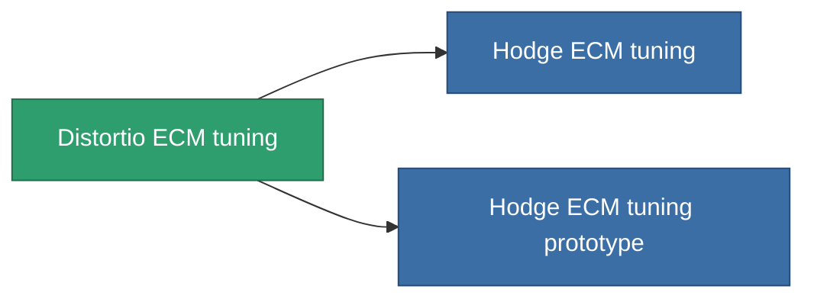

<!-- Generated by tools/generate from the live database (source: entitydefaults definition 4587, aggregatevalues via aggregatefields).
     Do not edit by hand; regenerate instead. -->

# Distortio ECM tuning

|  |  |
|---|---|
| 定義 | `def_named1_ecm_booster` |
| ティア | T2 |
| 耐久 | 100 |
| 容量 | 0.5 |
| 質量 | 135 |
| カテゴリ | Modules / Enhancements |
| Tier line | [Standard ECM tuning](/ja/content/items/standard-ecm-booster/) (T1) → **Distortio ECM tuning** (T2) → [Hodge ECM tuning](/ja/content/items/named2-ecm-booster/) (T3) → [Sludge ECM tuning](/ja/content/items/named3-ecm-booster/) (T4) |

## 統計

| フィールド | 値 |
|---|---|
| core_usage_sensor_jammer_modifier | 1.1 |
| cpu_usage | 57 |
| ecm_strength_modifier | 1.25 |
| powergrid_usage | 22 |

<!-- production:generated -->
## 製造

**コンポーネント6個から製造 、研究レベル 6** — コンポーネントを組立てて製造します（全リストは[レシピ](/ja/content/recipes/)を参照）:

**設計図:** [Distortio ECM tuning CT](/ja/content/items/named1-ecm-booster-cprg/)

<svg class="prod-card-icon" aria-hidden="true"><use href="#mi-grid"/></svg><a class="prod-card-name" href="/ja/content/items/axicol/">Cryoperine</a>

必要: <b>150</b>

<svg class="prod-card-icon" aria-hidden="true"><use href="#mi-grid"/></svg><a class="prod-card-name" href="/ja/content/items/chollonin/">Chollonin</a>

必要: <b>150</b>

<svg class="prod-card-icon" aria-hidden="true"><use href="#mi-crystal"/></svg><a class="prod-card-name" href="/ja/content/items/robotshard-common-basic/">Damaged common fragment</a>

必要: <b>15</b>

<svg class="prod-card-icon" aria-hidden="true"><use href="#mi-crystal"/></svg><a class="prod-card-name" href="/ja/content/items/robotshard-nuimqol-basic/">Damaged nuimqol fragment</a>

必要: <b>15</b>

<svg class="prod-card-icon" aria-hidden="true"><use href="#mi-panel"/></svg><a class="prod-card-name" href="/ja/content/items/standard-ecm-booster/">Standard ECM tuning</a>

必要: <b>1</b>

<svg class="prod-card-icon" aria-hidden="true"><use href="#mi-grid"/></svg><a class="prod-card-name" href="/ja/content/items/titanium/">Titanium</a>

必要: <b>50</b>

## 製造に使用

**2個のアイテムのコンポーネント** — これを使用して生産するすべて:

