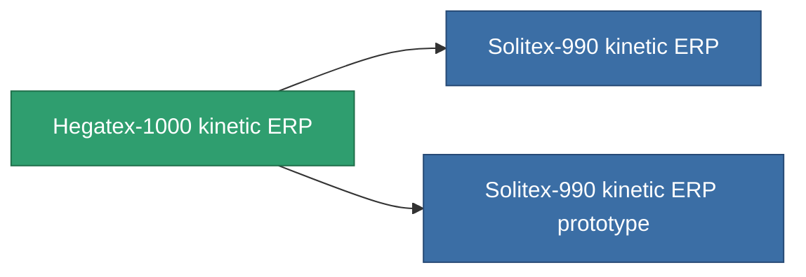

<!-- Generated by tools/generate from the live database (source: entitydefaults definition 3294, aggregatevalues via aggregatefields).
     Do not edit by hand; regenerate instead. -->

# Hegatex-1000 kinetic ERP

|  |  |
|---|---|
| 定義 | `def_named1_kinetic_kers` |
| ティア | T2 |
| 耐久 | 100 |
| 容量 | 1 |
| 質量 | 450 |
| カテゴリ | Modules / Enhancements |
| Tier line | [Standard kinetic ERP](/ja/content/items/standard-kinetic-kers/) (T1) → **Hegatex-1000 kinetic ERP** (T2) → [Solitex-990 kinetic ERP](/ja/content/items/named2-kinetic-kers/) (T3) → [Emerolyte kinetic ERP](/ja/content/items/named3-kinetic-kers/) (T4) |

## 統計

| フィールド | 値 |
|---|---|
| chemical_damage_to_core_modifier | 0.2 |
| cpu_usage | 45 |
| explosive_damage_to_core_modifier | 0.1 |
| kinetic_damage_to_core_modifier | 0.5 |
| powergrid_usage | 10 |
| thermal_damage_to_core_modifier | 0.1 |

<!-- production:generated -->
## 製造

**コンポーネント6個から製造 、研究レベル 6** — コンポーネントを組立てて製造します（全リストは[レシピ](/ja/content/recipes/)を参照）:

**設計図:** [Hegatex-1000 kinetic ERP CT](/ja/content/items/named1-kinetic-kers-cprg/)

<svg class="prod-card-icon" aria-hidden="true"><use href="#mi-grid"/></svg><a class="prod-card-name" href="/ja/content/items/axicol/">Cryoperine</a>

必要: <b>200</b>

<svg class="prod-card-icon" aria-hidden="true"><use href="#mi-grid"/></svg><a class="prod-card-name" href="/ja/content/items/metachropin/">Metachropin</a>

必要: <b>100</b>

<svg class="prod-card-icon" aria-hidden="true"><use href="#mi-grid"/></svg><a class="prod-card-name" href="/ja/content/items/plasteosine/">Plasteosine</a>

必要: <b>100</b>

<svg class="prod-card-icon" aria-hidden="true"><use href="#mi-grid"/></svg><a class="prod-card-name" href="/ja/content/items/prilumium/">Prilumium</a>

必要: <b>200</b>

<svg class="prod-card-icon" aria-hidden="true"><use href="#mi-grid"/></svg><a class="prod-card-name" href="/ja/content/items/standard-kinetic-kers/">Standard kinetic ERP</a>

必要: <b>1</b>

<svg class="prod-card-icon" aria-hidden="true"><use href="#mi-grid"/></svg><a class="prod-card-name" href="/ja/content/items/titanium/">Titanium</a>

必要: <b>200</b>

## 製造に使用

**2個のアイテムのコンポーネント** — これを使用して生産するすべて:

