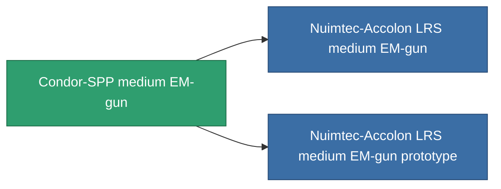

<!-- Generated by tools/generate from the live database (source: entitydefaults definition 1018, aggregatevalues via aggregatefields).
     Do not edit by hand; regenerate instead. -->

# Condor-SPP medium EM-gun

|  |  |
|---|---|
| 定義 | `def_named1_longrange_medium_railgun` |
| ティア | T2 |
| 耐久 | 100 |
| 容量 | 1 |
| 質量 | 585 |
| カテゴリ | Modules / Weapons |
| Tier line | **Condor-SPP medium EM-gun** (T2) → [Nuimtec-Accolon LRS medium EM-gun](/ja/content/items/named2-longrange-medium-railgun/) (T3) → [5.5-Glipler medium EM-gun](/ja/content/items/named3-longrange-medium-railgun/) (T4) |

## 統計

| フィールド | 値 |
|---|---|
| accuracy | 14 |
| core_usage | 20 |
| cpu_usage | 36 |
| cycle_time | 10k |
| damage_modifier | 2 |
| falloff | 7.5 |
| least_optimal | 21 |
| optimal_range | 29 |
| powergrid_usage | 170 |

<!-- production:generated -->
## 製造

**コンポーネント8個から製造 、研究レベル 5** — コンポーネントを組立てて製造します（全リストは[レシピ](/ja/content/recipes/)を参照）:

**設計図:** [Condor-SPP medium EM-gun CT](/content/items/named1-longrange-medium-railgun-cprg/)

<svg class="prod-card-icon" aria-hidden="true"><use href="#mi-grid"/></svg><a class="prod-card-name" href="/ja/content/items/axicol/">Cryoperine</a>

必要: <b>50</b>

<svg class="prod-card-icon" aria-hidden="true"><use href="#mi-grid"/></svg><a class="prod-card-name" href="/ja/content/items/axicoline/">Axicoline</a>

必要: <b>100</b>

<svg class="prod-card-icon" aria-hidden="true"><use href="#mi-grid"/></svg><a class="prod-card-name" href="/ja/content/items/chollonin/">Chollonin</a>

必要: <b>50</b>

<svg class="prod-card-icon" aria-hidden="true"><use href="#mi-grid"/></svg><a class="prod-card-name" href="/ja/content/items/longrange-standard-medium-railgun/">Standard medium EM-gun</a>

必要: <b>1</b>

<svg class="prod-card-icon" aria-hidden="true"><use href="#mi-grid"/></svg><a class="prod-card-name" href="/ja/content/items/polynitrocol/">Polynitrocol</a>

必要: <b>100</b>

<svg class="prod-card-icon" aria-hidden="true"><use href="#mi-crystal"/></svg><a class="prod-card-name" href="/ja/content/items/robotshard-common-basic/">Damaged common fragment</a>

必要: <b>30</b>

<svg class="prod-card-icon" aria-hidden="true"><use href="#mi-crystal"/></svg><a class="prod-card-name" href="/ja/content/items/robotshard-nuimqol-basic/">Damaged nuimqol fragment</a>

必要: <b>30</b>

<svg class="prod-card-icon" aria-hidden="true"><use href="#mi-grid"/></svg><a class="prod-card-name" href="/ja/content/items/titanium/">Titanium</a>

必要: <b>100</b>

## 製造に使用

**2個のアイテムのコンポーネント** — これを使用して生産するすべて:

