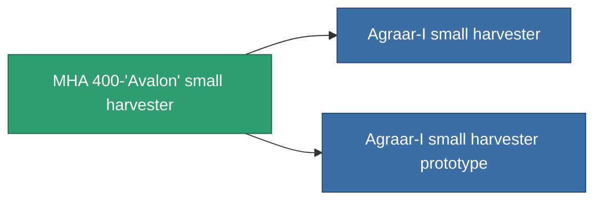

<!-- Generated by tools/generate from the live database (source: entitydefaults definition 807, aggregatevalues via aggregatefields).
     Do not edit by hand; regenerate instead. -->

# MHA 400-'Avalon' small harvester

|  |  |
|---|---|
| 定義 | `def_named1_small_harvester` |
| ティア | T2 |
| 耐久 | 100 |
| 容量 | 1 |
| 質量 | 360 |
| カテゴリ | Modules / Harvesting |
| Tier line | [Standard small harvester](/ja/content/items/standard-small-harvester/) (T1) → **MHA 400-'Avalon' small harvester** (T2) → [Agraar-I small harvester](/ja/content/items/named2-small-harvester/) (T3) → [Protrim FDV-30 small harvester](/ja/content/items/named3-small-harvester/) (T4) |

## 統計

| フィールド | 値 |
|---|---|
| core_usage | 15 |
| cpu_usage | 38 |
| cycle_time | 15.5k |
| optimal_range | 3 |
| powergrid_usage | 28 |

<!-- production:generated -->
## 製造

**コンポーネント4個から製造 、研究レベル 2** — コンポーネントを組立てて製造します（全リストは[レシピ](/ja/content/recipes/)を参照）:

**設計図:** [MHA 400-'Avalon' small harvester CT](/ja/content/items/named1-small-harvester-cprg/)

<svg class="prod-card-icon" aria-hidden="true"><use href="#mi-grid"/></svg><a class="prod-card-name" href="/ja/content/items/axicol/">Cryoperine</a>

必要: <b>50</b>

<svg class="prod-card-icon" aria-hidden="true"><use href="#mi-crystal"/></svg><a class="prod-card-name" href="/ja/content/items/robotshard-common-basic/">Damaged common fragment</a>

必要: <b>30</b>

<svg class="prod-card-icon" aria-hidden="true"><use href="#mi-grid"/></svg><a class="prod-card-name" href="/ja/content/items/standard-small-harvester/">Standard small harvester</a>

必要: <b>1</b>

<svg class="prod-card-icon" aria-hidden="true"><use href="#mi-grid"/></svg><a class="prod-card-name" href="/ja/content/items/titanium/">Titanium</a>

必要: <b>150</b>

## 製造に使用

**2個のアイテムのコンポーネント** — これを使用して生産するすべて:

