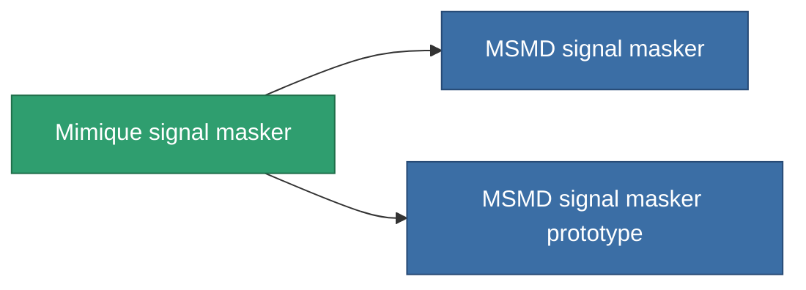

<!-- Generated by tools/generate from the live database (source: entitydefaults definition 2902, aggregatevalues via aggregatefields).
     Do not edit by hand; regenerate instead. -->

# Mimique signal masker

|  |  |
|---|---|
| 定義 | `def_named1_stealth_modul` |
| ティア | T2 |
| 耐久 | 100 |
| 容量 | 0.5 |
| 質量 | 225 |
| カテゴリ | Modules / Enhancements |
| Tier line | [Standard signal masker](/ja/content/items/standard-stealth-modul/) (T1) → **Mimique signal masker** (T2) → [MSMD signal masker](/ja/content/items/named2-stealth-modul/) (T3) → [Longlag signal masker](/ja/content/items/named3-stealth-modul/) (T4) |

## 統計

| フィールド | 値 |
|---|---|
| core_usage | 1.6 |
| cpu_usage | 90 |
| cycle_time | 10k |
| effect_stealth_strength_modifier | 35 |
| powergrid_usage | 5 |

<!-- production:generated -->
## 製造

**コンポーネント5個から製造 、研究レベル 7** — コンポーネントを組立てて製造します（全リストは[レシピ](/ja/content/recipes/)を参照）:

**設計図:** [Mimique signal masker CT](/ja/content/items/named1-stealth-modul-cprg/)

<svg class="prod-card-icon" aria-hidden="true"><use href="#mi-grid"/></svg><a class="prod-card-name" href="/ja/content/items/axicol/">Cryoperine</a>

必要: <b>450</b>

<svg class="prod-card-icon" aria-hidden="true"><use href="#mi-grid"/></svg><a class="prod-card-name" href="/ja/content/items/plasteosine/">Plasteosine</a>

必要: <b>50</b>

<svg class="prod-card-icon" aria-hidden="true"><use href="#mi-crystal"/></svg><a class="prod-card-name" href="/ja/content/items/robotshard-common-basic/">Damaged common fragment</a>

必要: <b>60</b>

<svg class="prod-card-icon" aria-hidden="true"><use href="#mi-grid"/></svg><a class="prod-card-name" href="/ja/content/items/standard-stealth-modul/">Standard signal masker</a>

必要: <b>1</b>

<svg class="prod-card-icon" aria-hidden="true"><use href="#mi-grid"/></svg><a class="prod-card-name" href="/ja/content/items/titanium/">Titanium</a>

必要: <b>200</b>

## 製造に使用

**2個のアイテムのコンポーネント** — これを使用して生産するすべて:

