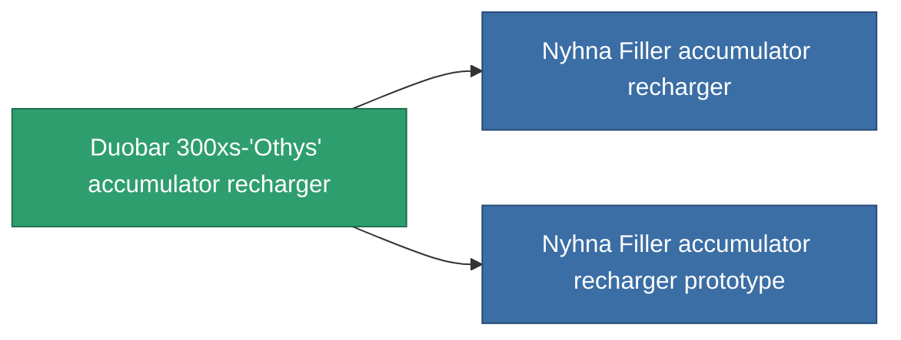

<!-- Generated by tools/generate from the live database (source: entitydefaults definition 763, aggregatevalues via aggregatefields).
     Do not edit by hand; regenerate instead. -->

# Duobar 300xs-'Othys' accumulator recharger

|  |  |
|---|---|
| 定義 | `def_named2_core_recharger` |
| ティア | T3 |
| 耐久 | 100 |
| 容量 | 0.5 |
| 質量 | 100 |
| カテゴリ | Modules / Power |
| Tier line | [Standard accumulator recharger](/ja/content/items/standard-core-recharger/) (T1) → [Basis Ionostator accumulator recharger](/ja/content/items/named1-core-recharger/) (T2) → **Duobar 300xs-'Othys' accumulator recharger** (T3) → [Nyhna Filler accumulator recharger](/ja/content/items/named3-core-recharger/) (T4) |

## 統計

| フィールド | 値 |
|---|---|
| core_recharge_time_modifier | 0.875 |
| cpu_usage | 27 |
| powergrid_usage | 2 |

<!-- production:generated -->
## 製造

**コンポーネント6個から製造 、研究レベル 5** — コンポーネントを組立てて製造します（全リストは[レシピ](/ja/content/recipes/)を参照）:

**設計図:** [Duobar 300xs-'Othys' accumulator recharger CT](/content/items/named2-core-recharger-cprg/)

<svg class="prod-card-icon" aria-hidden="true"><use href="#mi-grid"/></svg><a class="prod-card-name" href="/ja/content/items/axicol/">Cryoperine</a>

必要: <b>125</b>

<svg class="prod-card-icon" aria-hidden="true"><use href="#mi-grid"/></svg><a class="prod-card-name" href="/ja/content/items/espitium/">Espitium</a>

必要: <b>125</b>

<svg class="prod-card-icon" aria-hidden="true"><use href="#mi-grid"/></svg><a class="prod-card-name" href="/ja/content/items/named1-core-recharger/">Basis Ionostator accumulator recharger</a>

必要: <b>1</b>

<svg class="prod-card-icon" aria-hidden="true"><use href="#mi-crystal"/></svg><a class="prod-card-name" href="/ja/content/items/robotshard-common-advanced/">Functional common fragment</a>

必要: <b>20</b>

<svg class="prod-card-icon" aria-hidden="true"><use href="#mi-crystal"/></svg><a class="prod-card-name" href="/ja/content/items/robotshard-common-basic/">Damaged common fragment</a>

必要: <b>20</b>

<svg class="prod-card-icon" aria-hidden="true"><use href="#mi-grid"/></svg><a class="prod-card-name" href="/ja/content/items/titanium/">Titanium</a>

必要: <b>150</b>

## 製造に使用

**2個のアイテムのコンポーネント** — これを使用して生産するすべて:

