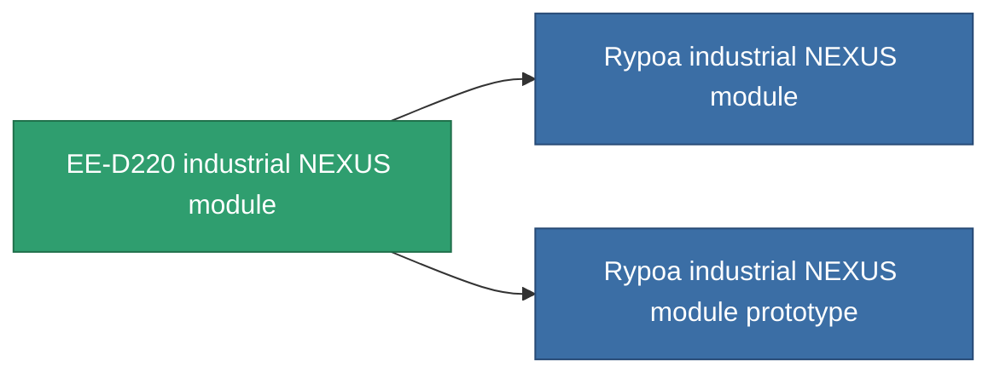

<!-- Generated by tools/generate from the live database (source: entitydefaults definition 2575, aggregatevalues via aggregatefields).
     Do not edit by hand; regenerate instead. -->

# EE-D220 industrial NEXUS module

|  |  |
|---|---|
| 定義 | `def_named2_gang_assist_industry_module` |
| ティア | T3 |
| 耐久 | 100 |
| 容量 | 0.2 |
| 質量 | 10 |
| カテゴリ | Modules / Enhancements |
| Tier line | [Standard industrial NEXUS module](/ja/content/items/standard-gang-assist-industry-module/) (T1) → [Thobys industrial NEXUS module](/ja/content/items/named1-gang-assist-industry-module/) (T2) → **EE-D220 industrial NEXUS module** (T3) → [Rypoa industrial NEXUS module](/ja/content/items/named3-gang-assist-industry-module/) (T4) |
| 備考 | core_usage gathering  1.5% / ext lvl   |

## 統計

| フィールド | 値 |
|---|---|
| core_usage | 36 |
| cpu_usage | 88 |
| cycle_time | 10k |
| default_effect_range | 100 |
| effect_core_usage_gathering_modifier | 0.95 |
| powergrid_usage | 36 |

<!-- production:generated -->
## 製造

**コンポーネント8個から製造 、研究レベル 6** — コンポーネントを組立てて製造します（全リストは[レシピ](/ja/content/recipes/)を参照）:

**設計図:** [EE-D220 industrial NEXUS module CT](/ja/content/items/named2-gang-assist-industry-module-cprg/)

<svg class="prod-card-icon" aria-hidden="true"><use href="#mi-grid"/></svg><a class="prod-card-name" href="/ja/content/items/alligior/">Alligior</a>

必要: <b>50</b>

<svg class="prod-card-icon" aria-hidden="true"><use href="#mi-grid"/></svg><a class="prod-card-name" href="/ja/content/items/axicol/">Cryoperine</a>

必要: <b>250</b>

<svg class="prod-card-icon" aria-hidden="true"><use href="#mi-grid"/></svg><a class="prod-card-name" href="/ja/content/items/espitium/">Espitium</a>

必要: <b>250</b>

<svg class="prod-card-icon" aria-hidden="true"><use href="#mi-panel"/></svg><a class="prod-card-name" href="/ja/content/items/named1-gang-assist-industry-module/">Thobys industrial NEXUS module</a>

必要: <b>1</b>

<svg class="prod-card-icon" aria-hidden="true"><use href="#mi-grid"/></svg><a class="prod-card-name" href="/ja/content/items/plasteosine/">Plasteosine</a>

必要: <b>50</b>

<svg class="prod-card-icon" aria-hidden="true"><use href="#mi-crystal"/></svg><a class="prod-card-name" href="/ja/content/items/robotshard-common-advanced/">Functional common fragment</a>

必要: <b>20</b>

<svg class="prod-card-icon" aria-hidden="true"><use href="#mi-crystal"/></svg><a class="prod-card-name" href="/ja/content/items/robotshard-common-basic/">Damaged common fragment</a>

必要: <b>20</b>

<svg class="prod-card-icon" aria-hidden="true"><use href="#mi-grid"/></svg><a class="prod-card-name" href="/ja/content/items/titanium/">Titanium</a>

必要: <b>50</b>

## 製造に使用

**2個のアイテムのコンポーネント** — これを使用して生産するすべて:

