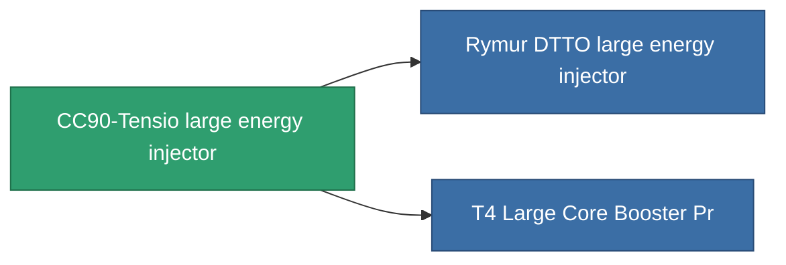

<!-- Generated by tools/generate from the live database (source: entitydefaults definition 829, aggregatevalues via aggregatefields).
     Do not edit by hand; regenerate instead. -->

# CC90-Tensio large energy injector

|  |  |
|---|---|
| 定義 | `def_named2_large_core_booster` |
| ティア | T3 |
| 耐久 | 100 |
| 容量 | 2 |
| 質量 | 1600 |
| カテゴリ | Modules / Enhancements |
| Tier line | [Standard large energy injector](/ja/content/items/standard-large-core-booster/) (T1) → [Shoxit Parter II. large energy injector](/ja/content/items/named1-large-core-booster/) (T2) → **CC90-Tensio large energy injector** (T3) → [Rymur DTTO large energy injector](/ja/content/items/named3-large-core-booster/) (T4) |

## 統計

| フィールド | 値 |
|---|---|
| core_usage | 0 |
| cpu_usage | 375 |
| cycle_time | 5.5k |
| powergrid_usage | 1.375k |

<!-- production:generated -->
## 製造

**コンポーネント7個から製造** — コンポーネントを組立てて製造します（全リストは[レシピ](/ja/content/recipes/)を参照）:

**設計図:** [T3 Large Core Booster Cprg](/content/items/named2-large-core-booster-cprg/)

<svg class="prod-card-icon" aria-hidden="true"><use href="#mi-grid"/></svg><a class="prod-card-name" href="/ja/content/items/axicol/">Cryoperine</a>

必要: <b>150</b>

<svg class="prod-card-icon" aria-hidden="true"><use href="#mi-grid"/></svg><a class="prod-card-name" href="/ja/content/items/espitium/">Espitium</a>

必要: <b>150</b>

<svg class="prod-card-icon" aria-hidden="true"><use href="#mi-grid"/></svg><a class="prod-card-name" href="/ja/content/items/named1-large-core-booster/">Shoxit Parter II. large energy injector</a>

必要: <b>1</b>

<svg class="prod-card-icon" aria-hidden="true"><use href="#mi-crystal"/></svg><a class="prod-card-name" href="/ja/content/items/robotshard-common-advanced/">Functional common fragment</a>

必要: <b>60</b>

<svg class="prod-card-icon" aria-hidden="true"><use href="#mi-crystal"/></svg><a class="prod-card-name" href="/ja/content/items/robotshard-common-basic/">Damaged common fragment</a>

必要: <b>60</b>

<svg class="prod-card-icon" aria-hidden="true"><use href="#mi-grid"/></svg><a class="prod-card-name" href="/ja/content/items/specimen-sap-item-flux/">Specimen Sap Item Flux</a>

必要: <b>15</b>

<svg class="prod-card-icon" aria-hidden="true"><use href="#mi-grid"/></svg><a class="prod-card-name" href="/ja/content/items/titanium/">Titanium</a>

必要: <b>300</b>

## 製造に使用

**2個のアイテムのコンポーネント** — これを使用して生産するすべて:

