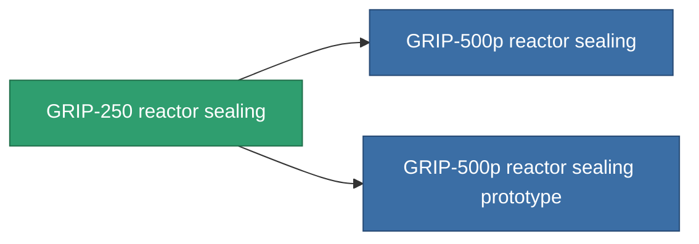

<!-- Generated by tools/generate from the live database (source: entitydefaults definition 4581, aggregatevalues via aggregatefields).
     Do not edit by hand; regenerate instead. -->

# GRIP-250 reactor sealing

|  |  |
|---|---|
| 定義 | `def_named2_reactor_sealing` |
| ティア | T3 |
| 耐久 | 100 |
| 容量 | 1 |
| 質量 | 150 |
| カテゴリ | Modules / Enhancements |
| Tier line | [Standard reactor sealing](/ja/content/items/standard-reactor-sealing/) (T1) → [Tortoise reactor sealing](/ja/content/items/named1-reactor-sealing/) (T2) → **GRIP-250 reactor sealing** (T3) → [GRIP-500p reactor sealing](/ja/content/items/named3-reactor-sealing/) (T4) |

## 統計

| フィールド | 値 |
|---|---|
| cpu_usage | 15 |
| powergrid_usage | 75 |
| reactor_radiation_modifier | 0.7 |

<!-- production:generated -->
## 製造

**コンポーネント8個から製造 、研究レベル 5** — コンポーネントを組立てて製造します（全リストは[レシピ](/ja/content/recipes/)を参照）:

**設計図:** [GRIP-250 reactor sealing CT](/content/items/named2-reactor-sealing-cprg/)

<svg class="prod-card-icon" aria-hidden="true"><use href="#mi-grid"/></svg><a class="prod-card-name" href="/ja/content/items/alligior/">Alligior</a>

必要: <b>125</b>

<svg class="prod-card-icon" aria-hidden="true"><use href="#mi-grid"/></svg><a class="prod-card-name" href="/ja/content/items/axicol/">Cryoperine</a>

必要: <b>75</b>

<svg class="prod-card-icon" aria-hidden="true"><use href="#mi-grid"/></svg><a class="prod-card-name" href="/ja/content/items/espitium/">Espitium</a>

必要: <b>75</b>

<svg class="prod-card-icon" aria-hidden="true"><use href="#mi-grid"/></svg><a class="prod-card-name" href="/ja/content/items/named1-reactor-sealing/">Tortoise reactor sealing</a>

必要: <b>1</b>

<svg class="prod-card-icon" aria-hidden="true"><use href="#mi-grid"/></svg><a class="prod-card-name" href="/ja/content/items/plasteosine/">Plasteosine</a>

必要: <b>125</b>

<svg class="prod-card-icon" aria-hidden="true"><use href="#mi-crystal"/></svg><a class="prod-card-name" href="/ja/content/items/robotshard-common-advanced/">Functional common fragment</a>

必要: <b>20</b>

<svg class="prod-card-icon" aria-hidden="true"><use href="#mi-crystal"/></svg><a class="prod-card-name" href="/ja/content/items/robotshard-common-basic/">Damaged common fragment</a>

必要: <b>20</b>

<svg class="prod-card-icon" aria-hidden="true"><use href="#mi-grid"/></svg><a class="prod-card-name" href="/ja/content/items/titanium/">Titanium</a>

必要: <b>100</b>

## 製造に使用

**2個のアイテムのコンポーネント** — これを使用して生産するすべて:

