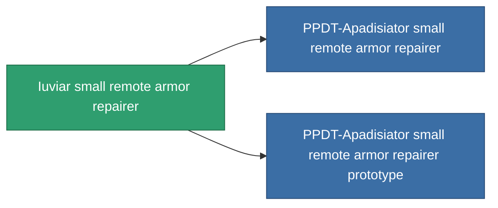

<!-- Generated by tools/generate from the live database (source: entitydefaults definition 703, aggregatevalues via aggregatefields).
     Do not edit by hand; regenerate instead. -->

# Iuviar small remote armor repairer

|  |  |
|---|---|
| 定義 | `def_named2_small_remote_armor_repairer` |
| ティア | T3 |
| 耐久 | 100 |
| 容量 | 1 |
| 質量 | 250 |
| カテゴリ | Modules / Repair |
| Tier line | [Standard small remote armor repairer](/ja/content/items/standard-small-remote-armor-repairer/) (T1) → [Avaror GD-200 small remote armor repairer](/ja/content/items/named1-small-remote-armor-repairer/) (T2) → **Iuviar small remote armor repairer** (T3) → [PPDT-Apadisiator small remote armor repairer](/ja/content/items/named3-small-remote-armor-repairer/) (T4) |
| 備考 | armor_hp += repair_amount * armor_repair_amount_modifier  rof = cycle_time * armor_repair_cycle_time_modifier    pont ugy mint az armor repair systemnel. -> sajat magamat is jobban gyogyitom, es remote armor systemmel is jobb vagyok.    range = optimal_range * armor_repair_optimal_range_modifier   |

## 統計

| フィールド | 値 |
|---|---|
| armor_repair_amount | 70 |
| core_usage | 72 |
| cpu_usage | 50 |
| cycle_time | 17k |
| falloff | 0 |
| optimal_range | 12 |
| powergrid_usage | 28 |

<!-- production:generated -->
## 製造

**コンポーネント8個から製造 、研究レベル 4** — コンポーネントを組立てて製造します（全リストは[レシピ](/ja/content/recipes/)を参照）:

**設計図:** [Iuviar small remote armor repairer CT](/content/items/named2-small-remote-armor-repairer-cprg/)

<svg class="prod-card-icon" aria-hidden="true"><use href="#mi-grid"/></svg><a class="prod-card-name" href="/ja/content/items/alligior/">Alligior</a>

必要: <b>125</b>

<svg class="prod-card-icon" aria-hidden="true"><use href="#mi-grid"/></svg><a class="prod-card-name" href="/ja/content/items/axicol/">Cryoperine</a>

必要: <b>25</b>

<svg class="prod-card-icon" aria-hidden="true"><use href="#mi-grid"/></svg><a class="prod-card-name" href="/ja/content/items/espitium/">Espitium</a>

必要: <b>25</b>

<svg class="prod-card-icon" aria-hidden="true"><use href="#mi-tree"/></svg><a class="prod-card-name" href="/ja/content/items/named1-small-remote-armor-repairer/">Avaror GD-200 small remote armor repairer</a>

必要: <b>1</b>

<svg class="prod-card-icon" aria-hidden="true"><use href="#mi-grid"/></svg><a class="prod-card-name" href="/ja/content/items/plasteosine/">Plasteosine</a>

必要: <b>125</b>

<svg class="prod-card-icon" aria-hidden="true"><use href="#mi-crystal"/></svg><a class="prod-card-name" href="/ja/content/items/robotshard-common-advanced/">Functional common fragment</a>

必要: <b>20</b>

<svg class="prod-card-icon" aria-hidden="true"><use href="#mi-crystal"/></svg><a class="prod-card-name" href="/ja/content/items/robotshard-common-basic/">Damaged common fragment</a>

必要: <b>20</b>

<svg class="prod-card-icon" aria-hidden="true"><use href="#mi-grid"/></svg><a class="prod-card-name" href="/ja/content/items/titanium/">Titanium</a>

必要: <b>100</b>

## 製造に使用

**2個のアイテムのコンポーネント** — これを使用して生産するすべて:

