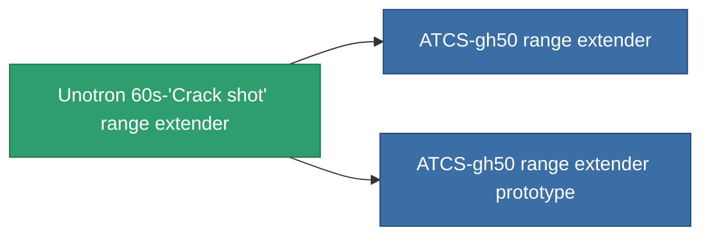

<!-- Generated by tools/generate from the live database (source: entitydefaults definition 937, aggregatevalues via aggregatefields).
     Do not edit by hand; regenerate instead. -->

# Unotron 60s-'Crack shot' range extender

|  |  |
|---|---|
| 定義 | `def_named2_tracking_upgrade` |
| ティア | T3 |
| 耐久 | 100 |
| 容量 | 0.1 |
| 質量 | 50 |
| カテゴリ | Modules / Enhancements |
| Tier line | [Standard range extender](/ja/content/items/standard-tracking-upgrade/) (T1) → [Opaletrak range extender](/ja/content/items/named1-tracking-upgrade/) (T2) → **Unotron 60s-'Crack shot' range extender** (T3) → [ATCS-gh50 range extender](/ja/content/items/named3-tracking-upgrade/) (T4) |

## 統計

| フィールド | 値 |
|---|---|
| cpu_usage | 38 |
| optimal_range_modifier | 1.125 |
| powergrid_usage | 110 |

<!-- production:generated -->
## 製造

**コンポーネント8個から製造 、研究レベル 5** — コンポーネントを組立てて製造します（全リストは[レシピ](/ja/content/recipes/)を参照）:

**設計図:** [Unotron 60s-'Crack shot' range extender CT](/ja/content/items/named2-tracking-upgrade-cprg/)

<svg class="prod-card-icon" aria-hidden="true"><use href="#mi-grid"/></svg><a class="prod-card-name" href="/ja/content/items/axicol/">Cryoperine</a>

必要: <b>150</b>

<svg class="prod-card-icon" aria-hidden="true"><use href="#mi-grid"/></svg><a class="prod-card-name" href="/ja/content/items/axicoline/">Axicoline</a>

必要: <b>75</b>

<svg class="prod-card-icon" aria-hidden="true"><use href="#mi-grid"/></svg><a class="prod-card-name" href="/ja/content/items/espitium/">Espitium</a>

必要: <b>150</b>

<svg class="prod-card-icon" aria-hidden="true"><use href="#mi-grid"/></svg><a class="prod-card-name" href="/ja/content/items/hydrobenol/">Hydrobenol</a>

必要: <b>75</b>

<svg class="prod-card-icon" aria-hidden="true"><use href="#mi-grid"/></svg><a class="prod-card-name" href="/ja/content/items/named1-tracking-upgrade/">Opaletrak range extender</a>

必要: <b>1</b>

<svg class="prod-card-icon" aria-hidden="true"><use href="#mi-crystal"/></svg><a class="prod-card-name" href="/ja/content/items/robotshard-common-advanced/">Functional common fragment</a>

必要: <b>20</b>

<svg class="prod-card-icon" aria-hidden="true"><use href="#mi-crystal"/></svg><a class="prod-card-name" href="/ja/content/items/robotshard-common-basic/">Damaged common fragment</a>

必要: <b>20</b>

<svg class="prod-card-icon" aria-hidden="true"><use href="#mi-grid"/></svg><a class="prod-card-name" href="/ja/content/items/titanium/">Titanium</a>

必要: <b>100</b>

## 製造に使用

**2個のアイテムのコンポーネント** — これを使用して生産するすべて:

