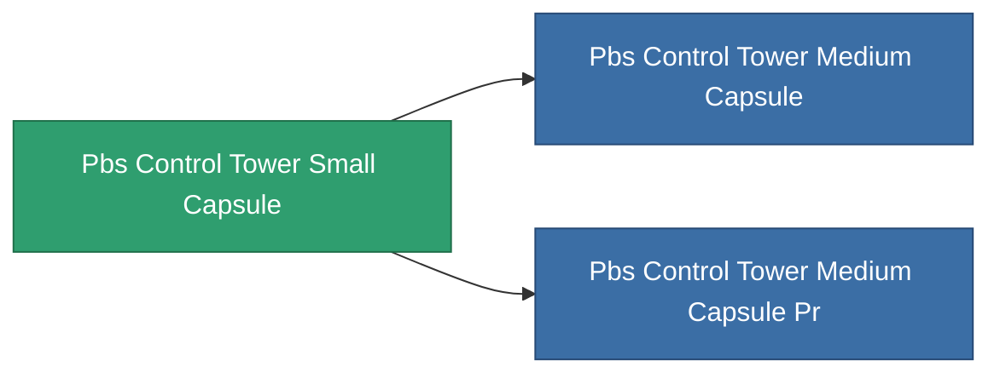

<!-- Generated by tools/generate from the live database (source: entitydefaults definition 4700, aggregatevalues via aggregatefields).
     Do not edit by hand; regenerate instead. -->

# Pbs Control Tower Small Capsule

|  |  |
|---|---|
| 定義 | `def_pbs_control_tower_small_capsule` |
| ティア | T1 |
| 耐久 | 100 |
| 容量 | 10 |
| 質量 | 10000 |
| カテゴリ | Special & other / Miscellaneous |

## 統計

| フィールド | 値 |
|---|---|
| armor_max | 50k |
| resist_chemical | 30 |
| resist_explosive | 30 |
| resist_kinetic | 30 |
| resist_thermal | 30 |
| signature_radius | 20 |
| stealth_strength | 50 |

<!-- production:generated -->
## 製造

**コンポーネント4個から製造** — コンポーネントを組立てて製造します（全リストは[レシピ](/ja/content/recipes/)を参照）:

**設計図:** [Standard command relay foundation CT](/ja/content/items/pbs-control-tower-small-capsule-cprg/)

<svg class="prod-card-icon" aria-hidden="true"><use href="#mi-grid"/></svg><a class="prod-card-name" href="/ja/content/items/axicol/">Cryoperine</a>

必要: <b>500</b>

<svg class="prod-card-icon" aria-hidden="true"><use href="#mi-grid"/></svg><a class="prod-card-name" href="/ja/content/items/espitium/">Espitium</a>

必要: <b>500</b>

<svg class="prod-card-icon" aria-hidden="true"><use href="#mi-grid"/></svg><a class="prod-card-name" href="/ja/content/items/titanium/">Titanium</a>

必要: <b>500</b>

<svg class="prod-card-icon" aria-hidden="true"><use href="#mi-grid"/></svg><a class="prod-card-name" href="/ja/content/items/unimetal/">Briochit</a>

必要: <b>500</b>

## 製造に使用

**2個のアイテムのコンポーネント** — これを使用して生産するすべて:

